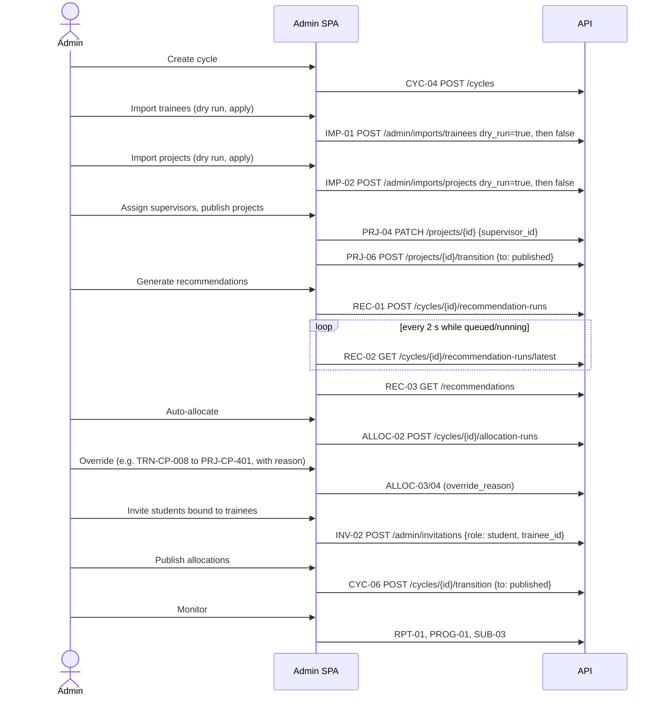

# Admin Module Handbook (Teammate C)

> **ADR-017 (rev 3, binding — supersedes conflicting sections below).** Admin navigation is **Overview** (cycle creation,
> settings, history, manual and scheduled archive with preview, automation status), **Projects** (create with title,
> description and document only; import; generated code, metadata, guide and supervisor; corrections for trades, deadline,
> minimum match and verified practical requirement), **Allocation & Progress** (one row per trainee incl. unassigned with a
> waiting reason; minimum vs trainee match; source; status; latest version and analysis; evaluation score + score type;
> deadline; archive state; summary over the whole filtered set; details drawer with rejection/replacement history) and
> **Staff & Invitations** (users, invitations with email delivery status, staff spreadsheet import). The Recommendations,
> Allocations, Progress, Cycles and Trainees pages are removed (old URLs redirect). There is no capacity field and no
> manual allocation; allocation and replacement are automatic.

**Status:** Proposed (Phase 1, rev 2.1). Implementation reference for **Teammate C**: the programme team UI (`features/admin/*`) and the admin APIs C owns.
**Binding sources:** [api.md](api.md) (the API contract, rev 2.1, including the binding §8 Clarifications C-1 to C-30) and [schema.md](schema.md) win over this file on any conflict. Also [auth.md](auth.md), [frontend.md](frontend.md), [requirements.md](requirements.md), [decisions.md](decisions.md), [roadmap.md](roadmap.md), [testing.md](testing.md).
Every endpoint below is referenced by its api.md ID; clarifications are cited as `C-n`. Paths are relative to `{API_BASE_URL}/api/v1`. Anything this handbook could not resolve from the contract is listed in §18, not invented.

---

## 1. Role and module responsibilities

The **Admin** role (glossary: the Tata STRIVE programme team) loads trainee and project data, runs AI recommendations, reviews and edits allocations, publishes them, and monitors submissions and evaluations. Allocation is a human decision: the engine only drafts (ADR-003).

| Layer | C owns | Notes |
|---|---|---|
| Backend `modules/admin_users` | USR-01, USR-02 with all [auth.md](auth.md) §5 guards | Writes `users.role`, `users.status` only |
| Backend `modules/invitations` | INV-01, INV-02, INV-03 | Uses F's `core.tokens.generate_invite_token()` and `hash_invite_token(token)` |
| Backend `modules/cycles` | CYC-02, CYC-03, CYC-04, CYC-05, CYC-06 | CYC-01 (`/cycles/current`) is F |
| Backend `modules/projects` (write side) | PRJ-03, PRJ-04, PRJ-05, PRJ-06 | PRJ-01/02 reads and the `Project` serializer are F |
| Backend `modules/imports/projects.py` | IMP-02 | Uses A's shared `modules/imports/parser.py` |
| Backend `modules/reference` | REF-02 (endpoint only) | REF-01 is F. REF-02 writes through F's `reference.service.resolve_trade_names(session, names, create_missing=True)` (C-5) |
| Backend `modules/reports` | RPT-01 | Uses B's `progress.service.derive_progress(*, has_allocation, latest_submission_status, allocations_visible)` and `recommendations.service.latest_completed_run(session, cycle_id)` (C-1) |
| Frontend `features/admin/*` | All `/admin/*` pages (§3) | Also drives A's TRN-03..07, IMP-01, SUB-02/03/04 and B's REC-01..03, ALLOC-01..06, PROG-01 |

Tables C writes (roadmap §1): `cycles`, `projects`, `project_skills`, `invitations`, `users.role/status`. **`trades` and `skills` are F-owned** (C-4, C-5): C calls `reference.service.resolve_trade_names(session, names, create_missing)` and `skills.service.resolve_names(session, names)`. Audit rows go through F's `audit.record(...)`.

## 2. Scope boundaries

### 2.1 C owns and may change
- Everything under `backend/app/modules/{admin_users,invitations,cycles,projects (write services, schemas for PRJ-03..06),imports/projects.py,reference (REF-02),reports}`.
- `frontend/src/features/admin/*` and the admin query keys listed in §12.1.
- Admin-owned tests (`tests/integration/test_admin_*.py`, `e2e/admin-*.spec.ts`).

### 2.2 C must not change
| Item | Owner | What C does instead |
|---|---|---|
| `core/*` (incl. `tokens.py`, `errors.py`, `deps.py`), `db/*`, migrations, `audit.py`, `app/nav.ts`, `components/shared`, `api/*` | F | Request via a lead-reviewed PR |
| `trainees`, `trainee_skills`, `submissions` tables; TRN/IMP-01/SUB code; `TraineeProfileView`, `SubmissionDetailView` | A | Call A's endpoints from the UI; read-only counts in C's `repo.py` |
| `recommendation_runs`, `recommendations`, `allocations`, `evaluations`; REC/ALLOC/EVAL/PROG code; `RecommendationCard`, `ProgressTable` | B | Call B's endpoints and functions |
| `ProjectCard`, `ProjectDetailView`, PRJ-01/02, CYC-01, REF-01, SKL-01 | F | Consume |
| `docs/api.md`, `docs/schema.md`, `contracts/openapi.json` | Lead | Raise a `contract/*` PR; list in §18 |

### 2.3 Ask the lead before
- Adding any field, filter, sort value, error code or audit action not in api.md (see §18).
- Changing the cycle/project state machines ([schema.md](schema.md) §6).
- Anything that would require C to write an A/B table (never do it).

### 2.4 Admin privileged operations
Create/edit/transition cycles · create trades · create/edit/delete/transition/import projects · create/edit/delete/import trainees (A's endpoints) · start recommendation runs · auto-allocate, manually allocate/reassign/remove, override with reason · publish/unpublish/archive · change roles and disable/enable accounts · create/revoke invitations (incl. student invites bound to a trainee) · read the overview, progress, all submissions and file URLs.

### 2.5 What even admins cannot do
| Action | Contract result |
|---|---|
| Evaluate a submission | EVAL-01 is supervisor-only → `403 FORBIDDEN` |
| Submit work for a trainee | SUB-01 is student-only → `403` (on-behalf submission is P1) |
| Edit a student's own-profile text | **Allowed** by contract: TRN-06 accepts any TRN-05 field, which includes `skills`, `career_interest`, `background`. The UI labels these "Trainee-maintained; edit only to correct data." |
| Modify own role or status | USR-02 on self → `403 SELF_MODIFICATION_FORBIDDEN` (ME-02 only edits `full_name`, `department`) |
| Create a second active cycle | CYC-04 → `409 ACTIVE_CYCLE_EXISTS` (archive the old one first) |
| Publish a cycle without allocations | CYC-06 `to=published` → `409 INVALID_STATE` |
| Unpublish when submissions exist | CYC-06 `to=draft` → `409 INVALID_STATE` |
| Reassign/remove a trainee with submissions | ALLOC-04/05 → `409 TRAINEE_HAS_SUBMISSIONS` |
| Exceed project capacity | `409 PROJECT_FULL` (DB trigger) |
| Allocate an ineligible pair without a reason | `422 OVERRIDE_REASON_REQUIRED` |
| Leave zero active admins | `409 LAST_ADMIN` |
| See Groq prompts or raw responses | Never stored, logged or returned. Only `ai_explanation` and `ai_refined` flags are visible. |
| Set a role through any other body | Only USR-02 and INV-02 accept `role` |
| Link a self-registered account to another trainee record | P1 (requirements §5.13). MVP: invite links. |
| Edit an archived cycle or anything in it | CYC-05, TRN-05/06/07, PRJ-04/05/06, ALLOC-03/04/05, IMP-01/02 → `409 INVALID_STATE` (C-3) |

## 3. Pages and navigation

Nav (from `app/nav.ts`, F): Overview `/admin` · Trainees `/admin/trainees` · Projects `/admin/projects` · Recommendations `/admin/recommendations` · Allocations `/admin/allocations` · Progress `/admin/progress` · Cycles `/admin/cycles` · Users & invites `/admin/users`.
Non-nav routes: `/admin/trainees/:traineeId`, `/admin/projects/new`, `/admin/projects/:projectId`, `/admin/submissions/:submissionId`, `/admin/cycles/:cycleId`. Declare `/admin/projects/new` before `/admin/projects/:projectId`.
All pages: wrapped in `RequireRole role="admin"` (UX only), start with `PageHeader`, follow the page-state standard (frontend.md §7). "Active cycle" = CYC-01 result (`qk.cycles.current()`).

### 3.1 `/admin` Overview
| Aspect | Specification |
|---|---|
| Purpose | One consolidated snapshot (FR-22) |
| Data | CYC-01; RPT-01 `GET /admin/reports/overview` (optional `cycle_id`, selectable from CYC-02 for archived cycles) |
| Components | `PageHeader` with cycle `StatusBadge kind="cycle"`; stat tiles; tables via `DataTable`; `ScoreBar` for average match; `StatusBadge kind="grade"` |
| Sections | (1) Stat tiles: `users.students/supervisors/admins/disabled/pending_invitations`, `trainees.total`, `assessment_complete`, `assessment_pending`, `linked_accounts`. (2) Trainees by trade: `trainees.by_trade[]` (name, count). (3) Recommendation status: `recommendations.latest_run.status` badge, `finished_at`, "AI used" `ai_used_count`, "AI failed" `ai_failed_count`, `trainees_with_eligible`, `trainees_without_eligible`. (4) Allocation: coverage `allocated / (allocated + unallocated)`, `auto`, `manual`, `overrides`, `average_match_score` (`ScoreBar`), capacity `capacity_used / capacity_total`. (5) Demand table: `demand[]` columns project code, title, max trainees, eligible trainees, allocated; row link `/admin/projects/:project_id`. (6) Submission/evaluation status: `submissions.not_submitted/submitted/rework_requested/evaluated/late`. (7) Grade distribution: `grades` keys in band order A1, A, B+, B, C, D (absent key = 0). |
| Actions | Links: "Run recommendations" → `/admin/recommendations`; "Review allocations" → `/admin/allocations`; "View progress" → `/admin/progress` |
| Permissions | admin |
| Loading | `LoadingState` (the 5 s "Waking the server…" applies) |
| Empty | CYC-01 `null` and CYC-02 total 0 → `EmptyState` "Create your first cycle" → `/admin/cycles` (opens create dialog). CYC-01 `null` but archived cycles exist → "No active cycle. Create a new cycle or pick an archived one" + cycle selector. With no cycle RPT-01 returns every key except `users` as `null` (C-26): render only the user tiles. `recommendations.latest_run` null → tile "No recommendations yet → Run recommendations". `average_match_score` null → "—". |
| Error | `ErrorState` with `request_id` + Retry; unknown `cycle_id` → `NotFound` |
| Acceptance | Every number equals RPT-01; no client-side recomputation except coverage %, capacity % and the zero-filled grade keys |

### 3.2 `/admin/trainees`
| Aspect | Specification |
|---|---|
| Purpose | Trainee records (A's domain, admin UI by C). Filter "Open invitation: yes/no" maps to `has_open_invitation` (the `Trainee` object itself has no such field). |
| Data | TRN-03 `GET /trainees` with `cycle_id` (default active), `trade_id`, `assessment_status`, `allocated`, `linked`, `has_open_invitation` (C-10), `q`, `page`, `page_size`, `sort` ∈ `full_name` (default), `trainee_code`, `-practical_score` (nulls last, C-2); REF-01 for the trade filter |
| Columns | Code, name, trade, centre, theory/practical/safety (`ScoreBar` compact or numbers), assessment `StatusBadge kind="assessment"`, account (email or "No account"), skills (`SkillChips`) |
| Actions | Row → `/admin/trainees/:traineeId`. "Import trainees" dialog (IMP-01). "New trainee" dialog (TRN-05). |
| Import dialog | Step 1: `FileField` (.xlsx/.csv, client pre-check 5 MB) → `uploadMultipart` to IMP-01 `POST /admin/imports/trainees` with `file`, `cycle_id`, `dry_run=true`. Step 2 (preview): counts `rows`, `created`, `updated`, `unchanged` (valid rows only, C-11), `created_trades`, `created_skills`, `warnings`; `errors` is always present (C-11): when non-empty, render the import error table (§9.3) and disable "Apply". Step 3: "Apply import" re-sends the same file with `dry_run=false`; on `422 IMPORT_INVALID` render `details` as the error table; on `200` toast "Imported N trainees", close. Upload progress bar from `onProgress`. |
| New trainee form | TRN-05 fields: `trainee_code`, `full_name`, `gender` (select: female/male/other/undisclosed/blank), `trade_id` (REF-01), `centre_name`, `scores.theory/practical/safety` (0–100, optional), `skills` (names, SKL-01 autocomplete), `career_interest`, `background`; `cycle_id` = active cycle (hidden). `409 DUPLICATE_CODE` → `trainee_code` field error. |
| Permissions | admin; import and create disabled with reason when no active cycle ("Create a cycle first") or the selected cycle is archived |
| Empty | No trainees → "No trainees yet → Import the Trainee Profiles sheet" |
| Acceptance | Dry run of the dataset shows `created: 12` and writes nothing; apply shows 12 rows; filters map 1:1 to query params |

### 3.3 `/admin/trainees/:traineeId`
| Aspect | Specification |
|---|---|
| Data | TRN-04 `GET /trainees/{trainee_id}`; REC-03 `GET /recommendations?trainee_id=…&cycle_id=<trainee.cycle_id>&sort=rank`; allocation status via PROG-01 `GET /progress?cycle_id=<trainee.cycle_id>&include_unallocated=true&trainee_id=…` (one row: progress + latest submission) and ALLOC-01 `GET /allocations?cycle_id=…&trainee_id=…` (0 or 1 `Allocation` with `factors`, `override_reason`) (C-23) |
| Components | `TraineeProfileView trainee={t} showSensitive` ; edit form; `RecommendationCard recommendation={r} perspective="trainee" actions={…}` per row (factors expanded); allocation panel with `StatusBadge kind="progress"`, source/override badges, `override_reason`, match `ScoreBar`, and the allocation's `factors` (C-22; "Manual allocation without a recommendation: match score only" when `factors` is null) |
| Edit (TRN-06) | `PATCH /trainees/{trainee_id}` with only changed fields (any TRN-05 field except `cycle_id`). On 200 show `meta.warnings` in an inline warning alert that stays until dismissed (e.g. allocation now ineligible), plus a toast. |
| Delete (TRN-07) | `ConfirmDialog` "Delete trainee {code}? This cannot be undone." → `204` → navigate `/admin/trainees`. `409 RESOURCE_IN_USE` → alert "This trainee has an allocation, recommendations or invitations and cannot be deleted." |
| Invite student (INV-02) | Visible when `trainee.account === null`; otherwise disabled with reason "Account already linked ({account.email})". Dialog: `email`; sends `{"email", "role": "student", "trainee_id": trainee.id}`. On 201 show `invite_url` once (§12.5). |
| Resume (ADR-015) | RES-03 `GET /trainees/{trainee_id}/resume` (latest, or "No resume uploaded"). Shows the extracted skills, projects, certifications, tools and `source`, plus a "Download resume" button (RES-04 signed URL). Read-only: admins edit skills through TRN-06 as usual. Component: `TraineeResumeCard canDownload` (`features/shared/views.tsx`), key `qk.resumes.trainee(traineeId)`. |
| Recommendations | Ranked list from the latest completed run; empty → "No recommendations for this trainee yet" (+ "Assessment pending" note when `assessment_status = pending`) |
| Allocation actions | "Allocate"/"Reassign"/"Remove" open the same dialogs as §3.6 (reuse components) |
| Archived cycle | Edit, delete, invite and allocation actions disabled with reason "Cycle is archived (read-only)" (server: `409 INVALID_STATE`, C-3; INV-02 for a trainee outside the active cycle: `422 body.trainee_id`, C-28) |
| Error | 404 → `NotFound` |
| Acceptance | Gender and account are visible only here (admin); warnings from TRN-06 are shown verbatim; invite URL visible once |

### 3.4 `/admin/projects`, `/admin/projects/new`, `/admin/projects/:projectId`
| Aspect | Specification |
|---|---|
| List data | PRJ-01 `GET /projects` with `cycle_id`, `q`, `trade_id`, `difficulty`, `skill_id`, `status`, `supervisor_id`, `sort` ∈ `title` (default), `project_code`, `-created_at`. Columns: code, title, trade, difficulty, min practical, capacity (`stats.allocated_count / max_trainees`), eligible (`stats.eligible_trainee_count`), supervisor, status badge. |
| List actions | "New project" → `/admin/projects/new`; "Import projects" dialog (IMP-02, same three-step flow as §3.2, endpoint `POST /admin/imports/projects`, success toast "Imported N projects"); row → detail |
| Editor data | PRJ-02 (edit), REF-01 trades, SKL-01 skill autocomplete, USR-01 `GET /admin/users?role=supervisor&status=active&page_size=100&sort=full_name` for the supervisor picker |
| Editor fields | `project_code`, `title`, `description`, `problem_doc_url`, `target_trade_id`, `difficulty` (beginner/intermediate/advanced), `min_practical_score`, `max_trainees`, `category`, `supervisor_id` (nullable), `skills` (names, ≤ 15). Create sends `cycle_id` = active cycle. |
| Create | PRJ-03 → 201 → navigate to `/admin/projects/:id`, toast "Project created as Draft" |
| Save | PRJ-04 with changed fields only (`skills` replaces the set). Show `meta.warnings` inline. |
| Transitions | Buttons from current status: draft → "Publish" / "Archive"; published → "Move to draft" / "Archive"; archived → "Restore to draft". PRJ-06 `{"to": …}`. `409 INVALID_STATE` → alert listing `details[].message`. "Publish" disabled with reason when `supervisor` is null ("Assign a supervisor before publishing"). |
| Delete | Visible for `draft` only. `ConfirmDialog` → PRJ-05 → 204 → `/admin/projects`. `409 RESOURCE_IN_USE` → "Project has recommendations or allocations; archive it instead." |
| Best-matching trainees | REC-03 `GET /recommendations?project_id=…&cycle_id=…&sort=-score` (toggle `eligible_only`), each row a `RecommendationCard compact perspective="project"` with link to the trainee |
| Archived cycle | Editor, transitions and delete disabled with reason "Cycle is archived (read-only)" (C-3) |
| Detail view | `ProjectDetailView project={p} actions={<transition/delete buttons>}` above the editor tabs |
| Empty | List: "No projects yet → Import the Project Catalog sheet or create one". Best matches: "No recommendations yet → Run recommendations". |
| Acceptance | Supervisor picker lists only active supervisors; capacity error maps to `max_trainees`; publish without supervisor shows the server reason |

### 3.5 `/admin/recommendations`
| Aspect | Specification |
|---|---|
| Data | CYC-01; REC-02 `GET /cycles/{cycle_id}/recommendation-runs/latest` (poll, §12.3; response `meta.ai_configured`, C-18); REC-03 `GET /recommendations` with `cycle_id`, `trainee_id`, `project_id`, `eligible_only`, `sort` ∈ `rank` (default), `-score`, `trainee_name` (C-19; ties by `trainee_code`, then `project_code`); TRN-03 for the trainee filter picker; PRJ-01 `status=published` count for the warning |
| Run panel | Toggle "Use AI refinement" (`use_ai`, default on) + "Generate recommendations" → REC-01 `POST /cycles/{cycle_id}/recommendation-runs` `{"use_ai": true|false}` → 202 → start polling. When REC-02 `meta.ai_configured = false` the toggle is disabled (off) with reason "AI is not configured on the server; runs are rule-based". |
| Disabled-with-reason | No active cycle → "Create a cycle first". Cycle `archived` → "Cycle is archived". Latest run `queued`/`running` → "A run is in progress". 0 published projects → warning (not disabled): "No published projects; the run will score nothing". |
| Run status | `StatusBadge kind="run"`; progress bar `progress_done / trainee_count` (`aria-live="polite"`); "AI used: `ai_used_count`", "AI failed: `ai_failed_count`", "Skipped (assessment pending): `skipped_pending_count`", `scored_pairs`, `ai_model` or "Rule-based only" when `use_ai=false`, `started_by.full_name`, `started_at`, `finished_at`. `failed` → danger alert with `error_message` (e.g. "Interrupted by server restart", C-16) and "Re-run". |
| Results | Filter by trainee (select) or project; `eligible_only` toggle; default `sort=trainee_name` so pages are grouped by trainee (each group ordered by `project_code` tie-break, then rank shown); switch to `rank` / `-score`. Table rows: trainee code/name, project code/title, rank, score `ScoreBar`, eligibility badge(s) from `ineligible_reasons` (incl. `assessment_pending`, C-17), source badge. Row expand → `RecommendationCard recommendation={r} perspective="trainee"` (factor drill-down). |
| Empty | No completed run → "No recommendations yet → Run recommendations" |
| Errors | `409 RUN_IN_PROGRESS` → toast + refetch REC-02; `409 INVALID_STATE` → alert with details |
| Acceptance | Polling stops at `completed`/`failed`; results refresh automatically on completion; factors sum visibly to the score |

### 3.6 `/admin/allocations`
| Aspect | Specification |
|---|---|
| Data | CYC-01; ALLOC-01 `GET /allocations` with `cycle_id`, `project_id`, `trade_id`, `source`, `is_override`, `trainee_id`, `q`, `sort` ∈ `project_title` (default), `trainee_name`, `-match_score` (nulls last, C-2); ALLOC-06 last run; REC-02 (run active?) and REC-02 `?status=completed` (completed run exists?, C-18); PROG-01 `include_unallocated=true&progress=unallocated` (unallocated list); SUB-02 `?cycle_id=…&page_size=1` (`meta.total` = allocations with submissions, for the unpublish guard) |
| Columns | Trainee code/name, trade, project code/title, supervisor (name + `department`, C-22), source badge, override badge + `override_reason` (tooltip; always present for admin, C-22), match score, created_by, updated_at. Row expand → the allocation's `factors` (from its recommendation); `factors: null` → "Manual allocation without a recommendation: match score only". |
| `draft` cycle actions | **Auto-allocate** → `ConfirmDialog`: "Auto-allocate places as many trainees as possible first, then maximises the total match score, within capacity, using only eligible pairs from the latest completed recommendation run (re-checked against current trainee and project data). Existing **Auto** allocations are replaced; **Manual** allocations are kept." → ALLOC-02 `POST /cycles/{cycle_id}/allocation-runs` (no body, C-20) → show the summary (`allocated_count` = auto rows placed by this run, `manual_kept_count`, `average_match_score` (1 decimal, "—" when null), `unallocated_trainees[]` with reason label). Disabled with reason when a run is active ("Recommendation run in progress") or REC-02 `status=completed` returns `null` ("Run recommendations first"). |
| Last run summary | ALLOC-06 `GET /cycles/{cycle_id}/allocation-runs/latest`; `null` → "Auto-allocate has not run yet"; reasons: `assessment_pending` "Assessment pending", `no_eligible_project` "No eligible project", `no_capacity` "No capacity left" |
| Manual allocate / reassign dialog | Allocate: pick trainee (from the unallocated list) and project (PRJ-01 `status=published`). Reassign: project only. The dialog loads REC-03 `trainee_id=…&sort=rank` and lists the trainee's recommendations as `RecommendationCard compact` with a "Choose" action; ineligible options show the eligibility badge. `override_reason` textarea (10–500) shown when the chosen project's recommendation is ineligible or when no recommendation exists for the pair; the server is authoritative and ignores a reason sent for an eligible pair (`is_override=false`, reason not stored, C-21), so the UI sends `override_reason` only when the field is shown. ALLOC-03 `POST /allocations {"trainee_id", "project_id", "override_reason"?}` / ALLOC-04 `PATCH /allocations/{allocation_id} {"project_id", "override_reason"?}`. Server check order (C-21): `PROJECT_NOT_AVAILABLE` → `TRAINEE_ALREADY_ALLOCATED` (03) / `TRAINEE_HAS_SUBMISSIONS` then same-project `INVALID_STATE` (04) → `OVERRIDE_REASON_REQUIRED` → `PROJECT_FULL`. `422 OVERRIDE_REASON_REQUIRED` → show the reason field (if hidden), focus it, and list `details[].message` (the ineligibility reasons) above it. |
| Remove | `ConfirmDialog` → ALLOC-05 `DELETE /allocations/{allocation_id}` → 204 |
| Unallocated list | `ProgressTable rows showTraineeColumn` from PROG-01 `include_unallocated=true&progress=unallocated`; each row action "Allocate" |
| Publish | "Publish allocations" → `ConfirmDialog` ("Students and supervisors will see allocations") → CYC-06 `{"to": "published"}`. Disabled with reason when ALLOC-01 `meta.total = 0` ("Create at least one allocation") or a run is active. |
| `published` cycle | Same table. Manual allocate/reassign/remove still allowed (server returns `409 TRAINEE_HAS_SUBMISSIONS` per row). Auto-allocate hidden, replaced by the note "Auto-allocate is only available in Planning". "Unpublish" → CYC-06 `{"to": "draft"}`, disabled with reason when SUB-02 `meta.total > 0` ("Submissions exist; unpublishing is blocked"). |
| `archived` | Read-only table, all actions hidden with the banner "Cycle is archived" |
| Errors | `PROJECT_NOT_AVAILABLE` → "Project is not published"; `TRAINEE_ALREADY_ALLOCATED` → "This trainee already has an allocation" + refetch; `TRAINEE_HAS_SUBMISSIONS` → "This trainee has submissions; the allocation is locked"; `INVALID_STATE` (ALLOC-04 same project) → "Choose a different project"; `INVALID_STATE` (cycle archived/state) → details; `OVERRIDE_REASON_REQUIRED` → reason field; `PROJECT_FULL` → dialog error on project field; `NO_RECOMMENDATIONS` → "Run recommendations first"; `RUN_IN_PROGRESS` → "Recommendation run in progress" |
| Acceptance | Every override shows its reason; overrides counted in RPT-01 after save; publish only after ≥ 1 allocation |

### 3.7 `/admin/progress`
| Aspect | Specification |
|---|---|
| Data | PROG-01 `GET /progress` with `cycle_id`, `include_unallocated=true` (toggle, default on), `trade_id`, `project_id`, `progress`, `late_only`, `q`, `sort` ∈ `trainee_name` (default), `project_title`, `-match_score`, `-total_score` |
| Component | `ProgressTable rows meta onPageChange sort onSortChange isLoading error onRetry emptyState showTraineeColumn showSupervisorColumn getRowHref={(row) => row.latest_submission ? `/admin/submissions/${row.latest_submission.id}` : null}` |
| Empty | "No trainees in this cycle → Import trainees" |
| Acceptance | Filters map to query params; rows with a submission open the submission page |

### 3.8 `/admin/submissions/:submissionId`
| Aspect | Specification |
|---|---|
| Data | SUB-03 `GET /submissions/{submission_id}`; history: SUB-02 `GET /submissions?cycle_id=<s.cycle_id>&trainee_id=<s.trainee.id>&latest_only=false&sort=submitted_at&page_size=100`; file download is inside the view (SUB-04). `evaluation` is present for both outcomes (C-25). |
| Component | `SubmissionDetailView submission={s} history={h} historyHref={(x) => `/admin/submissions/${x.id}`}` with no `actions` (read-only; admins cannot evaluate) |
| States | 404 → `NotFound`; loading; error with Retry |
| Acceptance | All versions listed; evaluation rubric, total and grade shown when present |

### 3.9 `/admin/cycles` and `/admin/cycles/:cycleId`
| Aspect | Specification |
|---|---|
| List | CYC-02 `GET /cycles` with `status`, `sort` ∈ `-created_at` (default), `name`. Columns: name, status badge, submission deadline (`DateTime`), created_at. "New cycle" dialog (CYC-04): `name`, `submission_deadline` (local datetime → ISO UTC). Disabled with reason when CYC-01 is non-null ("Archive {name} before creating a new cycle"). |
| Detail | CYC-03; edit form CYC-05 (`name`, `submission_deadline` must be in the future, C-3), disabled when `archived`; note under deadline: "Late flags are computed against this deadline". Summary tiles from RPT-01 `?cycle_id=`. |
| Transitions | draft → "Publish allocations" (`published`), "Archive / discard" (`archived`); published → "Unpublish" (`draft`), "Archive" (`archived`); archived → none. Each via `ConfirmDialog` → CYC-06. `409 INVALID_STATE` → alert listing every `details[].message`. |
| Manage trades | Dialog: list REF-01 `GET /trades` (`qk.trades.list()`); add form `name` (1–80) → REF-02 `POST /trades`; `409 DUPLICATE_NAME` → field error "Trade already exists" |
| Empty | "No cycles yet → Create your first cycle" |
| Acceptance | Second active cycle impossible from the UI and rejected by the API; the top-bar cycle chip updates immediately after any CYC-04/05/06 |

### 3.10 `/admin/users`
| Aspect | Specification |
|---|---|
| Tab "Users" | USR-01 `GET /admin/users` with `role`, `status`, `q`, `sort` ∈ `full_name` (default), `email`, `-created_at`. Columns: name, email, role, status badge, department, linked trainee (`trainee.trainee_code` link), created_at. Row menu: "Change role" (select student/supervisor/admin) and "Disable"/"Enable" → USR-02 `PATCH /admin/users/{user_id}`. The caller's own row has both actions disabled with reason "You cannot change your own account". |
| Disable-supervisor warning | Before disabling a supervisor, load PRJ-01 `?supervisor_id=<id>&page_size=100` (active cycle by default) and count rows with `status ≠ archived` client-side (PRJ-01 `status` takes a single value); if > 0 the `ConfirmDialog` says "This supervisor has N active projects. Their trainees will have no evaluator until you reassign them." |
| Guard errors | `SELF_MODIFICATION_FORBIDDEN`, `LAST_ADMIN` ("At least one active admin is required"), `ROLE_CHANGE_BLOCKED` (show server `message`, e.g. "Reassign N projects first") as dialog alerts |
| Tab "Invitations" | INV-01 `GET /admin/invitations` with `status`, `role`, `sort=-created_at`. Columns: email, role, trainee (code/name), status badge, invited_by, expires_at, accepted_at, revoked_at. Row action "Revoke" (pending only) → INV-03. |
| Invite dialog (INV-02) | `email`, `role` (supervisor/admin/student). When `student`: trainee picker from TRN-03 `GET /trainees?linked=false&has_open_invitation=false&q=…` (active cycle, C-10). Sends `{"email", "role", "trainee_id"?}` (omit `trainee_id` for staff). On 201 show `invite_url` once with Copy (§12.5). |
| Errors | `EMAIL_IN_USE` → email field; `INVITATION_EXISTS` → "An open invitation already exists for this email or trainee; revoke it first"; `ACCOUNT_ALREADY_LINKED` → trainee field; 422 → fields |
| Acceptance | Invite URL never re-displayed after the dialog closes; guards produce the documented codes |

## 4. Workflows

### 4.1 End-to-end programme-team flow


### 4.2 Cycle lifecycle (schema.md §6)
```mermaid
stateDiagram-v2
    [*] --> draft: CYC-04 (no other draft/published cycle)
    draft --> published: CYC-06 (>= 1 allocation, no queued/running run)
    published --> draft: CYC-06 (0 submissions in cycle)
    published --> archived: CYC-06 (none; read-only after)
    draft --> archived: CYC-06 (none)
    archived --> [*]
```

### 4.3 Project lifecycle

```mermaid
stateDiagram-v2
    [*] --> draft: PRJ-03 or IMP-02 (new rows)
    draft --> published: PRJ-06 (cycle not archived; active supervisor set)
    published --> draft: PRJ-06 (0 allocations)
    draft --> archived: PRJ-06 (0 allocations)
    published --> archived: PRJ-06 (0 allocations)
    archived --> draft: PRJ-06 (cycle not archived)
    draft --> [*]: PRJ-05 delete (draft, cycle not archived, unreferenced)
```


### 4.4 Invitation lifecycle (status derived)

```mermaid
stateDiagram-v2
    [*] --> pending: INV-02 (token hashed; invite_url returned once)
    pending --> accepted: AUTH-01 with token (email match; student invite links trainee)
    pending --> revoked: INV-03, or auto-revoke when expired and superseded by INV-02
    pending --> expired: now() > expires_at (7 days)
    expired --> revoked: INV-02 for same email/trainee (reason superseded_expired)
    accepted --> [*]
    revoked --> [*]
```

Derivation: `accepted` if `accepted_at` not null; else `revoked` if `revoked_at` not null; else `expired` if `expires_at <= now()`; else `pending`.

## 5. Endpoint inventory

### 5.1 C-owned (17)
| ID | Method | Path | Page(s) |
|---|---|---|---|
| REF-02 | POST | `/trades` | Cycles detail (Manage trades) |
| CYC-02 | GET | `/cycles` | Cycles, Overview selector |
| CYC-03 | GET | `/cycles/{cycle_id}` | Cycle detail |
| CYC-04 | POST | `/cycles` | Cycles |
| CYC-05 | PATCH | `/cycles/{cycle_id}` | Cycle detail |
| CYC-06 | POST | `/cycles/{cycle_id}/transition` | Cycle detail, Allocations |
| PRJ-03 | POST | `/projects` | Project editor |
| PRJ-04 | PATCH | `/projects/{project_id}` | Project editor |
| PRJ-05 | DELETE | `/projects/{project_id}` | Project detail |
| PRJ-06 | POST | `/projects/{project_id}/transition` | Project detail |
| IMP-02 | POST | `/admin/imports/projects` | Projects |
| USR-01 | GET | `/admin/users` | Users, project editor picker |
| USR-02 | PATCH | `/admin/users/{user_id}` | Users |
| INV-01 | GET | `/admin/invitations` | Users → Invitations |
| INV-02 | POST | `/admin/invitations` | Users, trainee detail |
| INV-03 | POST | `/admin/invitations/{invitation_id}/revoke` | Users → Invitations |
| RPT-01 | GET | `/admin/reports/overview` | Overview, cycle detail |

### 5.2 Consumed
| ID | Owner | Path | Used on |
|---|---|---|---|
| ME-01 | F | `/me` | caller id (self-row guard) |
| REF-01 | F | `/trades` | filters, editors |
| SKL-01 | F | `/skills` | skill autocomplete |
| CYC-01 | F | `/cycles/current` | all pages, cycle chip |
| PRJ-01, PRJ-02 | F | `/projects`, `/projects/{project_id}` | projects, allocation dialog, supervisor warning |
| TRN-03..07 | A | `/trainees`, `/trainees/{trainee_id}` | trainees, invite picker |
| IMP-01 | A | `/admin/imports/trainees` | trainees import |
| SUB-02, SUB-03, SUB-04 | A | `/submissions`, `/submissions/{submission_id}`, `/submissions/{submission_id}/file-url` | submission page, unpublish guard |
| REC-01..03 | B | `/cycles/{cycle_id}/recommendation-runs`, `…/latest`, `/recommendations` | recommendations, trainee/project detail, allocation dialog |
| ALLOC-01..06 | B | `/allocations`, `/cycles/{cycle_id}/allocation-runs`, `/allocations/{allocation_id}`, `…/allocation-runs/latest` | allocations |
| PROG-01 | B | `/progress` | progress, unallocated list, trainee detail |

## 6. Request/response examples (C-owned) and errors in precedence order

Envelope rules (api.md §1): success `{"data": …}`; lists add `"meta": {"page", "page_size", "total"}`; errors `{"error": {"code", "message", "details": [{"field", "message"}], "request_id"}}`. All C endpoints are `admin`. Common prefix of every error list: `401 UNAUTHENTICATED` → `403 NOT_PROVISIONED`/`ACCOUNT_DISABLED` → `403 FORBIDDEN` (non-admin). Only the endpoint-specific tail is listed below.

Example error body:
```json
{"error": {"code": "ACTIVE_CYCLE_EXISTS", "message": "Archive the current cycle before creating a new one.", "details": [], "request_id": "…"}}
```

### REF-02 `POST /trades`
```json
{"name": "Electrician"}
```
`201 {"data": {"id": "uuid", "name": "Electrician"}}`
Errors: `422 VALIDATION_ERROR` (name 1–80, unknown fields) → `409 DUPLICATE_NAME` (`trades_name_key`, case-insensitive). Implementation: read-only existence check on `lower(name)` → `DUPLICATE_NAME`; else F's `reference.service.resolve_trade_names(session, [name], create_missing=True)` (C-5; the unique index backs up races). Audit `trade.created {name}`.

### CYC-02 `GET /cycles?status=draft&sort=-created_at&page=1&page_size=20`
```json
{"data": [{"id": "uuid", "name": "Oct 2026 CSR Projects", "status": "draft",
 "submission_deadline": "2026-11-30T12:30:00Z", "created_at": "…", "updated_at": "…"}],
 "meta": {"page": 1, "page_size": 20, "total": 1}}
```
Errors: `422` (bad `status` enum, `sort` not in `-created_at`, `name`, page bounds).

### CYC-03 `GET /cycles/{cycle_id}`
`200 {"data": <Cycle>}` · `422` (malformed uuid) → `404 NOT_FOUND`.

### CYC-04 `POST /cycles`
```json
{"name": "Oct 2026 CSR Projects", "submission_deadline": "2026-11-30T12:30:00Z"}
```
`201 {"data": {"id": "uuid", "name": "Oct 2026 CSR Projects", "status": "draft", "submission_deadline": "2026-11-30T12:30:00Z", "created_at": "…", "updated_at": "…"}}`
Errors: `422` (name 1–120; deadline not a datetime or not in the future) → `409 ACTIVE_CYCLE_EXISTS` → `409 DUPLICATE_NAME`. The service pre-checks both 409s in that order; the DB indexes `cycles_single_active` / `cycles_name_key` back them up under races. `created_by` = caller. Audit `cycle.created {name}`.

### CYC-05 `PATCH /cycles/{cycle_id}`
```json
{"submission_deadline": "2026-12-05T12:30:00Z"}
```
`200 {"data": <Cycle>}`
Errors: `422` (shape; `submission_deadline` must be in the future, C-3) → `404` → `409 INVALID_STATE` (archived) → `409 DUPLICATE_NAME`.

### CYC-06 `POST /cycles/{cycle_id}/transition`
```json
{"to": "published"}
```
`200 {"data": {"id": "uuid", "name": "Oct 2026 CSR Projects", "status": "published", "submission_deadline": "2026-11-30T12:30:00Z", "created_at": "…", "updated_at": "…"}}`
Errors: `422` (`to` not in enum) → `404` → `409 INVALID_STATE`, `details` lists every failing precondition:
```json
{"error": {"code": "INVALID_STATE", "message": "Cannot publish this cycle.", "details": [
  {"field": "to", "message": "Create at least one allocation before publishing"},
  {"field": "to", "message": "Wait for the recommendation run to finish"}], "request_id": "…"}}
```
Algorithm: tx; `SELECT … FROM cycles WHERE id = :id FOR UPDATE`; same state, `archived → *`, or a pair not in §4.2 → `INVALID_STATE`; `draft → published`: `count(allocations WHERE cycle_id) ≥ 1` and `NOT EXISTS (recommendation_runs WHERE cycle_id AND status IN ('queued','running'))`; `published → draft`: `count(submissions WHERE cycle_id) = 0`; update `status`; audit `cycle.transitioned {from, to}`. Unarchiving is impossible, so `cycles_single_active` can only fire on CYC-04.

### PRJ-03 `POST /projects`
Request (verbatim api.md):
```json
{"cycle_id": "uuid", "project_code": "PRJ-EL-101", "title": "Dual-Axis Automatic Solar Tracking System",
 "description": null, "problem_doc_url": "https://drive.google.com/…", "target_trade_id": "uuid",
 "difficulty": "advanced", "min_practical_score": 85, "max_trainees": 4, "category": "CSR Green Energy Drive",
 "supervisor_id": "uuid", "skills": ["Solar Wiring", "Circuit Design", "Microcontrollers"]}
```
`201 {"data": <Project>}` with `status: "draft"` and `stats: {"allocated_count": 0, "eligible_trainee_count": …}` (serializer is F's).
Field validation (schema.md): `project_code` `^[A-Za-z0-9-]{1,40}$`; `title` 5–200; `description` ≤ 5000; `problem_doc_url` `https://`, ≤ 2048; `difficulty` enum; `min_practical_score` 0–100; `max_trainees` 1–100; `category` ≤ 120; `skills` each 1–80, ≤ 15, deduplicated case-insensitively.
Errors: `422` shape → `422` field `cycle_id` (unknown) → `409 INVALID_STATE` (cycle archived, C-3) → `422` fields `target_trade_id` (unknown), `supervisor_id` (not an active supervisor) → `409 DUPLICATE_CODE` (`projects_cycle_code_key`, case-insensitive per cycle).
Tx: cycle `FOR SHARE`; supervisor `users` row `FOR SHARE`; `skills.service.resolve_names(session, skills)` (C-4); insert project + `project_skills`; audit `project.created {project_code}`.

### PRJ-04 `PATCH /projects/{project_id}`
```json
{"min_practical_score": 90, "max_trainees": 3, "supervisor_id": "uuid", "skills": ["Solar Wiring", "Microcontrollers"]}
```
`200 {"data": <Project>, "meta": {"warnings": ["2 allocations are now below the minimum practical score"]}}` (`meta` omitted when there are no warnings).
Errors: `422` shape (incl. `cycle_id` or `status` in body) → `404` → `409 INVALID_STATE` (cycle archived, C-3) → `422` fields `target_trade_id`, `supervisor_id` → `409 CAPACITY_BELOW_ALLOCATED` → `409 INVALID_STATE` (`supervisor_id: null` on a `published` project) → `409 DUPLICATE_CODE`.
Algorithm: tx; cycle `FOR UPDATE` when `max_trainees`, `target_trade_id` or `min_practical_score` change, else `FOR SHARE`; project `FOR UPDATE`; `max_trainees < count(allocations WHERE project_id)` → `CAPACITY_BELOW_ALLOCATED`; update; replace `project_skills` if `skills` present; when trade or minimum changed, for each allocation on the project call B's `recommendations.scoring.eligibility(trainee, project)` and add one warning per distinct reason with its count; audit `project.updated {changed: [field names]}` (C-29) only when something changed (§6 idempotency: same input → same state).

### PRJ-05 `DELETE /projects/{project_id}`
`204`. Errors: `404` → `409 INVALID_STATE` (status not `draft`, or cycle archived) → `409 RESOURCE_IN_USE` (FK violation from `recommendations`/`allocations`; `project_skills` cascades). Audit `project.deleted {project_code}`.

### PRJ-06 `POST /projects/{project_id}/transition`
```json
{"to": "published"}
```
`200 {"data": <Project>}`. Errors: `422` → `404` → `409 INVALID_STATE` with all failing preconditions, e.g.
```json
{"error": {"code": "INVALID_STATE", "message": "Cannot publish this project.", "details": [{"field": "to", "message": "Assign a supervisor before publishing"}], "request_id": "…"}}
```
Preconditions per §4.3; same-state → `INVALID_STATE`; any transition in an archived cycle → `INVALID_STATE` (C-3). Tx: cycle `FOR UPDATE`, project `FOR UPDATE`, supervisor `FOR SHARE` (must be `role='supervisor' AND status='active'`). Audit `project.transitioned {from, to}`.

### IMP-02 `POST /admin/imports/projects` (multipart)
Fields: `file` (.xlsx or .csv, ≤ 5 MB), `cycle_id`, `dry_run` (`true|false`, default `true`).

**Column mapping (dataset sheet "Project Catalog"; header row = first row containing `Project ID`; in the dataset that is sheet row 2 under the title row "Project Catalog Dataset (CSR Trade Projects)", so the first project is sheet row 3).** Matching is case-insensitive and trimmed. Rules per C-11 (identical for IMP-01).
| Dataset column | Field | Row rule (error message examples) |
|---|---|---|
| `Project ID` | `project_code` (upsert key within the cycle, case-insensitive) | required; `^[A-Za-z0-9-]{1,40}$`; duplicate within the file → row error on the later row |
| `Project Title` | `title` | required; 5–200 chars |
| `Target Trade` | `target_trade_id` | required; resolved by F's `reference.service.resolve_trade_names(session, names, create_missing=True)`; new ones listed in `created_trades` |
| `Difficulty Level` | `difficulty` | required; `Beginner`/`Intermediate`/`Advanced`, case-insensitive |
| `Required Prerequisite Skills` | `skills` | comma-separated, trimmed, case-insensitive dedupe, each 1–80, ≤ 15 (C-4); new ones listed in `created_skills` |
| `Min Practical Score Required (%)` | `min_practical_score` | required; number 0–100 |
| `Max Trainee Capacity` | `max_trainees` | required; integer 1–100 ("must be 1–100"); on update ≥ current allocations |
| `Project Category / Sponsor Goal` | `category` | optional; ≤ 120 |
| `Problem Statement Doc` | `problem_doc_url` | optional; `https://`, ≤ 2048 |
| `Current Allocations` | ignored (A-10) | |
| `Description` (optional column) | `description` | optional; ≤ 5000 |
| `Supervisor Email` (optional column) | `supervisor_id` | must be an active supervisor's email; blank on a **published** project → row error |
Other rules (C-11): `row` = 1-based sheet row number; at most 2000 data rows; a missing header row or required column is a file-level error `{"row": null, "column": "<name>", …}` (dry run → 200 `errors`; apply → `422 IMPORT_INVALID` with `field: "file"`). A blank optional cell is `null` and **clears** the field on update. New projects are created as `draft`; existing projects keep their status. Trade/minimum changes that make allocations ineligible add `warnings` (as PRJ-04). Responses always include `errors` (possibly `[]`) and `warnings`; counts cover valid rows only.

Dry run of the dataset into a cycle whose trainees were already imported (trades exist; project-only skills are new):
```json
{"data": {"applied": false, "rows": 8, "created": 8, "updated": 0, "unchanged": 0,
  "created_trades": [],
  "created_skills": ["Circuit Design", "Switches", "Relay Modules", "Lathe Turning", "Hydraulic Assembly", "Sheet Metal Cutting", "TIG/MIG Welding", "Joint Grinding", "Blueprint", "SQLite Database", "EV Battery Wiring", "ECU Scanners", "PV Array Wiring", "DC Motors", "Inverters"],
  "warnings": [], "errors": []}}
```
Into an empty database `created_trades` lists all six trades (api.md example `["Electrician", "…"]`). Apply (`dry_run=false`) returns the same shape with `"applied": true`. Re-import of the same file → `"created": 0, "updated": 0, "unchanged": 8`.

Dry run with a bad row (sheet row 7 = PRJ-WD-301, capacity 0; 200, nothing written; counts cover the 7 valid rows):
```json
{"data": {"applied": false, "rows": 8, "created": 7, "updated": 0, "unchanged": 0, "created_trades": [],
  "created_skills": ["Circuit Design", "Switches", "Relay Modules", "Lathe Turning", "Hydraulic Assembly", "Sheet Metal Cutting", "SQLite Database", "EV Battery Wiring", "ECU Scanners", "PV Array Wiring", "DC Motors", "Inverters"],
  "warnings": [],
  "errors": [{"row": 7, "column": "Max Trainee Capacity", "message": "must be 1–100"}]}}
```
Apply with the same bad row:
```json
{"error": {"code": "IMPORT_INVALID", "message": "The import has errors; nothing was written.",
  "details": [{"field": "row 7: Max Trainee Capacity", "message": "must be 1–100"}], "request_id": "…"}}
```
Errors in precedence: `422` shape (missing `file`/`cycle_id`, bad `dry_run`) → `413 FILE_TOO_LARGE` (> 5 MB) → `415 UNSUPPORTED_FILE_TYPE` (not xlsx/csv by extension **and** signature) → `422 body.cycle_id` (unknown cycle, C-11) → `409 INVALID_STATE` (cycle archived, C-3) → `422` file-level (more than 2000 data rows; §18 N3) → `422 IMPORT_INVALID` (apply only).
Tx (schema.md §7): cycle `FOR SHARE`; parse with A's `parser.py`; validate every row (collect all errors); if `dry_run` or errors → rollback and return; else `resolve_trade_names(..., create_missing=True)` and `skills.service.resolve_names(session, names)` (both F), upsert all projects + replace `project_skills`, one audit event `import.projects {rows, created, updated}`; commit. All-or-nothing (the F resolvers run inside C's transaction, so a rollback also discards created trades/skills).

### USR-01 `GET /admin/users?role=supervisor&status=active&sort=full_name`
```json
{"data": [{"id": "uuid", "email": "mehta@strive.org", "full_name": "Dr. Mehta", "role": "supervisor",
  "status": "active", "department": "Electrical", "created_at": "…", "trainee": null}],
 "meta": {"page": 1, "page_size": 20, "total": 1}}
```
`trainee` is a `TraineeRef` for students linked in the active cycle. Errors: `422` (enum/sort/page).

### USR-02 `PATCH /admin/users/{user_id}`
```json
{"role": "admin"}
```
`200 {"data": <User + "trainee">}` (the USR-01 item shape, C-27). Errors: `422` shape (incl. empty body: at least one field required, C-27) → `404` → `403 SELF_MODIFICATION_FORBIDDEN` → `409 LAST_ADMIN` → `409 ROLE_CHANGE_BLOCKED`. Algorithm §7.2.

### INV-01 `GET /admin/invitations?status=pending&role=student&sort=-created_at`
```json
{"data": [{"id": "uuid", "email": "priya@example.org", "role": "student",
  "trainee": {"id": "uuid", "trainee_code": "TRN-EL-002", "full_name": "Priya Sharma"},
  "status": "pending", "invited_by": {"id": "uuid", "full_name": "Admin"},
  "expires_at": "…", "accepted_at": null, "revoked_at": null, "created_at": "…"}],
 "meta": {"page": 1, "page_size": 20, "total": 1}}
```
Errors: `422`.

### INV-02 `POST /admin/invitations`
```json
{"email": "priya@example.org", "role": "student", "trainee_id": "uuid"}
```
`201`:
```json
{"data": {"invitation": {"id": "uuid", "email": "priya@example.org", "role": "student",
  "trainee": {"id": "uuid", "trainee_code": "TRN-EL-002", "full_name": "Priya Sharma"},
  "status": "pending", "invited_by": {"id": "uuid", "full_name": "Admin"},
  "expires_at": "…", "accepted_at": null, "revoked_at": null, "created_at": "…"},
  "invite_url": "https://…/register?invite=…"}}
```
Staff invite: `{"email": "mehta@strive.org", "role": "supervisor"}` → `trainee: null`.
Errors: `422` (email format/length, role enum, `trainee_id` present for staff or missing for student) → `422 body.trainee_id` (unknown, not in the active cycle, or no active cycle; C-28) → `409 ACCOUNT_ALREADY_LINKED` → `409 EMAIL_IN_USE` → `409 INVITATION_EXISTS` (order per C-28). Algorithm §7.3.

### INV-03 `POST /admin/invitations/{invitation_id}/revoke`
No body (`{}` accepted). `200 {"data": <Invitation>}` with `status: "revoked"`. Errors: `404` → `409 INVALID_STATE` (not pending: accepted, revoked or expired).

### RPT-01 `GET /admin/reports/overview?cycle_id=uuid`
Response (verbatim api.md shape):
```json
{"data": {
  "cycle": {"id": "uuid", "name": "Oct 2026 CSR Projects", "status": "published"},
  "users": {"students": 4, "supervisors": 2, "admins": 1, "disabled": 0, "pending_invitations": 8},
  "trainees": {"total": 12, "assessment_complete": 12, "assessment_pending": 0, "linked_accounts": 4,
               "by_trade": [{"trade_id": "uuid", "name": "Electrician", "count": 2}]},
  "recommendations": {"latest_run": {"id": "uuid", "status": "completed", "finished_at": "…", "ai_used_count": 11, "ai_failed_count": 1},
                      "trainees_with_eligible": 11, "trainees_without_eligible": 1},
  "allocation": {"allocated": 12, "unallocated": 0, "auto": 11, "manual": 1, "overrides": 1,
                 "average_match_score": 86.2, "capacity_total": 34, "capacity_used": 12},
  "demand": [{"project_id": "uuid", "project_code": "PRJ-EL-101", "title": "…", "max_trainees": 4, "eligible_trainees": 1, "allocated": 1}],
  "submissions": {"not_submitted": 2, "submitted": 0, "rework_requested": 0, "evaluated": 10, "late": 0},
  "grades": {"A1": 6, "A": 3, "B+": 1, "B": 1}
}}
```
The numbers above are illustrative (C-26). Exact expected demo-seed values are in §13.3.
Errors: `422` (malformed uuid) → `404` (unknown `cycle_id`). No active cycle and no `cycle_id` → `200` with `users` filled and **every other key `null`** (C-26).

**Computation rules** (one read-only snapshot: run all queries in one `REPEATABLE READ READ ONLY` transaction; `:c` = resolved cycle id; `:run` = `latest_completed_run(session, :c).id` or null):
| Key | SQL-level rule |
|---|---|
| `cycle` | `SELECT id, name, status FROM app.cycles WHERE id = :c` |
| `users.students/supervisors/admins` | `SELECT role, count(*) FROM app.users WHERE status = 'active' GROUP BY role` (global) |
| `users.disabled` | `SELECT count(*) FROM app.users WHERE status = 'disabled'` |
| `users.pending_invitations` | `SELECT count(*) FROM app.invitations WHERE accepted_at IS NULL AND revoked_at IS NULL AND expires_at > now()` (global) |
| `trainees.total` | `count(*) FROM app.trainees WHERE cycle_id = :c` |
| `trainees.assessment_complete` | same with `theory_score IS NOT NULL AND practical_score IS NOT NULL AND safety_score IS NOT NULL` (equivalent to A's `assessment_status`; call it if exposed as SQL) |
| `trainees.assessment_pending` | `total − assessment_complete` |
| `trainees.linked_accounts` | `count(*) … WHERE cycle_id = :c AND user_id IS NOT NULL` |
| `trainees.by_trade` | `SELECT t.trade_id, tr.name, count(*) FROM app.trainees t JOIN app.trades tr ON tr.id = t.trade_id WHERE t.cycle_id = :c GROUP BY t.trade_id, tr.name ORDER BY tr.name` (only trades with ≥ 1 trainee, ordered by name; C-26) |
| `recommendations.latest_run` | the latest run by `created_at` for `:c` (any status, same as REC-02), projected to `id, status, finished_at, ai_used_count, ai_failed_count`; `null` if none (C-26) |
| `recommendations.trainees_with_eligible` | assessed trainees (all three scores non-null) of `:c` with ≥ 1 eligible row in `:run`: `SELECT count(*) FROM app.trainees t WHERE t.cycle_id = :c AND <assessed> AND EXISTS (SELECT 1 FROM app.recommendations r WHERE r.run_id = :run AND r.trainee_id = t.id AND r.eligible)` (C-26) |
| `recommendations.trainees_without_eligible` | assessed trainees of `:c` with no eligible row in `:run` (`NOT EXISTS …`); when `:run` is null every assessed trainee counts here (C-26) |
| `allocation.allocated` | `count(*) FROM app.allocations WHERE cycle_id = :c` |
| `allocation.unallocated` | `trainees.total − allocated` (all trainees without an allocation, incl. pending assessment; C-26) |
| `allocation.auto` / `manual` | `count(*) FILTER (WHERE source = 'auto' / 'manual')` |
| `allocation.overrides` | `count(*) FILTER (WHERE is_override)` |
| `allocation.average_match_score` | `round(avg(match_score), 1)` over allocations of `:c` with non-null `match_score`; `null` when none (C-26) |
| `allocation.capacity_total` | `sum(max_trainees) FROM app.projects WHERE cycle_id = :c AND status = 'published'` (0 if none; C-26) |
| `allocation.capacity_used` | `= allocated` (allocations only reference published projects at creation) |
| `demand[]` | per project `WHERE cycle_id = :c AND status = 'published'`: `max_trainees`; `eligible_trainees = count(DISTINCT r.trainee_id) FROM recommendations r WHERE r.run_id = :run AND r.project_id = p.id AND r.eligible`; `allocated = count(*) FROM allocations a WHERE a.project_id = p.id`; `ORDER BY eligible_trainees DESC, project_code` |
| `submissions.*` | for each allocation of `:c`, call B's `derive_progress(has_allocation=True, latest_submission_status=<latest version status or None>, allocations_visible=True)` and count: `allocated → not_submitted`, `submitted → submitted`, `rework_requested → rework_requested`, `evaluated → evaluated`. Never re-implement the derivation. |
| `submissions.late` | count of allocated trainees whose **latest** submission `submitted_at > cycles.submission_deadline` (C-26) |
| `grades` | per allocation the latest `submissions.status = 'evaluated'` version, joined to `evaluations.grade`; `SELECT grade, count(*) … GROUP BY grade`; omit zero keys; `grade` is the generated column |

## 7. AuthN/AuthZ

### 7.1 Routers
Every C router uses `Depends(require_roles("admin"))` at the router level (F's `core/deps.py`). There are no object-level scopes for admins beyond existence (404) and the guards below. CORS, JWT verification and `ACCOUNT_DISABLED` handling are F's. Input models use `ConfigDict(extra="forbid", str_strip_whitespace=True)`.

### 7.2 USR-02 guard algorithm (auth.md §5)
1. Validate body (`role` ∈ `user_role`, `status` ∈ `user_status`, nothing else, at least one field present, C-27) → 422.
2. Load target by id → 404.
3. `target.id == caller.id` → `403 SELF_MODIFICATION_FORBIDDEN`.
4. `BEGIN`; `SELECT … FROM app.users WHERE id = :t FOR UPDATE`. Compute changed fields; if none → commit, `200`, no audit.
5. If target is `role='admin' AND status='active'` and the change demotes or disables it: `SELECT id FROM app.users WHERE role='admin' AND status='active' FOR UPDATE`; if no row other than the target → `409 LAST_ADMIN`. (With step 3 this is reachable only under concurrent changes, e.g. two admins demoting each other; the lock makes the second fail.)
6. If `role` changes and target is a supervisor: `N = count(projects p JOIN cycles c ON c.id = p.cycle_id WHERE p.supervisor_id = :t AND p.status <> 'archived' AND c.status <> 'archived')`; `N > 0` → `409 ROLE_CHANGE_BLOCKED` message "Reassign N projects first". Disabling (status only) is allowed.
7. If `role` changes and target is a student: `EXISTS (trainees t JOIN allocations a ON a.trainee_id = t.id JOIN cycles c ON c.id = t.cycle_id WHERE t.user_id = :t AND c.status <> 'archived')` → `409 ROLE_CHANGE_BLOCKED`.
8. Update; `audit.record(caller, "user.role_changed", "user", t, {"from", "to"})` and/or `"user.status_changed"`; commit. Takes effect on the target's next request.

### 7.3 Invitation token handling
- INV-02: validate → for `student`, trainee must exist in the active cycle (`FOR SHARE`; unknown, other cycle or no active cycle → `422 body.trainee_id`, C-28) and have `user_id IS NULL` (else `ACCOUNT_ALREADY_LINKED`) → `EXISTS users WHERE email = :e` → `EMAIL_IN_USE` → auto-revoke open **expired** invites for the email and for the trainee (`UPDATE invitations SET revoked_at = now() WHERE … AND expires_at <= now() AND accepted_at IS NULL AND revoked_at IS NULL`, audit each `invitation.revoked {reason: "superseded_expired"}`) → remaining open invite for email or trainee → `INVITATION_EXISTS` (also from `invitations_one_open_per_email` / `_per_trainee`) → `token = generate_invite_token()`, store `token_hash = hash_invite_token(token)`, `expires_at = now() + interval '7 days'`, `invited_by = caller` → audit `invitation.created {role, trainee_id?}` → return `invite_url = {FRONTEND_BASE_URL}/register?invite=<token>`.
- The raw token exists only in that response body. Never log it, never put it in audit metadata, never return it from INV-01/INV-03.
- Acceptance is F's AUTH-01 (email-bound, single-use).
- INV-03: `UPDATE invitations SET revoked_at = now() WHERE id = :id AND accepted_at IS NULL AND revoked_at IS NULL AND expires_at > now() RETURNING *`; 0 rows on an existing id → `409 INVALID_STATE`.

### 7.4 Audit actions (via `audit.record(actor, action, entity_type, entity_id, metadata)`, same transaction; catalog C-29)
| Endpoint | Action | entity_type / id | Metadata |
|---|---|---|---|
| CYC-04 | `cycle.created` | cycle | `{name}` |
| CYC-05 | `cycle.updated` | cycle | `{field: {from, to}}` |
| CYC-06 | `cycle.transitioned` | cycle | `{from, to}` |
| PRJ-03 | `project.created` | project | `{project_code}` |
| PRJ-04 | `project.updated` | project | `{changed: [field names]}` |
| PRJ-05 | `project.deleted` | project | `{project_code}` |
| PRJ-06 | `project.transitioned` | project | `{from, to}` |
| IMP-02 (apply only) | `import.projects` | cycle | `{rows, created, updated}` |
| REF-02 | `trade.created` | trade | `{name}` |
| USR-02 | `user.role_changed` / `user.status_changed` | user | `{from, to}` |
| INV-02 | `invitation.created` | invitation | `{role, trainee_id?}` (`trainee_id` for student invites only) |
| INV-02 (auto-revoke of expired) | `invitation.revoked` | invitation | `{reason: "superseded_expired"}` |
| INV-03 | `invitation.revoked` | invitation | `{}` (`reason` omitted; §18 N2) |
Never in metadata: tokens, gender values, file contents, secrets. No audit for reads or no-ops.

## 8. Database entities, permitted operations, transactions

| Table | C operations | Notes |
|---|---|---|
| `cycles` | INSERT, UPDATE (`name`, `submission_deadline`, `status`) | never DELETE |
| `projects`, `project_skills` | INSERT, UPDATE, DELETE (draft, unreferenced) | `project_skills` replaced on save |
| `trades` | none directly (F-owned, C-5) | REF-02 and IMP-02 call `reference.service.resolve_trade_names(session, names, create_missing=True)` |
| `invitations` | INSERT, UPDATE `revoked_at` | `accepted_*` written only by AUTH-01 (F) |
| `users` | UPDATE `role`, `status` | everything else is F |
| `skills` | none directly | `skills.service.resolve_names(session, names)` (F, C-4) |
| `audit_events` | INSERT via `audit.record` | append-only |
| `trainees`, `allocations`, `submissions`, `evaluations`, `recommendations`, `recommendation_runs` | SELECT only (counts, existence, RPT-01) | never write |

Transactions and locks follow schema.md §7, lock order **cycle → trainee → project → allocation → submission**:
| Operation | Locks |
|---|---|
| CYC-04 | none beyond inserts; unique indexes |
| CYC-05 | cycle `FOR UPDATE` |
| CYC-06 | cycle `FOR UPDATE`; precondition counts |
| PRJ-03 | cycle `FOR SHARE`; supervisor user `FOR SHARE` |
| PRJ-04 | cycle `FOR UPDATE` (capacity/trade/min changes) else `FOR SHARE`; project `FOR UPDATE`; supervisor `FOR SHARE` |
| PRJ-05 | cycle `FOR SHARE`; project `FOR UPDATE`; delete |
| PRJ-06 | cycle `FOR UPDATE`; project `FOR UPDATE`; supervisor `FOR SHARE` |
| IMP-02 | cycle `FOR SHARE`; all-or-nothing |
| USR-02 | target `FOR UPDATE`; active admins `FOR UPDATE` when demoting/disabling an admin |
| INV-02 | trainee `FOR SHARE` (student); unique partial indexes |
| RPT-01 | read-only snapshot |

Constraint → error mapping (F's `core/errors.py`, by constraint name):
| Constraint | Error | C endpoints |
|---|---|---|
| `cycles_single_active` | `409 ACTIVE_CYCLE_EXISTS` | CYC-04 |
| `cycles_name_key` | `409 DUPLICATE_NAME` | CYC-04/05 |
| `trades_name_key` | `409 DUPLICATE_NAME` (raised inside F's resolver path) | REF-02 |
| `projects_cycle_code_key` | `409 DUPLICATE_CODE` | PRJ-03/04, IMP-02 (pre-validated as row error) |
| `projects_published_has_supervisor` | backstop for `INVALID_STATE` (service checks first) | PRJ-04/06 |
| `invitations_one_open_per_email` / `_per_trainee` | `409 INVITATION_EXISTS` | INV-02 |
| `invitations_student_bound` | prevented by 422 | INV-02 |
| FK violation on delete | `409 RESOURCE_IN_USE` | PRJ-05 |
| CHECK violations (lengths, ranges) | prevented by Pydantic 422 | all |

## 9. Validation and error handling

### 9.1 Server
Pydantic is authoritative; zod mirrors limits for UX only. Strings are trimmed; empty optional strings → `null`. `q`: 1–100 chars, `ILIKE` with `%`/`_` escaped. `sort` must be in the endpoint allowlist exactly. Body ids that don't resolve → `422` with `details[].field = "body.<field>"`; path ids → `404`.

### 9.2 UI mapping per code
| Code | UI behaviour |
|---|---|
| `VALIDATION_ERROR` | Map `details[].field` (strip `body.`) to form fields; unmapped → form alert |
| `NOT_FOUND` | Page → `NotFound`; in dialogs → "This record no longer exists" + refetch list |
| `FORBIDDEN` | `Forbidden` page |
| `SELF_MODIFICATION_FORBIDDEN` | Alert "You cannot change your own account" |
| `LAST_ADMIN` | Alert "At least one active admin is required" |
| `ROLE_CHANGE_BLOCKED` | Alert with server `message` |
| `ACTIVE_CYCLE_EXISTS` | Alert "Archive the current cycle first" + link |
| `DUPLICATE_NAME` / `DUPLICATE_CODE` | Field error on `name` / `project_code` / `trainee_code` |
| `INVALID_STATE` | Alert listing every `details[].message` |
| `CAPACITY_BELOW_ALLOCATED` | Field error on `max_trainees` |
| `RESOURCE_IN_USE` | Alert "In use; archive instead" (projects) / "Has allocation, recommendations or invitations" (trainees) |
| `EMAIL_IN_USE` | Field error on `email` "An account with this email already exists" |
| `INVITATION_EXISTS` | Alert "Revoke the open invitation first" |
| `ACCOUNT_ALREADY_LINKED` | Field error on trainee picker |
| `RUN_IN_PROGRESS` | Toast; refetch REC-02 and resume polling |
| `NO_RECOMMENDATIONS` | Alert "Run recommendations first" |
| `PROJECT_NOT_AVAILABLE`, `PROJECT_FULL`, `TRAINEE_ALREADY_ALLOCATED`, `TRAINEE_HAS_SUBMISSIONS` | Dialog alert; refetch allocations |
| `OVERRIDE_REASON_REQUIRED` | Reveal and focus `override_reason`; list `details[].message` |
| `IMPORT_INVALID` | Import error table (§9.3) |
| `FILE_TOO_LARGE` / `UNSUPPORTED_FILE_TYPE` | Field error on file: "Max 5 MB" / "Upload an .xlsx or .csv file" |
| `SERVICE_UNAVAILABLE`, `INTERNAL_ERROR` | `ErrorState` with `request_id` + Retry |

### 9.3 Import error table
Source: dry-run `data.errors[]` (`row`, `column`, `message`) or `422 IMPORT_INVALID` `details[]` where `field` = `"row N: Column"`; parse with `/^row (\d+): (.+)$/` into the same three columns. Columns: Row, Column, Problem; sorted by row then column; header text "N problems found. Fix the file and upload again. Nothing was imported." Apply stays disabled while any error exists. File-level errors (C-11: dry-run `row: null`, apply `field: "file"`) render with an empty Row cell and the column name or "File".

## 10. Page states summary

| Page | Loading | Empty | Error | Read-only / disabled reasons |
|---|---|---|---|---|
| Overview | `LoadingState` | "Create your first cycle" / "No active cycle" | `ErrorState` | — |
| Trainees | table skeleton | "Import the Trainee Profiles sheet" | `ErrorState` | no active cycle; archived |
| Trainee detail | `LoadingState` | recommendations: "No recommendations yet" | 404 `NotFound` | archived cycle; linked account (invite) |
| Projects / editor | `LoadingState` | "Import the Project Catalog sheet" | `ErrorState` / `NotFound` | publish without supervisor; delete non-draft; archived cycle |
| Recommendations | `LoadingState`; run progress bar | "Run recommendations" | `ErrorState`; failed run alert | no cycle; archived; run active |
| Allocations | `LoadingState` | "No allocations yet → Auto-allocate" | `ErrorState` | auto-allocate outside draft / no completed run; publish with 0 allocations; unpublish with submissions; archived |
| Progress | via `ProgressTable isLoading` | "No trainees in this cycle" | `ProgressTable error onRetry` | — |
| Submission | `LoadingState` | — | 404 `NotFound` | always read-only |
| Cycles / detail | `LoadingState` | "Create your first cycle" | `ErrorState` / `NotFound` | create while active cycle; edit archived |
| Users & invites | `LoadingState` | "No invitations yet" | `ErrorState` | own row; revoke non-pending |
Mutations: button spinner + disabled while pending; toast on success; invalidations per §12.2.

## 11. Shared components and types

Consumed exactly as frontend.md §4:
| Component | Props used by C |
|---|---|
| `RecommendationCard` (B) | `{ recommendation: Recommendation; actions?: ReactNode; compact?: boolean; perspective?: 'trainee' \| 'project' }` (C uses `perspective="project"` on the project page, `"trainee"` elsewhere) |
| `ProgressTable` (B) | `{ rows: ProgressRow[]; meta?: PageMeta; onPageChange?; sort?; onSortChange?; isLoading?; error?; onRetry?; emptyState?; showTraineeColumn?: boolean; showSupervisorColumn?: boolean; getRowHref?: (row: ProgressRow) => string \| null }` |
| `TraineeProfileView` (A) | `{ trainee: Trainee; showSensitive?: boolean }` (admin passes `showSensitive`) |
| `SubmissionDetailView` (A) | `{ submission: Submission; history?: Submission[]; historyHref?: (s: Submission) => string; actions?: ReactNode }` (no `actions`) |
| `ProjectCard` (F) | `{ project: Project; to: string; badge?: ReactNode }` |
| `ProjectDetailView` (F) | `{ project: Project; actions?: ReactNode }` |
| Shared (F) | `PageHeader`, `DataTable<T>`, `StatusBadge {kind, value}`, `LoadingState`, `EmptyState`, `ErrorState`, `ConfirmDialog`, `FormField`, `FileField`, `DateTime`, `UserChip`, `Toaster`, `Forbidden`, `NotFound`, `ScoreBar`, `SkillChips` |

Types: only from `schema.gen.ts` (`Cycle`, `Project`, `Trainee`, `TraineeRef`, `User`, `Invitation`, `Recommendation`, `RecommendationRun`, `Allocation`, `Submission`, `ProgressRow`, `Factor`, …). No hand-written DTOs. Labels and badge variants only from `lib/statusLabels.ts`.
C-owned components (in `features/admin/components`): `ImportDialog` (props: `{ endpoint: "/admin/imports/trainees" | "/admin/imports/projects"; cycleId: string; onApplied: () => void }`), `InviteDialog` (`{ fixedTrainee?: TraineeRef; onCreated? }`), `InviteUrlReveal`, `AllocationDialog` (`{ mode: "create" | "reassign"; trainee?: TraineeRef; allocation?: Allocation; cycleId: string }`), `RunPanel`, `CycleTransitionButtons`, `ProjectTransitionButtons`, `StatTile`.

## 12. Frontend–backend integration

### 12.1 Query keys (canonical registry api.md C-6; all functions, `api/queryKeys.ts`)
| Key | Endpoint | Owner |
|---|---|---|
| `qk.me()` | ME-01 | F |
| `qk.cycles.current()` | CYC-01 | F |
| `qk.cycles.all()`, `qk.cycles.list(p)`, `qk.cycles.detail(id)` | CYC-02/03 | C |
| `qk.trades.list()` | REF-01 | F |
| `qk.skills.list(q?)` | SKL-01 | F |
| `qk.projects.all()`, `qk.projects.list(p)`, `qk.projects.detail(id)` | PRJ-01/02 | F |
| `qk.users.all()`, `qk.users.list(p)` | USR-01 | C |
| `qk.invitations.all()`, `qk.invitations.list(p)` | INV-01 | C |
| `qk.reports.overview(cycleId?)` | RPT-01 | C |
| `qk.trainees.all()`, `qk.trainees.list(p)`, `qk.trainees.detail(id)` (`qk.trainees.me()` is student-only) | TRN-03/04 | A |
| `qk.submissions.all()`, `qk.submissions.list(p)`, `qk.submissions.detail(id)` | SUB-02/03 | A |
| `qk.recommendationRuns.latest(cycleId, status?)` | REC-02 (`status` = `"completed"` for the C-18 variant) | B |
| `qk.recommendations.all()`, `qk.recommendations.list(p)` | REC-03 | B |
| `qk.allocations.all()`, `qk.allocations.list(p)`, `qk.allocationRuns.latest(cycleId)` | ALLOC-01/06 | B |
| `qk.progress.all()`, `qk.progress.list(p)` | PROG-01 | B |
C adds no keys beyond its C-6 row. "Reports" below means `qk.reports.overview()` invalidated as a prefix so every `cycleId` variant refetches (see §18 N1).

### 12.2 Invalidations after every mutation
| Mutation | Invalidate |
|---|---|
| CYC-04, CYC-05 | `qk.cycles.all()`, `qk.cycles.current()`, reports |
| CYC-06 | `qk.cycles.all()`, `qk.cycles.current()`, `qk.allocations.all()`, `qk.progress.all()`, `qk.trainees.all()`, `qk.projects.all()` (stats visibility), `qk.submissions.all()`, reports |
| REF-02 | `qk.trades.list()` |
| PRJ-03 | `qk.projects.all()`, `qk.skills.list()` (prefix), reports |
| PRJ-04 | `qk.projects.all()`, `qk.skills.list()`, `qk.allocations.all()`, `qk.progress.all()`, reports |
| PRJ-05, PRJ-06 | `qk.projects.all()`, reports |
| IMP-02 apply | `qk.projects.all()`, `qk.trades.list()`, `qk.skills.list()`, reports (dry run invalidates nothing) |
| USR-02 | `qk.users.all()`, `qk.projects.all()` (supervisor display), reports |
| INV-02 | `qk.invitations.all()`, `qk.trainees.all()` (`has_open_invitation` picker), reports |
| INV-03 | `qk.invitations.all()`, `qk.trainees.all()`, reports |
| TRN-05, TRN-07 (A) | `qk.trainees.all()`, `qk.progress.all()`, reports |
| TRN-06 (A) | `qk.trainees.all()` (incl. detail), `qk.skills.list()`, `qk.progress.all()`, `qk.allocations.all()`, reports |
| IMP-01 apply (A) | `qk.trainees.all()`, `qk.trades.list()`, `qk.skills.list()`, `qk.progress.all()`, reports |
| REC-01 (B) | `qk.recommendationRuns.latest(cycleId)` (then poll); on terminal status `qk.recommendations.all()`, `qk.recommendationRuns.latest(cycleId, "completed")`, `qk.projects.all()` (eligible counts), reports |
| ALLOC-02 (B) | `qk.allocations.all()`, `qk.allocationRuns.latest(cycleId)`, `qk.progress.all()`, `qk.trainees.all()`, `qk.projects.all()`, reports |
| ALLOC-03, ALLOC-04, ALLOC-05 (B) | `qk.allocations.all()`, `qk.progress.all()`, `qk.trainees.all()`, `qk.projects.all()`, reports |

### 12.3 REC-02 polling
`useQuery({ queryKey: qk.recommendationRuns.latest(cycleId), queryFn: REC-02, refetchInterval: (q) => ["queued","running"].includes(q.state.data?.data?.status) ? 2000 : false })`. The same response carries `meta.ai_configured` for the AI toggle (C-18). On transition from non-terminal to `completed`/`failed`, invalidate `qk.recommendations.all()`, `qk.recommendationRuns.latest(cycleId, "completed")` and reports once. Polling resumes on page revisit (the query reads the latest run), so navigating away is safe.

### 12.4 Cycle chip refresh
The AppShell chip reads `qk.cycles.current()`. After CYC-04, CYC-05 or CYC-06, invalidate `qk.cycles.current()` and `qk.cycles.all()` so the chip and every page that defaults to the active cycle refetch.

### 12.5 `invite_url` one-time display
`InviteUrlReveal` keeps the URL only in component state from the INV-02 mutation result: read-only input + "Copy link" (`navigator.clipboard.writeText`, toast "Copied") + text "This link is shown once. Copy it now; it expires in 7 days." Never store it in the query cache, `localStorage`, URL or logs; closing the dialog discards it. INV-01 never contains it; a lost link means revoke and re-invite.

### 12.6 Uploads
IMP-01/IMP-02 via `uploadMultipart<T>(path, formData, { onProgress })`; `dry_run` sent as the string `"true"`/`"false"`. Keep the `File` object between preview and apply so the admin doesn't reselect it.

## 13. Tests

### 13.1 Unit (API)
| Area | Cases |
|---|---|
| Cycle state machine | every allowed/disallowed pair; same-state → invalid |
| Project state machine | every pair incl. `archived → draft` |
| USR-02 guard function | self; last admin; supervisor with active projects (archived project or archived cycle not counted); student with allocation in archived cycle allowed; no-op |
| Invitation status derivation | pending/accepted/revoked/expired, boundary `expires_at = now()` → expired |
| IMP-02 row validator | each column rule; required-blank → row error; optional-blank → `null`; difficulty case; skill dedupe; duplicate code → error on the later row; missing column → file-level `row: null`; > 2000 rows; Current Allocations ignored; extra column ignored; supervisor email unknown/inactive; blank supervisor on a published project; capacity below allocations; `row` = sheet row number (C-11) |
| RPT-01 assemblers | zero-key omission in `grades`; ordering of `demand` and `by_trade`; every key except `users` null without a cycle; `average_match_score` 1 decimal / null (C-26) |

### 13.2 Integration (real Postgres, `spa_api`)
- **Authz:** every C endpoint × {student, supervisor} → 403; anonymous → 401; disabled admin → `ACCOUNT_DISABLED`.
- **Cycles:** create while active → `ACTIVE_CYCLE_EXISTS`; duplicate name (case-insensitive) → `DUPLICATE_NAME`; past deadline → 422; publish with 0 allocations → `INVALID_STATE`; publish with active run → `INVALID_STATE` with both details when both fail; unpublish with a submission → `INVALID_STATE`; PATCH with a past deadline → 422 (C-3); archive then PATCH → `INVALID_STATE`; audit rows match the C-29 catalog.
- **Projects:** create in archived cycle → 409; PATCH/DELETE/transition in an archived cycle → 409 (C-3); inactive supervisor → 422 field; duplicate code → 409; publish without supervisor → 409 with detail "Assign a supervisor before publishing"; capacity below allocated → `CAPACITY_BELOW_ALLOCATED`; min score raised over allocated trainee → `meta.warnings`; unassign supervisor of published → 409; delete published → 409; delete draft with recommendations → `RESOURCE_IN_USE`; `status` in PATCH body → 422.
- **IMP-02:** dataset dry run → `created: 8`, zero rows in `projects`; apply → 8 rows with skills; re-import → `unchanged: 8`; one bad row with `dry_run=false` → 422 `IMPORT_INVALID` and **no** project, trade, skill or audit row written (all-or-nothing); 6 MB file → 413; `.txt` renamed `.xlsx` → 415; archived cycle → 409; unknown cycle → `422 body.cycle_id`; duplicate code in file → error on the later row; missing `Project ID` column → file-level error (`row: null`; apply → `field: "file"`); blank `Category` on update clears it; responses always contain `errors` (C-11).
- **Users:** self → 403; concurrent mutual demotion of two admins → one `LAST_ADMIN`; demote supervisor with published project → `ROLE_CHANGE_BLOCKED`; disable same supervisor → 200; student with allocation → `ROLE_CHANGE_BLOCKED`; same values → 200 and no audit row; `{}` → 422 (C-27); response is the USR-01 item shape.
- **Invitations:** staff invite → 201 and `token_hash` ≠ token, raw token absent from DB and audit; student invite without `trainee_id` → 422; staff with `trainee_id` → 422; linked trainee → `ACCOUNT_ALREADY_LINKED`; existing user email → `EMAIL_IN_USE`; second open invite → `INVITATION_EXISTS`; trainee in an archived cycle → `422 body.trainee_id`; linked trainee + existing email → `ACCOUNT_ALREADY_LINKED` (C-28 order); TRN-03 `has_open_invitation=false` excludes the invited trainee; expired open invite is auto-revoked with `superseded_expired`; revoke accepted → 409; invite then AUTH-01 accept links the trainee (with F's fixture).
- **RPT-01:** exact numbers against the `demo` seed (§13.3); no active cycle → every key except `users` null; student/supervisor → 403.

### 13.3 RPT-01 expected values on the `demo` seed
Fixed by the dataset and the seed pins (C-30: 1 admin, 2 supervisors, 4 linked students, 0 pending invitations, `submission_deadline` `2026-11-30T12:30:00Z`, allocations = the Sample Submissions trainee→project pairs, TRN-CP-008 → PRJ-CP-401 a manual override with a reason, TRN-AU-010 and TRN-SL-012 allocated without submissions):
| Section | Expected |
|---|---|
| `cycle.status` | `"published"` |
| `users` | `{"students": 4, "supervisors": 2, "admins": 1, "disabled": 0, "pending_invitations": 0}` |
| `trainees` | `total 12`, `assessment_complete 12`, `assessment_pending 0`, `linked_accounts 4`; `by_trade` = COPA 2, Electrician 2, Fitter 2, Mechanic Motor Vehicle 2, Solar Technician 2, Welder 2 (name order) |
| `recommendations` | `latest_run.status "completed"`, `ai_used_count 0`, `ai_failed_count 0` (rule-only run); `trainees_with_eligible 11`, `trainees_without_eligible 1` (TRN-CP-008: practical 83 < 85 for the only COPA project) |
| `allocation` | `allocated 12`, `unallocated 0`, `overrides 1`, `capacity_total 34`, `capacity_used 12`; `auto 11` / `manual 1` when the seed's auto-allocate reproduces the dataset pairs (it does for the rule-only scorer by hand calculation); `auto + manual = 12` always (§18 N4) |
| `demand` | PRJ-AU-501 eligible 2 / allocated 2, PRJ-EL-101 2/1, PRJ-EL-102 2/1, PRJ-FT-202 2/1, PRJ-SL-601 2/2, PRJ-WD-301 2/2, PRJ-CP-401 1/2, PRJ-FT-201 1/1, in that order |
| `submissions` | `not_submitted 2`, `submitted 0`, `rework_requested 0`, `evaluated 10`, `late 0` (all dataset dates are before the pinned deadline) |
| `grades` | `{"A1": 5, "A": 3, "B+": 1, "B": 1}` (totals 96, 85, 89, 93, 99, 87, 92, 71, 78, 83) |
`average_match_score` is asserted against an independent `SELECT round(avg(match_score), 1)` over the seeded allocations, because it depends on the scorer's exact output.

### 13.4 Web (Vitest)
`ImportDialog` (preview, error table from both sources, apply disabled with errors), `AllocationDialog` (422 `OVERRIDE_REASON_REQUIRED` focuses the reason field), `InviteUrlReveal` (not persisted after close), `RunPanel` polling stop + invalidation, disabled-with-reason states for publish/unpublish/auto-allocate, USR-02 self-row disabled.

### 13.5 E2E (Playwright, testing.md §4 path 1, `empty` seed + admin)
Create cycle → import trainees (dry run shows 12 creates, apply) → import projects (dry run 8, apply) → assign supervisors and publish all 8 → run recommendations (rule-only) → open TRN-EL-002 factors → auto-allocate (11 placed, TRN-CP-008 `no_eligible_project`; `average_match_score` shown to 1 decimal) → allocate TRN-CP-008 to PRJ-CP-401: first without reason (422 shown on field) then with reason → publish → Overview shows 12 allocated, 1 override. Plus: invite a student for a trainee and see the URL once; student opening `/admin` → Forbidden.

## 14. Security and privacy
- **Gender:** shown only on admin pages (`TraineeProfileView showSensitive`, edit form). Never in tables exported to others, never in audit metadata (A's TRN-06 audit stores field names only), never a filter, never in RPT-01.
- **Invite URLs:** bearer secrets. Shown once, not cached, not logged, not in audit, not in analytics. Revoke on loss.
- **No secrets in UI:** the SPA holds only the Supabase URL and publishable key. No Groq key, no service key. Whether Groq is configured is exposed only as the boolean REC-02 `meta.ai_configured` (C-18).
- **AI text:** `ai_explanation` rendered as escaped text (inside `RecommendationCard`).
- **Override reasons:** admin-only; the field is always present but `null` for supervisors and students (C-22).
- **Audit:** every privileged write in §7.4; same transaction as the change.
- **Logs:** `user_id`, `request_id`, route, status, latency only; no emails, names, file names or tokens. Import row errors are returned to the admin, never logged with cell values.
- **Uploads:** 5 MB, xlsx/csv extension **and** signature checked server-side; parser never evaluates formulas (`data_only`) or macros.

## 15. Acceptance criteria and definition of done

| # | Criterion |
|---|---|
| AC-1 | Admin creates a cycle; a second creation is blocked with `ACTIVE_CYCLE_EXISTS`; the cycle chip updates |
| AC-2 | Dataset imports: trainees dry run 12 creates, projects dry run 8 creates (20 total, requirements §9.1), nothing written; apply persists; re-import is all unchanged |
| AC-3 | A bad import row shows a Row/Column/Problem table and writes nothing |
| AC-4 | Projects require an active supervisor to publish; capacity below allocations is rejected; warnings shown on trade/minimum changes |
| AC-5 | Recommendation run shows live progress, AI used/failed counts, failure message; results show factors summing to scores |
| AC-6 | Auto-allocate shows its explanation, replaces auto rows, keeps manual rows, returns the summary |
| AC-7 | Ineligible manual allocation requires a reason; stored as override; audited; visible in the table and RPT-01 |
| AC-8 | Publish is blocked with 0 allocations; unpublish blocked with submissions; edits after publish respect `TRAINEE_HAS_SUBMISSIONS` |
| AC-9 | User guards return the exact codes; disabling a supervisor shows the warning |
| AC-10 | Staff and trainee-bound student invites work end to end; the URL is shown once |
| AC-11 | Overview numbers equal §13.3 on the `demo` seed |
| AC-12 | Progress table with unallocated rows; submission page read-only with history |

DoD (testing.md §6): matches api.md exactly and `openapi.json` regenerated; tests for happy path, 401/403, 404, 422 and every documented 409; all page states; CI green; verified on a Vercel preview against `spa-dev`; §17 checklist ticked in the PR.

## 16. Dependencies and checkpoints

| Checkpoint | C must have |
|---|---|
| **CP0** (end Sprint 0) | Log in as seeded admin; admin shell + nav render; F's `require_roles`, `audit.record`, `core.tokens`, `skills.service.resolve_names`, `reference.service.resolve_trade_names`, `parser.py` (A, Sprint 0) and the `Project` serializer available; A/B cross-module signatures frozen (C-1) |
| Sprint 1 order 1 | CYC-02..06, PRJ-03..06, IMP-02, REF-02 merged with tests |
| Order 2 | Cycles, projects (+ import UI), trainees pages |
| **CP½** (end day 2) | Lifecycle steps 1–5 (import → publish projects → rule-only recommendations) via Swagger on `spa-dev` with the real dataset, using C's cycle/project/import endpoints |
| Order 3 | USR, INV + Users & invites page; start wiring the Allocations page as soon as B's ALLOC backend (B order 3) merges |
| **CP¾** (mid day 3) | Lifecycle steps 6–7 (auto-allocate, override, publish) once B's order 3 lands; C's CYC-06 publish exercised |
| Order 4 | Recommendations + Allocations pages (finish and polish on B's live APIs) |
| Order 5 | RPT-01 + Overview; Progress page |
| **CP1** | All C endpoints merged; authz matrix rows for all 17 green |
| **CP2** | Full lifecycle from the `empty` seed with the real dataset, three people |

| Need from | What | When | While blocked |
|---|---|---|---|
| A | TRN-03..07 (incl. `has_open_invitation`, C-10), IMP-01 (C-11 rules) | end of Sprint 1 order 1 | build trainees pages against the `imported` seed data via TRN-03/04 once merged; meanwhile build cycles/projects |
| A | `TraineeProfileView`, `SubmissionDetailView`, SUB-02/03 | order 2 / order 4 | render raw fields in a placeholder card behind the same props; use `demo`-seed submissions |
| B | REC-01..03 (incl. REC-02 `status=completed` + `meta.ai_configured`, REC-03 `trainee_name` sort), `RecommendationCard`, `latest_completed_run(session, cycle_id)` | order 2 | `recommended` seed (completed rule-only run) |
| B | ALLOC-01..06 (incl. C-20..C-23 behaviour) | order 3 | `published` seed (allocations + 1 override) |
| B | PROG-01, `ProgressTable`, `derive_progress` | order 5 | `demo` seed; RPT-01 `submissions` section last |
| B | `recommendations.scoring.eligibility(trainee, project)` | order 1 (PRJ-04 warnings) | ship PRJ-04 with warnings behind a call that returns `[]` until merged, then enable (no duplicate logic) |

## 17. Manual testing checklist
- [ ] Non-admin on `/admin` sees Forbidden; API returns 403 for every C endpoint.
- [ ] Overview with no cycles shows "Create your first cycle".
- [ ] Create cycle; chip shows "Planning"; second create blocked.
- [ ] Manage trades: add "Plumber"; duplicate "plumber" rejected.
- [ ] Import trainees dry run: 12 creates; apply; table shows 12; re-import all unchanged.
- [ ] Import projects with a capacity of 0 in one row: dry-run error table row/column/message; apply blocked; nothing created.
- [ ] Import projects correctly: 8 drafts.
- [ ] Publish a project without supervisor: blocked with reason. Assign supervisor (picker lists active supervisors only), publish.
- [ ] Lower capacity below allocations: field error.
- [ ] Run recommendations with AI on (or rule-only); progress bar moves; counts shown; results grouped by trainee; factors expand.
- [ ] Trainee detail: gender/account visible; edit practical score of an allocated trainee below minimum → warning shown.
- [ ] Auto-allocate: confirm text; summary lists TRN-CP-008 as no eligible project.
- [ ] Manual allocate TRN-CP-008 → PRJ-CP-401 without reason: reason field appears with "Below minimum practical"; with reason: Override badge.
- [ ] Fill a project to capacity and try one more: "Project is full".
- [ ] Publish allocations; chip shows "Allocations published".
- [ ] After a student submits: remove/reassign that trainee blocked; Unpublish disabled with reason.
- [ ] Progress table: unallocated rows visible; row with submission opens the submission page with history and download.
- [ ] Users: own row actions disabled; demote supervisor with projects → blocked message; disable supervisor → warning dialog.
- [ ] Invite supervisor: URL shown once with Copy; closing and reopening shows no URL; revoke works; revoke again → 409 message.
- [ ] Invite student from trainee detail; accept in a private window; trainee shows the linked account.
- [ ] Archive cycle: all edits disabled with "Cycle is archived".

## 18. Contract gaps found

### 18.1 Former gaps (all resolved by api.md rev 2.1)
| # | Former gap | Resolution |
|---|---|---|
| G1 | RPT-01 example `grades` did not match the dataset | Resolved by api.md C-26 (example fixed to `A1: 5`, marked illustrative) + C-30 (seed pins); §13.3 holds the exact values |
| G2 | Which RPT-01 keys are null with no cycle | Resolved by api.md C-26 |
| G3 | `latest_run` any-status vs completed; eligibility source run | Resolved by api.md C-26 |
| G4 | RPT-01 definitions (`trainees_without_eligible`, `unallocated`, `late`, `capacity_total`, `average_match_score`, `by_trade`) | Resolved by api.md C-26 |
| G5 | Missing audit action names / metadata | Resolved by api.md C-29 (§7.4 uses the catalog) |
| G6 | USR-02 response shape and empty body | Resolved by api.md C-27 |
| G7 | INV-02 trainee outside the active cycle; conflict order | Resolved by api.md C-28 |
| G8 | IMP-02 row numbering, `errors` presence, duplicates, blank cells, published supervisor, warnings | Resolved by api.md C-11 |
| G9 | IMP-01 writing C's `trades` table | Resolved by api.md C-5 (trades F-owned via `reference.service.resolve_trade_names`) |
| G10 | No `trainee_id` filter on ALLOC-01/PROG-01 | Resolved by api.md C-23 (§3.3 uses the filters) |
| G11 | No trainee grouping sort on REC-03; AI configuration unknown before a run | Resolved by api.md C-19 (`trainee_name` sort) + C-18 (`meta.ai_configured`) |
| G12 | No way to detect a completed run | Resolved by api.md C-18 (REC-02 `status=completed`) |
| G13 | A/B query key names undefined; `qk.runs.latest` ambiguous | Resolved by api.md C-6 (§12.1 uses the registry) |
| G14 | PRJ-04/05/06 in archived cycles; CYC-05 past deadline | Resolved by api.md C-3 |
| G15 | architecture.md drift (seed scenarios, shared views) | Fixed in architecture.md |
| G16 | Demo seed admins/invitations/deadline/allocation pairs | Resolved by api.md C-30 |
| G17 | Picker cannot exclude trainees with an open invitation | Resolved by api.md C-10 (`has_open_invitation`) |

### 18.2 New gaps (rev 2.1)
| # | Gap | Where | Handbook treatment |
|---|---|---|---|
| N1 | The C-6 registry has no reports root key, but frontend.md §5 (polling) still says to invalidate `qk.reports.all()`. The registry also doesn't say whether keys are hierarchical arrays, so it is unclear whether `qk.cycles.all()` covers `qk.cycles.current()`, or whether `qk.reports.overview()` / `qk.skills.list()` without arguments match their parameterised variants as prefixes. | api.md C-6, frontend.md §5 | §12 invalidates `qk.cycles.current()` explicitly and uses `qk.reports.overview()` / `qk.skills.list()` as prefixes. The lead should either add `qk.reports.all()` or fix frontend.md, and state the key structure. |
| N2 | C-29 lists `invitation.revoked {reason?}` but gives no `reason` value for an admin revoke (INV-03). | api.md C-29 | §7.4 omits `reason` for INV-03. |
| N3 | C-11 says more than 2000 data rows → "422 file-level", but not whether a dry run returns that as `200 errors` (like a missing header) or as a 422, nor which code (`IMPORT_INVALID` or `VALIDATION_ERROR`). | api.md C-11 | §6 lists it as a 422 before `IMPORT_INVALID`, code not specified. |
| N4 | C-30 lets the seed fall back to inserting the dataset pairs as **manual** allocations when auto-allocate differs, so `allocation.auto` / `manual` (and ALLOC-06's summary) aren't pinned. | api.md C-30 | §13.3 expects `auto 11` / `manual 1` (hand calculation says the rule-only scorer matches) and always asserts `auto + manual = 12`. F should pin which path the seed takes. |
| N5 | C-17 adds the `ineligible_reasons` value `assessment_pending`, but frontend.md §3's single label map has no label for it, and supervisor.md's `Eligibility.reasons` type lists only `trade_mismatch` / `below_min_practical`. | frontend.md §3, supervisor.md §2 | UI shows the badge only after a label is added to `lib/statusLabels.ts` (F). |
| N6 | api.md §3 `Allocation` example still lacks the C-22 fields (`factors`, `project.supervisor.department`). schema.md §5 still lists `trades` as written by "admin (and imports)" although C-5 moves trades to F. | api.md §3, schema.md §5 | Handbook follows C-22 and C-5 (§8 clarifications win). |

### Lead resolutions (rev 2.1, final)
- N1 → api.md C-6: `qk.reports.all()`, `qk.skills.all()`, `qk.trades.all()` exist. Keys are hierarchical arrays starting with the domain, so `qk.cycles.all()` covers `qk.cycles.current()`. Argument-less factories are valid prefixes.
- N2 → C-29: INV-03 records `{reason: "admin_revoked"}`.
- N3 → C-11: the >2000-row cap is a file-level error (dry run `200` `errors`; apply `422 IMPORT_INVALID`, `field: "file"`).
- N4 → C-30: the seed runs the real auto-allocate and fails loudly on mismatch, so `auto = 11`, `manual = 1` are pinned.
- N5 → frontend.md §3 label "Assessment pending". supervisor.md's type is updated.
- N6 → the api.md §3 `Allocation` includes the C-22 fields. schema.md §5 lists trades as F-written.

Open gaps: none.
