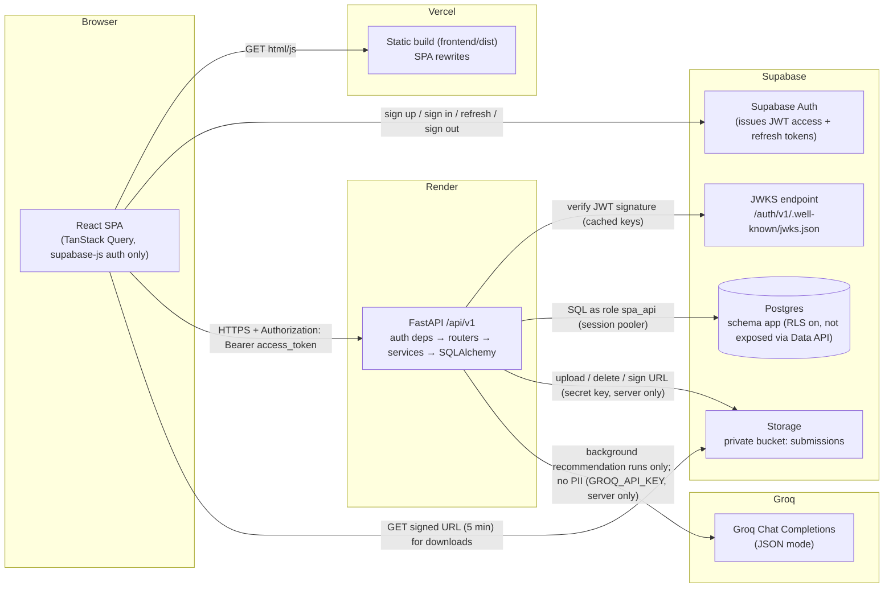

# Architecture — Smart Project Allocation

**Status:** Proposed (Phase 1, rev 2: official brief). Decisions here are mirrored as ADRs in [decisions.md](decisions.md).
Related: [requirements](requirements.md) · [auth](auth.md) · [schema](schema.md) · [api](api.md) · [frontend](frontend.md) · [deployment](deployment.md)

---

## 1. Stack decisions

| Concern | Decision | Why (and what was rejected) |
|---|---|---|
| Frontend | **React 18 + TypeScript + Vite**, React Router v6 | A static SPA on Vercel with no SSR. Rejected Next.js: its server features overlap with the FastAPI backend and blur where auth and data logic live. |
| Server state | **TanStack Query v5** | Caching, loading/error states, and invalidation without a global store. |
| Forms | **react-hook-form + zod** | Zod is used for *client* form UX only. The server's Pydantic validation is authoritative. |
| UI / styling | **Tailwind CSS + shadcn/ui** (Radix primitives) | Accessible primitives, design tokens as CSS variables, components copied into the repo (no runtime lock-in). |
| API client + types | **openapi-typescript + openapi-fetch**, generated from FastAPI's `openapi.json` | ADR-001: one contract source. No hand-written duplicate DTO types. |
| Backend | **Python 3.12 + FastAPI + Pydantic v2** (ADR-001, approved) | |
| Data access | **SQLAlchemy 2.0 (sync) + psycopg 3**, **Alembic** migrations | Sync is simpler to reason about and test. FastAPI runs sync endpoints in a threadpool, which is ample at demo scale (A-12). |
| Allocation solver | **SciPy `linear_sum_assignment`** | A well-tested optimal assignment solver in a few lines. |
| Recommendations | **Rule scorer (pure Python) + Groq refinement** via the OpenAI-compatible Chat Completions API (`httpx`, JSON mode, temperature 0), in the top-level `ai/` package (`spa_ai`, ADR-014) | ADR-003: explainable, deterministic baseline; AI improves fuzzy skill/interest matching and writes explanations; always falls back |
| Background work | **In-process worker** (`concurrent.futures.ThreadPoolExecutor`, 1 worker) started from the REC-01 handler; state persisted in `recommendation_runs` | No queue infrastructure for a hackathon. Stale runs are failed on boot. Tests run it inline. |
| Spreadsheet import | **openpyxl** (XLSX) + stdlib `csv` | Reads the provided dataset format directly |
| Database | **Supabase Postgres**, app tables in schema **`app`** | The `app` schema isn't exposed by Supabase's Data API (PostgREST), so browser clients can't reach tables even with the public key. RLS is also enabled as deny-by-default. |
| Authentication | **Supabase Auth** (email + password). The **API verifies the access token (JWT) on every request.** | See §4. Rejected custom auth: re-implementing password hashing, reset, refresh, and rotation is risk with no upside. |
| Authorization | **In the API only** (role from `app.users`, object checks in module `policies.py`) | One enforcement point. See [auth.md](auth.md). |
| File storage | **Supabase Storage, private buckets `submissions` and `resumes`** (ADR-015). Uploads are **proxied through the API**, and downloads use 5-minute signed URLs. | Proxying gives the API full control of size/type/ownership checks, with no orphaned client uploads. 10 MB × demo scale is fine on Render. |
| API style | **REST + JSON**, prefix `/api/v1`, snake_case fields, standard envelope | See [api.md](api.md) §1. |
| Testing | **pytest** + FastAPI `TestClient` against **real Postgres**. **Vitest** + Testing Library. **Playwright** E2E. | Integration tests must hit a real DB to exercise constraints and locks. |
| Lint / format / types | API: **ruff** (lint + format), **mypy --strict** on `app/`. Web: **ESLint**, **Prettier**, `tsc --noEmit`. | |
| Python packaging | **uv** (`pyproject.toml` + `uv.lock`) | Fast, reproducible installs on Render and CI. |
| JS packaging | **pnpm** | |
| Logging | **structlog** JSON logs with a `request_id` per request | |
| Config | **pydantic-settings** (API), `import.meta.env.VITE_*` (web) | Typed and validated at startup. The app refuses to boot on missing vars. |
| CI | **GitHub Actions**: API (ruff, mypy, alembic upgrade on a fresh Postgres, pytest) · Web (eslint, tsc, vitest, build) · Contract drift check | |
| CD | Render and Vercel Git integrations deploy `main`. Vercel creates preview deploys for PRs. | |

## 2. System diagram



The browser holds **only** the Supabase URL and **publishable (anon) key**. It uses them for auth calls and nothing else. The secret/service key and DB credentials exist **only** in Render's environment.

## 3. Request lifecycle

```mermaid
sequenceDiagram
    participant U as Browser (SPA)
    participant A as Supabase Auth
    participant API as FastAPI
    participant DB as Postgres (app)
    U->>A: signInWithPassword(email, password)
    A-->>U: access_token (1h) + refresh_token
    U->>API: GET /api/v1/me (Bearer access_token)
    API->>API: verify signature, iss, aud=authenticated, exp
    API->>DB: SELECT role, status FROM app.users WHERE id = sub
    alt no row
        API-->>U: 403 NOT_PROVISIONED
        U->>API: POST /api/v1/auth/provision {invitation_token?}
        API->>DB: INSERT user (accept invitation; student invites link the trainee record)
        API-->>U: 201 {data: user}
    else disabled
        API-->>U: 403 ACCOUNT_DISABLED → SPA signs out
    else active
        API-->>U: 200 {data: user}
    end
```

## 4. Supabase Auth vs custom auth (assessment)

| Criterion | Supabase Auth + API-verified JWT | Custom (FastAPI + passlib + own sessions) |
|---|---|---|
| Password storage, reset, refresh-token rotation | Built in, maintained | Must be built and secured ourselves |
| Fit with Supabase Storage / future features | Native | Extra glue |
| Role control | Roles stay in **our** DB, not in token claims | Same |
| Risk for a hackathon | Low | High (security-sensitive code under time pressure) |
| Vendor coupling | Token verification is standard JWT; replaceable | None |

**Decision: Supabase Auth.** The JWT proves *identity* only (`sub`, `email`). The **role and status are read from `app.users` on every request**, never from `user_metadata` (user-editable) or a client-supplied value. Full model in [auth.md](auth.md).

## 5. Backend structure and layering

```
backend/app/
├── main.py                  # create_app(): CORS, request-id + logging middleware, exception handlers, routers
├── core/
│   ├── config.py            # Settings (pydantic-settings); validated at boot
│   ├── logging.py           # structlog config; redaction of secrets
│   ├── errors.py            # AppError(code, status, message, details); handlers → error envelope
│   ├── security.py          # JWT verification (JWKS, cached; HS256 fallback for legacy/test)
│   ├── deps.py              # get_db, get_principal (token only), get_current_user (provisioned+active), require_roles(...)
│   ├── pagination.py        # Page params, sort allowlists, paginated envelope builder
│   └── responses.py         # Envelope[T], ListEnvelope[T] generic Pydantic models
├── db/
│   ├── session.py           # engine (pool_pre_ping), SessionLocal, transaction helper
│   ├── base.py              # DeclarativeBase with schema="app"
│   └── models/              # one file per aggregate: users.py, reference.py, cycles.py, trainees.py, projects.py, recommendations.py, allocations.py, submissions.py, evaluations.py, invitations.py, audit.py
├── modules/                 # one package per domain; each has the same files
│   ├── <module>/router.py   # HTTP only: parse, call service, wrap envelope
│   ├── <module>/schemas.py  # Pydantic request/response models (extra="forbid" on inputs)
│   ├── <module>/service.py  # business rules, state transitions, transactions
│   ├── <module>/repo.py     # SQLAlchemy queries (no business rules)
│   └── <module>/policies.py # object-level authorization predicates (can_view_submission(user, sub) …)
│   # modules: auth, me, reference (trades), skills, cycles, projects, trainees, imports (parser.py, trainees.py, projects.py), recommendations (worker.py: snapshots DB inputs, calls spa_ai.scoring/refiner, persists), allocations (solver.py), submissions, resumes (calls spa_ai.resume), evaluations, progress, admin_users, invitations, reports
│   # AI code (Groq client, scorer, refiner, resume extraction) lives in the top-level ai/ package (ADR-014)
├── storage/supabase_storage.py   # StorageClient protocol + Supabase impl (upload, delete, signed_url); FakeStorage for tests
└── audit.py                 # record(actor, action, entity_type, entity_id, metadata) — same transaction as the change
```

**Rules**
- Routers never touch the DB directly. Services own transactions (`with session.begin():`). Repos never commit.
- Every input model sets `model_config = ConfigDict(extra="forbid", str_strip_whitespace=True)`. Unknown fields such as `role`, `supervisor_id` on student payloads, or `status` give 422. This is the mass-assignment defence.
- Role checks use `require_roles(...)` dependencies at the router. Object checks call `policies.py` in the service. A missing policy check is a review blocker.
- The status enums are defined **once** in `app/db/models/enums.py` (Python `StrEnum`) and used by SQLAlchemy and Pydantic. They reach the frontend through OpenAPI.
- Domain errors raise `AppError` subclasses with stable `code`s (catalog in [api.md](api.md) §2). DB constraint violations are translated to those codes in `core/errors.py` by constraint name.

## 6. Frontend structure

See [frontend.md](frontend.md) for routes, layout, and components. In short:

```
frontend/src/
├── app/            # router.tsx (all routes), providers.tsx, AppShell, RoleRedirect
├── auth/           # supabase.ts (client), AuthProvider (session → /me → provision), RequireRole
├── api/            # schema.gen.ts (generated), client.ts (openapi-fetch + bearer middleware), errors.ts (ApiError), queryKeys.ts
├── components/ui/  # shadcn primitives (owned by foundation)
├── components/shared/ # PageHeader, DataTable, StatusBadge, EmptyState, ErrorState, LoadingState, ConfirmDialog, Pagination, FileField …
├── features/public/      # Landing, Login, Register
├── features/student/     # Teammate A
├── features/supervisor/  # Teammate B
├── features/admin/       # Teammate C
├── features/shared/      # ProjectCard, ProjectDetailView, TraineeProfileView, SubmissionDetailView, RecommendationCard, ProgressTable (see frontend.md §4)
└── lib/            # format.ts (dates, bytes), statusLabels.ts (enum → label/variant, single map)
```

## 7. Repository layout (monorepo)

**Monorepo** with three top-level parts (ADR-014), because one PR can change the API, the generated contract, and the frontend together. Reviewers see contract changes as a diff of `contracts/openapi.json`. Vercel and Render each build from a sub-directory.

ADR-014 layout:

```
/
├── frontend/                     # Vite SPA (Vercel root dir)
│   ├── src/ (see §6)
│   ├── e2e/                      # Playwright specs + fixtures
│   └── public/, index.html, vite.config.ts, tailwind.config.ts, vercel.json, package.json, .env.example
├── backend/                      # FastAPI (Render root dir)
│   ├── app/                      # see §5
│   ├── migrations/               # Alembic env.py + versions/ (0001_initial.py, 0002_trainee_resumes.py …)
│   ├── scripts/
│   │   ├── bootstrap_db.py       # runs sql/supabase_setup.sql with a generated spa_api password (one-time per env)
│   │   ├── create_admin.py       # first admin (Supabase admin API + app.users)
│   │   ├── seed.py               # --scenario empty|imported|recommended|published|demo (refuses APP_ENV=production unless --demo)
│   │   └── export_openapi.py     # writes contracts/openapi.json
│   ├── sql/supabase_setup.sql    # one-time per environment: role spa_api, storage buckets submissions + resumes
│   ├── tests/ (unit/, integration/, conftest.py, factories.py, tokens.py)
│   └── pyproject.toml, uv.lock, alembic.ini, .env.example   # depends on ../ai via a uv path source
├── ai/                           # Python package spa_ai: pure library, no DB/Storage/HTTP-framework imports
│   ├── spa_ai/
│   │   ├── llm/                  # GroqClient (httpx, timeout 10 s, 1 retry on 429/5xx) + FakeAIClient for tests
│   │   ├── text.py               # shared tokenizer (C-13)
│   │   ├── scoring.py            # rule scorer + eligibility() (ADR-003; pure)
│   │   ├── refiner.py            # Groq refinement of skill coverage / interest alignment + explanation
│   │   └── resume/               # extract_text.py (pypdf; DOCX via stdlib zipfile/XML), redact.py, extract.py (Groq + rule fallback) (ADR-015)
│   ├── tests/
│   └── pyproject.toml
├── contracts/openapi.json        # generated; committed; CI fails if stale
├── docs/                         # source of truth (this folder)
├── .github/workflows/ci.yml
├── .gitignore                    # .env*, !.env.example, node_modules, .venv, dist, coverage
├── CLAUDE.md
└── README.md                     # local setup, scripts, links to docs
```

## 8. Environments

| Env | Frontend | API | DB / Auth / Storage | Notes |
|---|---|---|---|---|
| local | `pnpm dev` on :5173 | `uv run fastapi dev` on :8000 | **Supabase project `spa-dev`** (shared by the team) | No Docker required. Each dev uses their own seeded accounts. |
| test (CI and local tests) | — | pytest | **Throwaway Postgres 16** (CI service container, or a local native Postgres). JWTs are signed with a test HS256 secret. Storage is `FakeStorage`. | Never point tests at `spa-dev`: tests truncate tables. |
| production (demo) | Vercel prod | Render web service | **Supabase project `spa-prod`** | Seeded with the `published` demo scenario before judging. |

Full variable list in [deployment.md](deployment.md) §2.
