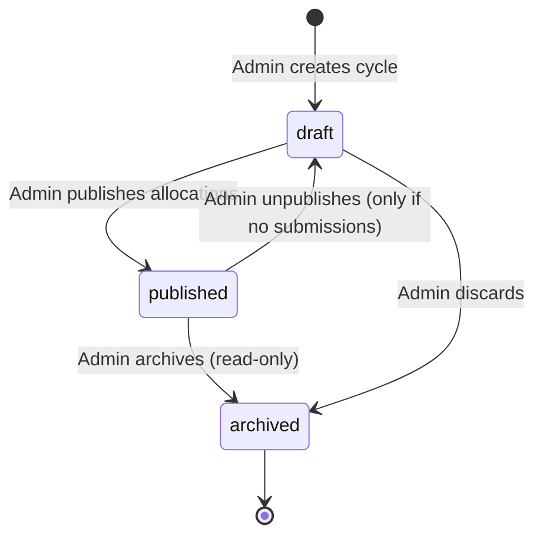

# Requirements — Smart Project Allocation MVP

> **ADR-017 (rev 3).** The judges' feedback changed the workflow: automated allocation (no recommendation screens, no
> publish gate, no capacity), self-service onboarding with multiple trades, trainee rejection with ranked replacement,
> mandatory reports with automated document evaluation and a Plagiarism & Originality Analysis, and manual/scheduled
> archives. See [decisions.md](decisions.md) ADR-017 and [api.md](api.md) §0. Requirements below that conflict are superseded.

**Status:** Proposed (Phase 1, rev 2: re-scoped to the official Tata STRIVE brief and dataset). Becomes binding when the owner approves it at the Phase 1 checkpoint.
Sources: `Project management_Smart project allocation_Hckathon 26 (1).docx.pdf` (brief) · `CSR_Hackathon_ITI_Project_Dataset.xlsx` (dataset) · [PROJECT_CONTEXT.md](PROJECT_CONTEXT.md).
Related: [architecture](architecture.md) · [auth](auth.md) · [schema](schema.md) · [api](api.md) · [roadmap](roadmap.md) · [decisions](decisions.md)

---

## 0. Glossary (one term everywhere)

| Term in code/docs | Meaning in the brief and dataset |
|---|---|
| **Student** (role `student`) | An ITI trainee with a login |
| **Trainee** (table `trainees`) | The trainee *record* (dataset "Trainee Profiles"), which may or may not be linked to a Student account |
| **Supervisor** (role `supervisor`) | Facilitator/evaluator assigned to projects; scores submissions |
| **Admin** (role `admin`) | Programme team member (Tata STRIVE); manages data, recommendations and allocation |
| **Cycle** | One cohort's allocation round (e.g. "Oct 2026 CSR Projects") |
| **Trade** | ITI trade, e.g. Electrician, Fitter, Welder, COPA, Mechanic Motor Vehicle, Solar Technician |
| **Recommendation** | A scored, explained (trainee, project) suggestion |
| **Allocation** | The programme team's decision: trainee → project |
| **Submission** | A trainee's project deliverable (video/report links, report file, logbook hours, bill-of-materials cost) |
| **Evaluation** | A supervisor's rubric scoring of one submission version |

## 1. Users and goals

| Role | Goals (from the brief) |
|---|---|
| **Admin** (programme team) | Load trainee and project data. Generate AI recommendations with visible factors. Review and modify them, then allocate and publish. Have one consolidated view of trainees, projects, submissions, evaluations and allocation status. Spend less manual effort. |
| **Supervisor** (facilitator) | See the trainees allocated to their projects, review submissions, and record rubric evaluations and feedback in one place. |
| **Student** (trainee) | Keep background, interests and skills current. See suggested projects and why they were suggested. See the final allocation. Submit project work, and see status, scores and feedback. |

## 2. MVP lifecycle

| # | Step | Actor | Cycle |
|---|---|---|---|
| 0 | The seed script creates the first admin. The admin invites supervisors. | Admin | — |
| 1 | Admin creates a cycle and sets its submission deadline | Admin | `draft` |
| 2 | Admin imports trainees and projects from XLSX/CSV (dataset format), or creates and edits them in the UI. Admin assigns a supervisor to each project and publishes the projects. | Admin | `draft` |
| 3 | Trainees get accounts: the admin sends per-trainee invite links, or trainees self-register (assessment then pending). Students update skills, career interest and background. | Admin, Student | any |
| 4 | Admin runs **Generate recommendations**. Every trainee gets scored projects with factors (rule-based, plus Groq refinement when available). | Admin | `draft` |
| 5 | Students see their top suggestions and the reasons, marked "final allocation is decided by the programme team". | Student | `draft` / `published` |
| 6 | Admin runs **Auto-allocate** (draft allocations from the scores), then reviews: accepts, reassigns, removes, and allocates manually. Overriding a hard rule (trade mismatch or below the minimum practical score) requires a written reason. | Admin | `draft` |
| 7 | Admin **publishes**. Students and supervisors now see allocations. | Admin | `published` |
| 8 | The student submits work: video URL and/or report URL and/or report file, logbook hours, bill-of-materials cost, and a note. | Student | `published` |
| 9 | The supervisor evaluates using the 5-criterion rubric. The total and grade are computed. Outcome is **evaluated** (final) or **rework requested** (feedback required). | Supervisor | `published` |
| 10 | After rework, the student submits version n+1, and the supervisor evaluates it. | Student, Supervisor | `published` |
| 11 | Admin monitors the consolidated dashboard: allocation coverage, recommendation quality, submission and evaluation status, grade distribution, capacity. | Admin | any |

**What is automated and what is human:** recommendations are automated (rule scoring, optionally refined by Groq). Auto-allocation is automated but only produces a **draft**. Every allocation becomes visible only after a human publishes it. Admins can change any allocation, and overrides are audited with a reason. This matches the brief: AI supports the programme team's decision rather than replacing it.

### Distinct states (never collapsed)

| Concept | Where | Values |
|---|---|---|
| Cycle lifecycle | `cycles.status` | `draft`, `published`, `archived` |
| Project lifecycle | `projects.status` | `draft`, `published`, `archived` |
| Trainee assessment | derived from score columns | `pending` (any score null) / `complete` |
| Recommendation | a row in `recommendations` (per run) | score + factors + `source` (`rule` / `rule_ai`) |
| Allocation | a row in `allocations` | `source` (`auto` / `manual`), `is_override`. Visible to non-admins only when the cycle is `published`. |
| Submission version | `submissions.status` | `submitted`, `evaluated`, `rework_requested` |
| Evaluation | `evaluations.outcome` (1:1 with a submission) | `evaluated`, `rework_requested` |
| Trainee progress | **derived** | `unallocated` → `allocated` → `submitted` → `rework_requested` → `evaluated` |

## 3. Functional requirements (P0 unless marked)

### Accounts and access
- **FR-01** Public registration creates a **Student** with a new trainee record (assessment `pending`). It can never create a Supervisor or Admin.
- **FR-02** Admin invites Supervisors/Admins by email, and Students **bound to an existing trainee record**. Single-use links expire after 7 days. The admin copies the link (email sending is P1).
- **FR-03** Login, logout, a persistent session, and automatic refresh. Each role lands on its own dashboard. The API rejects cross-role access.
- **FR-04** Admin changes roles (with guards) and disables or enables accounts.

### Trainee data (the brief's "capture student information")
- **FR-05** A trainee record holds: trainee code (e.g. `TRN-EL-001`), full name, gender (optional; admin-only; **never used in scoring**), trade, training centre, theory score %, practical score %, safety compliance score %, skills, career interest, background (free text), and an optional linked account.
- **FR-06** Admin creates and edits trainee records, including scores. Students edit **only** their own skills, career interest and background. Students never edit scores, trade, centre or code.
- **FR-07a** (ADR-015) A student uploads a resume (PDF/DOCX, ≤ 5 MB). The server extracts suggested skills, projects, certifications, tools and a career-interest hint (Groq, or a rule fallback), without sending personal details. The student reviews the suggestions and chooses which skills to add through their normal profile edit. Nothing is applied automatically, and scores are never taken from a resume. Admins see the resume and the extraction. Supervisors see only the extraction, for their allocated trainees.
- **FR-07** Admin imports trainees from XLSX/CSV in the dataset's "Trainee Profiles" format: upsert by trainee code, `dry_run` preview, and per-row errors. The import is all-or-nothing.

### Projects
- **FR-08** A project holds: project code (e.g. `PRJ-EL-101`), title, description/problem statement, problem-statement document URL, target trade, difficulty (`beginner|intermediate|advanced`), prerequisite skills, minimum practical score %, capacity (max trainees), category/sponsor goal, supervisor, and status.
- **FR-09** Admin creates, edits, publishes, archives and deletes (draft, unreferenced) projects, and imports them from the dataset's "Project Catalog" format (same import rules as FR-07).
- **FR-10** Everyone can browse published projects in the active cycle. Students see only projects for their own trade by default (filter can be removed).

### Recommendations (the brief's AI requirement)
- **FR-11** Admin starts a recommendation run for the cycle. It runs in the background, and progress is visible. For every trainee × published project it computes a **match score 0–100 and an itemised factor list**: each factor has a label, points earned/max, and a human-readable detail. It keeps the top 5 per trainee, plus every project whose trade matches.
- **FR-12** Scoring factors and weights are fixed and documented ([api.md](api.md) REC-01):

  | Factor | Max points |
  |---|---|
  | Trade match | gate (eligibility) |
  | Practical score vs project minimum | 35 |
  | Prerequisite skill coverage | 30 |
  | Career-interest alignment | 20 |
  | Theory + safety readiness for the difficulty | 15 |

  A trade mismatch or a practical score below the minimum marks the pair **ineligible**. It is still shown, flagged, with the reason.
- **FR-13** When `GROQ_API_KEY` is set and the run requests AI, Groq refines skill coverage and interest alignment for each trainee's top candidates and adds a short explanation. Any AI failure falls back to rule-only for that trainee. The run reports how many trainees used AI.
- **FR-14** Admin sees recommendations per trainee (ranked, with factors) and per project (best-matching trainees). Students see their own top suggestions with factors.

### Allocation
- **FR-15** In a `draft` cycle, auto-allocate creates draft allocations from the latest completed recommendation run. It uses only eligible pairs, never exceeds capacity, places as many trainees as possible, then maximises the total match score. It keeps manual allocations and returns a summary.
- **FR-16** Admin can manually allocate, reassign or remove allocations, in `draft` or `published`. Capacity is always enforced. Allocating an ineligible pair (trade mismatch or below the minimum) requires `override_reason`, is stored as an override, and is audited. A trainee with submissions can't be reassigned or removed.
- **FR-17** Publishing makes allocations visible. A student sees their project, supervisor, match score and factors. A supervisor sees their allocated trainees and their profiles.

### Submissions and evaluation
- **FR-18** A student with a published allocation submits: video URL, report URL, report file (≤10 MB: pdf, docx, pptx, zip, png, jpg), logbook hours (0–1000), bill-of-materials cost INR (0–10,000,000), and a note. At least one of video URL, report URL or file is required. One version can await evaluation at a time.
- **FR-19** The project's supervisor evaluates the latest pending version, with outcome `evaluated` or `rework_requested`:
  - `evaluated`: all five criteria (workmanship /25, functional demo /25, safety & SOP /15, logbook & documentation /15, viva voce /20) are required. The total and grade are computed.
  - `rework_requested`: feedback of at least 10 characters is required, and scores are optional.
- **FR-20** Grade bands (computed, matching the dataset):

  | Grade | Total score |
  |---|---|
  | A1 (Exemplary) | ≥ 88 |
  | A (Excellent) | 80–87 |
  | B+ (Very Good) | 75–79 |
  | B (Good) | 65–74 |
  | C (Satisfactory) | 50–64 |
  | D (Needs Improvement) | < 50 |

- **FR-21** A submission after the cycle's `submission_deadline` is accepted but flagged `is_late`. An evaluated submission is final, and no further versions are accepted.

### Oversight
- **FR-22** Admin overview: trainee counts by trade and assessment status, recommendation coverage and AI usage, allocation coverage and capacity use, average match score of allocations, override count, submission/evaluation status counts, grade distribution, and per-project demand (eligible trainees vs capacity).
- **FR-23** Consolidated progress table, one row per allocated trainee (trainee, trade, project, supervisor, match score, latest submission status, total score, grade, late flag). Admin sees all rows, a supervisor sees their own projects, and a student sees their own row.
- **FR-24** Security-relevant admin actions are audited (roles, invites, imports, transitions, allocation runs and overrides, project and trainee changes). No audit UI in the MVP.

## 4. Non-functional requirements

| ID | Requirement | Measure |
|---|---|---|
| NFR-01 Security | Server-side authorization on every endpoint, deny-by-default, object-level checks | Authz matrix test covers every endpoint × role |
| NFR-02 Integrity | One allocation per trainee per cycle. Capacity enforced by a DB trigger. One pending and one evaluated version per allocation. One evaluation per submission. Scores within rubric maxima (DB checks). | Constraint and concurrency tests |
| NFR-03 Privacy | Gender is admin-only and never a scoring input. Groq receives no name, gender, code or centre. Supervisors see only their allocated trainees. Logs carry no PII or tokens. | Tests + a code review checklist item |
| NFR-04 Explainability | Every recommendation and auto-allocation exposes its factors. Points per factor add up to the score. | Unit test: Σ factor points = score |
| NFR-05 Resilience | A recommendation run always completes (rule-only fallback). A Groq call times out after 10 s, is retried once, and is never on the request path of a page load. | Tests with a fake AI client that fails or times out |
| NFR-06 Performance | Demo scale ≤ 500 trainees × ≤ 100 projects. A rule-only run takes < 10 s. An AI run takes < 3 min (top-5 candidates, concurrency 4). Auto-allocate takes < 5 s. Pages take < 500 ms p95 warm. | Timing in the smoke test |
| NFR-07 Deployability, maintainability, accessibility | As in [architecture.md](architecture.md), [deployment.md](deployment.md) and [frontend.md](frontend.md) | CI green, checklists |

## 5. Edge cases (all handled)

1. A trainee with assessment `pending` gets no recommendations. They're listed as "assessment pending" in the run summary.
2. A trainee with no project in their trade: all pairs are ineligible. They appear in the summary as `no_eligible_project`, and manual override is possible.
3. Groq times out, returns invalid JSON or is rate-limited: that trainee falls back to rule-only. The run finishes with `ai_used_count < trainee_count`.
4. The server restarts during a recommendation run: on boot, runs stuck in `running` for more than 10 minutes become `failed`. The admin re-runs.
5. Two admins start runs at once: the second gets `409 RUN_IN_PROGRESS`.
6. Concurrent manual allocations for the last seat: one succeeds, and the other gets `PROJECT_FULL` (trigger).
7. Capacity reduced below current allocations: `CAPACITY_BELOW_ALLOCATED`.
8. Two submissions racing for the same allocation: one succeeds, and the other gets `SUBMISSION_PENDING`.
9. A supervisor double-submits an evaluation: `SUBMISSION_ALREADY_EVALUATED`.
10. The project's supervisor changes after publish: the new supervisor gets access immediately, and the old one loses it.
11. Import file with a bad row: the whole import is rejected, with per-row errors. `dry_run` previews creates and updates.
12. Import updates a trainee who is already allocated, changing their trade: allowed, but the allocation is flagged in the response warnings ("allocation now ineligible").
13. A self-registered student duplicates an imported trainee: the admin can **link** an account to the right record and archive the duplicate (P1). For the MVP demo, invite links are the recommended path.
14. Upload succeeds but the DB insert fails: the stored object is deleted (compensation).
15. A disabled user mid-session: their next call returns `ACCOUNT_DISABLED`.
16. Render cold start: the frontend shows "Waking the server…" and retries once.

## 6. Classification

- **Mandatory MVP (P0):** everything in §3 except items marked P1, plus the landing page, auth flows, role dashboards and full page states.
- **Foundations for later (P0, cheap now):** the scorer is a pure function with a pluggable AI refiner. Recommendation runs are stored, with factors (a basis for fairness analysis). Allocations keep `match_score` and `is_override`. The audit log. OpenAPI-generated types.
- **Optional post-MVP:** see §8.

## 7. Assumptions (documented defaults)

| ID | Default | Impact if wrong |
|---|---|---|
| A-01 | Role names stay Student/Supervisor/Admin (glossary §0) | Only UI copy changes |
| A-02 | Assessment scores are entered or imported by admins only | If trainees should self-report, PATCH rules change |
| A-03 | Trade match and minimum practical score are eligibility gates. Admins can override with a reason (the dataset itself allocates TRN-CP-008 at 83 % to a project requiring 85 %). | — |
| A-04 | Scoring weights are fixed constants (FR-12) in the MVP. Admin-tunable weights are P1. | |
| A-05 | One submission deadline per cycle; no milestones | Per-project deadlines are P2 |
| A-06 | Email confirmation is off for the demo. Invites carry secret tokens. | |
| A-07 | Groq model and key come from env vars. The demo works without a key (rule-only). | |
| A-08 | ~4–5 build days; 48 h cut line in [roadmap.md](roadmap.md) | |
| A-09 | Scale ≤ 500 trainees, ≤ 100 projects per cycle | |
| A-10 | The dataset's "Allocation Status" and "Current Allocations" columns are ignored on import. They're derived in-app. | |
| A-11 | The dataset's sample submissions and evaluations are loaded by the `demo` seed, not by the import endpoints | |

## 8. Feature priority

| Feature | Priority |
|---|---|
| Auth (register, invite incl. trainee-bound, login, refresh, logout), RBAC, provisioning | P0 |
| Trainee records: admin CRUD + XLSX/CSV import; student edits own skills/interest/background | P0 |
| Projects: admin CRUD + import + publish; catalogue for all roles | P0 |
| Recommendation runs (rule scoring + Groq refinement + fallback), with per-trainee and per-project views | P0 |
| Student "Suggested projects" with factors | P0 |
| Auto-allocate (draft) + manual allocate/reassign/remove with override reasons + publish | P0 |
| Submissions with links, file, logbook hours, BOM cost; versioning; late flag | P0 |
| Rubric evaluation with computed total/grade; rework loop | P0 |
| Consolidated progress table (scoped for all roles) + admin overview | P0 |
| Admin users, role change, disable; audit writes | P0 |
| Student "interested" flag on suggestions feeding the score | P1 |
| Admin-tunable scoring weights; fairness report (score distribution by trade/centre) | P1 |
| Email delivery for invites; email confirmation | P1 |
| CSV export of allocations/evaluations; audit viewer; rate limiting | P1 |
| Link/merge duplicate trainee records | P1 |
| Supervisor or admin records a submission on a trainee's behalf (offline trainees) | P1 |
| Submission-risk detection, workload balancing, per-project deadlines | P2 |
| Teams, chatbots, gamification | Not planned |

## 9. Whole-application acceptance criteria (on the deployed stack, no mock data)

1. Admin imports the provided dataset's Trainee Profiles (12) and Project Catalog (8) sheets. `dry_run` shows 20 creates. The real import persists them.
2. Admin assigns supervisors, publishes the projects, and runs recommendations (rule-only if there's no key). Every trainee with complete scores has ≥ 1 eligible recommendation whose factor points sum to its score.
3. With a Groq key configured, the run reports `ai_used_count > 0`, and recommendations show an AI explanation. Revoking the key gives a rule-only run that still succeeds.
4. Auto-allocate produces draft allocations within capacity, all eligible. The admin overrides one allocation below the minimum with a reason (it's audited) and publishes.
5. An invited student logs in, sees their suggestions with factors and their published allocation, and submits a report link plus a PDF.
6. The supervisor sees only their trainees, requests rework with feedback. The student submits v2. The supervisor evaluates with rubric scores, and the total and grade match FR-20.
7. The admin overview and progress table reflect steps 1–6 exactly.
8. Cross-role and cross-user access tests pass (student → other trainee's submission 404; supervisor → unallocated trainee 404; non-admin → admin endpoints 403).
9. CI is green, the Render health check passes, and the smoke test passes.
