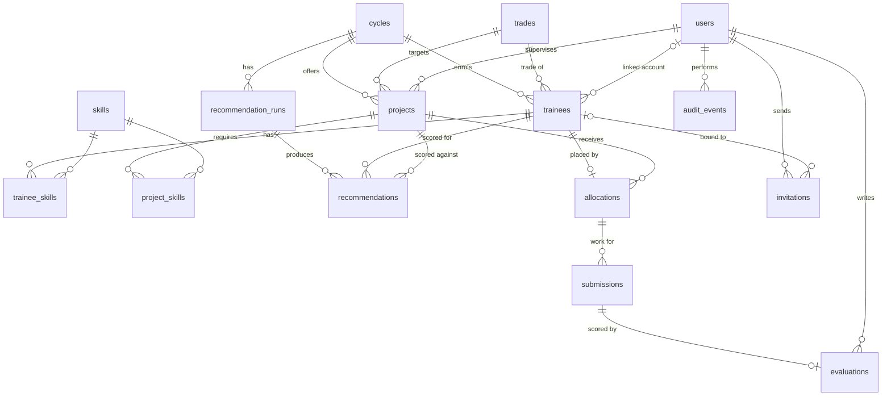

# Database Schema

**Status:** Proposed (Phase 1, rev 2: official brief and dataset). Migration `0001_initial` must implement this file exactly. Later changes need a new Alembic migration **and** an update to this file in the same PR.

Supabase Postgres 15+. All app objects live in schema **`app`**. IDs are `uuid` (`gen_random_uuid()`), timestamps are `timestamptz` (UTC), and enums are Postgres enum types mirrored by Python `StrEnum`s in `app/db/models/enums.py`.

---

## 1. Entities

| Table | Purpose | Hard delete? |
|---|---|---|
| `users` | Provisioned people; authoritative **role** and **status** | Never (disable) |
| `trades` | ITI trade list (Electrician, Fitter, …) | No (restricted by FKs) |
| `skills` | Shared skill vocabulary (case-insensitive unique) | No |
| `cycles` | Cohort allocation round with lifecycle | Never (archive) |
| `trainees` | Trainee record (dataset "Trainee Profiles"), per cycle, optionally linked to a Student user | Only if unreferenced (admin) |
| `trainee_skills` | Trainee ↔ skill | Yes (replaced on save) |
| `projects` | Project offered in a cycle (dataset "Project Catalog") | Only `draft` + unreferenced |
| `project_skills` | Prerequisite skills of a project | Yes (replaced on save) |
| `recommendation_runs` | One background scoring run per request | Never |
| `recommendations` | Scored + explained (trainee, project) pair within a run | Never (superseded by newer runs) |
| `allocations` | Trainee → project decision | Yes (admin remove; auto-allocate replaces `auto` rows) while there are no submissions |
| `submissions` | One row per submitted **version** | Never |
| `evaluations` | Supervisor rubric scoring of one submission version | Never |
| `invitations` | Single-use invites (supervisor/admin, or student bound to a trainee) | Never (revoke) |
| `audit_events` | Append-only log of privileged changes | Never |
| `trainee_resumes` | One row per uploaded resume version + its AI/rule extraction (ADR-015, migration 0002) | Cascades with the trainee (service deletes the Storage objects first) |

**Deliberately excluded:**
- teams, preferences, milestones, `student_profiles` (ADR-011, A-05; trainee data lives in `trainees`)
- notifications
- `allocation_runs` (summary in `audit_events`)
- `import_jobs` (imports are synchronous and audited)
- `supervisor_profiles` (department lives on `users`)
- FK `users.id → auth.users.id` (it would break plain-Postgres tests and couple us to Supabase internals)

## 2. ER diagram



## 3. Canonical enums

| Enum | Values |
|---|---|
| `user_role` | `student`, `supervisor`, `admin` |
| `user_status` | `active`, `disabled` |
| `cycle_status` | `draft`, `published`, `archived` |
| `project_status` | `draft`, `published`, `archived` |
| `difficulty_level` | `beginner`, `intermediate`, `advanced` |
| `run_status` | `queued`, `running`, `completed`, `failed` |
| `recommendation_source` | `rule`, `rule_ai` |
| `allocation_source` | `auto`, `manual` |
| `submission_status` | `submitted`, `evaluated`, `rework_requested` |
| `evaluation_outcome` | `evaluated`, `rework_requested` |
| `resume_status` (0002) | `extracted`, `failed` |
| `extraction_source` (0002) | `rule`, `ai` |
| *derived* `assessment_status` | `pending`, `complete` |
| *derived* `trainee_progress` | `unallocated`, `allocated`, `submitted`, `rework_requested`, `evaluated` |
| *derived* `invitation_status` | `pending`, `accepted`, `revoked`, `expired` |
| *derived* `grade` (generated column) | `A1`, `A`, `B+`, `B`, `C`, `D` (labels in [requirements.md](requirements.md) FR-20) |

## 4. DDL (reference for migration 0001)

```sql
CREATE SCHEMA IF NOT EXISTS app;
DO $$ BEGIN
  IF NOT EXISTS (SELECT 1 FROM pg_roles WHERE rolname = 'spa_api') THEN
    RAISE EXCEPTION 'Role spa_api must exist. Run backend/sql/supabase_setup.sql (or the CI bootstrap) first.';
  END IF;
END $$;

CREATE TYPE app.user_role             AS ENUM ('student','supervisor','admin');
CREATE TYPE app.user_status           AS ENUM ('active','disabled');
CREATE TYPE app.cycle_status          AS ENUM ('draft','published','archived');
CREATE TYPE app.project_status        AS ENUM ('draft','published','archived');
CREATE TYPE app.difficulty_level      AS ENUM ('beginner','intermediate','advanced');
CREATE TYPE app.run_status            AS ENUM ('queued','running','completed','failed');
CREATE TYPE app.recommendation_source AS ENUM ('rule','rule_ai');
CREATE TYPE app.allocation_source     AS ENUM ('auto','manual');
CREATE TYPE app.submission_status     AS ENUM ('submitted','evaluated','rework_requested');
CREATE TYPE app.evaluation_outcome    AS ENUM ('evaluated','rework_requested');

CREATE FUNCTION app.set_updated_at() RETURNS trigger LANGUAGE plpgsql AS $$
BEGIN NEW.updated_at = now(); RETURN NEW; END $$;

-- ============ users ============
CREATE TABLE app.users (
  id          uuid PRIMARY KEY,                       -- = Supabase auth user id (JWT sub)
  email       text NOT NULL CHECK (email = lower(email) AND char_length(email) BETWEEN 3 AND 254),
  full_name   text NOT NULL CHECK (char_length(full_name) BETWEEN 1 AND 120),
  role        app.user_role   NOT NULL,
  status      app.user_status NOT NULL DEFAULT 'active',
  department  text CHECK (char_length(department) <= 120),
  created_at  timestamptz NOT NULL DEFAULT now(),
  updated_at  timestamptz NOT NULL DEFAULT now()
);
CREATE UNIQUE INDEX users_email_key       ON app.users (email);
CREATE INDEX        users_role_status_idx ON app.users (role, status);

-- ============ reference data ============
CREATE TABLE app.trades (
  id         uuid PRIMARY KEY DEFAULT gen_random_uuid(),
  name       text NOT NULL CHECK (char_length(name) BETWEEN 1 AND 80),
  created_at timestamptz NOT NULL DEFAULT now()
);
CREATE UNIQUE INDEX trades_name_key ON app.trades (lower(name));

CREATE TABLE app.skills (
  id         uuid PRIMARY KEY DEFAULT gen_random_uuid(),
  name       text NOT NULL CHECK (char_length(name) BETWEEN 1 AND 80),
  created_at timestamptz NOT NULL DEFAULT now()
);
CREATE UNIQUE INDEX skills_name_key ON app.skills (lower(name));

-- ============ cycles ============
CREATE TABLE app.cycles (
  id                  uuid PRIMARY KEY DEFAULT gen_random_uuid(),
  name                text NOT NULL CHECK (char_length(name) BETWEEN 1 AND 120),
  status              app.cycle_status NOT NULL DEFAULT 'draft',
  submission_deadline timestamptz NOT NULL,
  created_by          uuid NOT NULL REFERENCES app.users(id),
  created_at          timestamptz NOT NULL DEFAULT now(),
  updated_at          timestamptz NOT NULL DEFAULT now()
);
CREATE UNIQUE INDEX cycles_name_key      ON app.cycles (lower(name));
CREATE UNIQUE INDEX cycles_single_active ON app.cycles ((true)) WHERE status IN ('draft','published');

-- ============ trainees ============
CREATE TABLE app.trainees (
  id               uuid PRIMARY KEY DEFAULT gen_random_uuid(),
  cycle_id         uuid NOT NULL REFERENCES app.cycles(id) ON DELETE RESTRICT,
  trainee_code     text NOT NULL CHECK (trainee_code ~ '^[A-Za-z0-9-]{1,40}$'),
  full_name        text NOT NULL CHECK (char_length(full_name) BETWEEN 1 AND 120),
  gender           text CHECK (gender IN ('female','male','other','undisclosed')),  -- admin-only; never a scoring input
  trade_id         uuid NOT NULL REFERENCES app.trades(id) ON DELETE RESTRICT,
  centre_name      text CHECK (char_length(centre_name) <= 120),
  theory_score     numeric(5,2) CHECK (theory_score BETWEEN 0 AND 100),
  practical_score  numeric(5,2) CHECK (practical_score BETWEEN 0 AND 100),
  safety_score     numeric(5,2) CHECK (safety_score BETWEEN 0 AND 100),
  career_interest  text CHECK (char_length(career_interest) <= 300),
  background       text CHECK (char_length(background) <= 2000),
  user_id          uuid REFERENCES app.users(id) ON DELETE RESTRICT,  -- linked Student account (nullable)
  created_at       timestamptz NOT NULL DEFAULT now(),
  updated_at       timestamptz NOT NULL DEFAULT now(),
  CONSTRAINT trainees_id_cycle_key UNIQUE (id, cycle_id)
);
CREATE UNIQUE INDEX trainees_cycle_code_key ON app.trainees (cycle_id, upper(trainee_code));
CREATE UNIQUE INDEX trainees_cycle_user_key ON app.trainees (cycle_id, user_id) WHERE user_id IS NOT NULL;
CREATE INDEX trainees_cycle_trade_idx ON app.trainees (cycle_id, trade_id);

CREATE TABLE app.trainee_skills (
  trainee_id uuid NOT NULL REFERENCES app.trainees(id) ON DELETE CASCADE,
  skill_id   uuid NOT NULL REFERENCES app.skills(id) ON DELETE RESTRICT,
  PRIMARY KEY (trainee_id, skill_id)
);
CREATE INDEX trainee_skills_skill_idx ON app.trainee_skills (skill_id);

-- ============ projects ============
CREATE TABLE app.projects (
  id                   uuid PRIMARY KEY DEFAULT gen_random_uuid(),
  cycle_id             uuid NOT NULL REFERENCES app.cycles(id) ON DELETE RESTRICT,
  project_code         text NOT NULL CHECK (project_code ~ '^[A-Za-z0-9-]{1,40}$'),
  title                text NOT NULL CHECK (char_length(title) BETWEEN 5 AND 200),
  description          text CHECK (char_length(description) <= 5000),
  problem_doc_url      text CHECK (char_length(problem_doc_url) <= 2048 AND problem_doc_url ~ '^https://'),
  target_trade_id      uuid NOT NULL REFERENCES app.trades(id) ON DELETE RESTRICT,
  difficulty           app.difficulty_level NOT NULL,
  min_practical_score  numeric(5,2) NOT NULL DEFAULT 0 CHECK (min_practical_score BETWEEN 0 AND 100),
  max_trainees         smallint NOT NULL CHECK (max_trainees BETWEEN 1 AND 100),
  category             text CHECK (char_length(category) <= 120),
  supervisor_id        uuid REFERENCES app.users(id) ON DELETE RESTRICT,  -- required before publish (service rule)
  status               app.project_status NOT NULL DEFAULT 'draft',
  created_by           uuid NOT NULL REFERENCES app.users(id),
  created_at           timestamptz NOT NULL DEFAULT now(),
  updated_at           timestamptz NOT NULL DEFAULT now(),
  CONSTRAINT projects_id_cycle_key UNIQUE (id, cycle_id),
  CONSTRAINT projects_published_has_supervisor CHECK (status <> 'published' OR supervisor_id IS NOT NULL)
);
CREATE UNIQUE INDEX projects_cycle_code_key ON app.projects (cycle_id, upper(project_code));
CREATE INDEX projects_cycle_status_idx ON app.projects (cycle_id, status);
CREATE INDEX projects_supervisor_idx   ON app.projects (supervisor_id);
CREATE INDEX projects_trade_idx        ON app.projects (cycle_id, target_trade_id);

CREATE TABLE app.project_skills (
  project_id uuid NOT NULL REFERENCES app.projects(id) ON DELETE CASCADE,
  skill_id   uuid NOT NULL REFERENCES app.skills(id) ON DELETE RESTRICT,
  PRIMARY KEY (project_id, skill_id)
);
CREATE INDEX project_skills_skill_idx ON app.project_skills (skill_id);

-- ============ recommendations ============
CREATE TABLE app.recommendation_runs (
  id                    uuid PRIMARY KEY DEFAULT gen_random_uuid(),
  cycle_id              uuid NOT NULL REFERENCES app.cycles(id) ON DELETE RESTRICT,
  status                app.run_status NOT NULL DEFAULT 'queued',
  use_ai                boolean NOT NULL,
  ai_model              text,                                   -- null when use_ai = false or AI not configured
  trainee_count         integer NOT NULL DEFAULT 0,             -- trainees with complete assessment
  skipped_pending_count integer NOT NULL DEFAULT 0,             -- trainees skipped: assessment pending
  scored_pairs          integer NOT NULL DEFAULT 0,
  ai_used_count         integer NOT NULL DEFAULT 0,
  ai_failed_count       integer NOT NULL DEFAULT 0,
  progress_done         integer NOT NULL DEFAULT 0,             -- trainees processed so far
  error_message         text CHECK (char_length(error_message) <= 500),  -- generic, no secrets
  started_by            uuid NOT NULL REFERENCES app.users(id),
  created_at            timestamptz NOT NULL DEFAULT now(),
  started_at            timestamptz,
  finished_at           timestamptz
);
CREATE UNIQUE INDEX recommendation_runs_one_active ON app.recommendation_runs (cycle_id) WHERE status IN ('queued','running');
CREATE INDEX recommendation_runs_cycle_idx ON app.recommendation_runs (cycle_id, created_at DESC);

CREATE TABLE app.recommendations (
  id                 uuid PRIMARY KEY DEFAULT gen_random_uuid(),
  run_id             uuid NOT NULL REFERENCES app.recommendation_runs(id) ON DELETE RESTRICT,
  cycle_id           uuid NOT NULL,
  trainee_id         uuid NOT NULL,
  project_id         uuid NOT NULL,
  score              numeric(5,2) NOT NULL CHECK (score BETWEEN 0 AND 100),
  rank               smallint NOT NULL CHECK (rank >= 1),        -- rank within (run, trainee), eligible first, then score desc
  eligible           boolean NOT NULL,
  ineligible_reasons text[] NOT NULL DEFAULT '{}',              -- subset of {'trade_mismatch','below_min_practical','assessment_pending'}
  factors            jsonb NOT NULL,                              -- [{key,label,points,max_points,detail,ai_refined}]; Σ points = score
  source             app.recommendation_source NOT NULL,
  ai_explanation     text CHECK (char_length(ai_explanation) <= 600),
  created_at         timestamptz NOT NULL DEFAULT now(),
  CONSTRAINT recommendations_trainee_fk FOREIGN KEY (trainee_id, cycle_id) REFERENCES app.trainees(id, cycle_id) ON DELETE RESTRICT,
  CONSTRAINT recommendations_project_fk FOREIGN KEY (project_id, cycle_id) REFERENCES app.projects(id, cycle_id) ON DELETE RESTRICT,
  CONSTRAINT recommendations_pair_key UNIQUE (run_id, trainee_id, project_id),
  CONSTRAINT recommendations_eligibility CHECK (eligible = (cardinality(ineligible_reasons) = 0))
);
CREATE INDEX recommendations_trainee_idx ON app.recommendations (run_id, trainee_id, rank);
CREATE INDEX recommendations_project_idx ON app.recommendations (run_id, project_id, score DESC);

-- ============ allocations ============
CREATE TABLE app.allocations (
  id                uuid PRIMARY KEY DEFAULT gen_random_uuid(),
  cycle_id          uuid NOT NULL,
  trainee_id        uuid NOT NULL,
  project_id        uuid NOT NULL,
  source            app.allocation_source NOT NULL,
  match_score       numeric(5,2) CHECK (match_score BETWEEN 0 AND 100),  -- from the recommendation used, else null
  recommendation_id uuid REFERENCES app.recommendations(id) ON DELETE RESTRICT,
  is_override       boolean NOT NULL DEFAULT false,
  override_reason   text CHECK (char_length(override_reason) <= 500),
  created_by        uuid NOT NULL REFERENCES app.users(id),
  created_at        timestamptz NOT NULL DEFAULT now(),
  updated_at        timestamptz NOT NULL DEFAULT now(),
  CONSTRAINT allocations_one_per_trainee UNIQUE (trainee_id),
  CONSTRAINT allocations_trainee_fk FOREIGN KEY (trainee_id, cycle_id) REFERENCES app.trainees(id, cycle_id) ON DELETE RESTRICT,
  CONSTRAINT allocations_project_fk FOREIGN KEY (project_id, cycle_id) REFERENCES app.projects(id, cycle_id) ON DELETE RESTRICT,
  CONSTRAINT allocations_override_reason CHECK (NOT is_override OR char_length(btrim(coalesce(override_reason,''))) >= 10),
  CONSTRAINT allocations_id_cycle_key UNIQUE (id, cycle_id)
);
CREATE INDEX allocations_project_idx ON app.allocations (project_id);
CREATE INDEX allocations_cycle_idx   ON app.allocations (cycle_id);

CREATE FUNCTION app.enforce_project_capacity() RETURNS trigger LANGUAGE plpgsql AS $$
DECLARE cap smallint; used integer;
BEGIN
  SELECT max_trainees INTO cap FROM app.projects WHERE id = NEW.project_id FOR UPDATE;
  SELECT count(*) INTO used FROM app.allocations WHERE project_id = NEW.project_id AND id <> NEW.id;
  IF used >= cap THEN
    RAISE EXCEPTION 'project capacity exceeded' USING ERRCODE = '23514', CONSTRAINT = 'allocations_project_capacity';
  END IF;
  RETURN NEW;
END $$;
CREATE TRIGGER allocations_capacity BEFORE INSERT OR UPDATE OF project_id ON app.allocations
  FOR EACH ROW EXECUTE FUNCTION app.enforce_project_capacity();

-- ============ submissions ============
CREATE TABLE app.submissions (
  id              uuid PRIMARY KEY DEFAULT gen_random_uuid(),
  allocation_id   uuid NOT NULL,
  cycle_id        uuid NOT NULL,
  version         smallint NOT NULL CHECK (version >= 1),
  status          app.submission_status NOT NULL DEFAULT 'submitted',
  submitted_by    uuid NOT NULL REFERENCES app.users(id),
  note            text CHECK (char_length(note) <= 2000),
  video_url       text CHECK (char_length(video_url)  <= 2048 AND video_url  ~ '^https://'),
  report_url      text CHECK (char_length(report_url) <= 2048 AND report_url ~ '^https://'),
  file_path       text,
  file_name       text CHECK (char_length(file_name) <= 255),
  file_size_bytes integer CHECK (file_size_bytes > 0),
  file_mime_type  text,
  logbook_hours   numeric(6,1) CHECK (logbook_hours BETWEEN 0 AND 1000),
  bom_cost_inr    numeric(12,2) CHECK (bom_cost_inr BETWEEN 0 AND 10000000),
  submitted_at    timestamptz NOT NULL DEFAULT now(),
  updated_at      timestamptz NOT NULL DEFAULT now(),
  CONSTRAINT submissions_allocation_fk FOREIGN KEY (allocation_id, cycle_id) REFERENCES app.allocations(id, cycle_id) ON DELETE RESTRICT,
  CONSTRAINT submissions_version_key  UNIQUE (allocation_id, version),
  CONSTRAINT submissions_has_content  CHECK (video_url IS NOT NULL OR report_url IS NOT NULL OR file_path IS NOT NULL),
  CONSTRAINT submissions_file_fields  CHECK (
    (file_path IS NULL) = (file_name IS NULL) AND
    (file_path IS NULL) = (file_size_bytes IS NULL) AND
    (file_path IS NULL) = (file_mime_type IS NULL))
);
CREATE UNIQUE INDEX submissions_one_pending   ON app.submissions (allocation_id) WHERE status = 'submitted';
CREATE UNIQUE INDEX submissions_one_evaluated ON app.submissions (allocation_id) WHERE status = 'evaluated';
CREATE INDEX submissions_cycle_status_idx ON app.submissions (cycle_id, status);

-- ============ evaluations ============
CREATE TABLE app.evaluations (
  id                    uuid PRIMARY KEY DEFAULT gen_random_uuid(),
  submission_id         uuid NOT NULL REFERENCES app.submissions(id) ON DELETE RESTRICT,
  evaluator_id          uuid NOT NULL REFERENCES app.users(id),
  outcome               app.evaluation_outcome NOT NULL,
  score_workmanship     smallint CHECK (score_workmanship   BETWEEN 0 AND 25),
  score_functional_demo smallint CHECK (score_functional_demo BETWEEN 0 AND 25),
  score_safety_sop      smallint CHECK (score_safety_sop    BETWEEN 0 AND 15),
  score_documentation   smallint CHECK (score_documentation BETWEEN 0 AND 15),
  score_viva            smallint CHECK (score_viva          BETWEEN 0 AND 20),
  total_score           smallint GENERATED ALWAYS AS
                          (score_workmanship + score_functional_demo + score_safety_sop + score_documentation + score_viva) STORED,
  grade                 text GENERATED ALWAYS AS (CASE
                          WHEN (score_workmanship + score_functional_demo + score_safety_sop + score_documentation + score_viva) IS NULL THEN NULL
                          WHEN (score_workmanship + score_functional_demo + score_safety_sop + score_documentation + score_viva) >= 88 THEN 'A1'
                          WHEN (score_workmanship + score_functional_demo + score_safety_sop + score_documentation + score_viva) >= 80 THEN 'A'
                          WHEN (score_workmanship + score_functional_demo + score_safety_sop + score_documentation + score_viva) >= 75 THEN 'B+'
                          WHEN (score_workmanship + score_functional_demo + score_safety_sop + score_documentation + score_viva) >= 65 THEN 'B'
                          WHEN (score_workmanship + score_functional_demo + score_safety_sop + score_documentation + score_viva) >= 50 THEN 'C'
                          ELSE 'D' END) STORED,
  feedback              text CHECK (char_length(feedback) <= 5000),
  created_at            timestamptz NOT NULL DEFAULT now(),
  CONSTRAINT evaluations_one_per_submission UNIQUE (submission_id),
  CONSTRAINT evaluations_complete_scores CHECK (outcome <> 'evaluated' OR (
    score_workmanship IS NOT NULL AND score_functional_demo IS NOT NULL AND score_safety_sop IS NOT NULL
    AND score_documentation IS NOT NULL AND score_viva IS NOT NULL)),
  CONSTRAINT evaluations_rework_feedback CHECK (outcome <> 'rework_requested' OR char_length(btrim(coalesce(feedback,''))) >= 10)
);
CREATE INDEX evaluations_evaluator_idx ON app.evaluations (evaluator_id);

-- ============ invitations ============
CREATE TABLE app.invitations (
  id               uuid PRIMARY KEY DEFAULT gen_random_uuid(),
  email            text NOT NULL CHECK (email = lower(email)),
  role             app.user_role NOT NULL,
  trainee_id       uuid REFERENCES app.trainees(id) ON DELETE RESTRICT,   -- required iff role = student
  token_hash       text NOT NULL,                 -- sha256 hex; raw token never stored
  invited_by       uuid NOT NULL REFERENCES app.users(id),
  expires_at       timestamptz NOT NULL,
  accepted_at      timestamptz,
  accepted_user_id uuid REFERENCES app.users(id),
  revoked_at       timestamptz,
  created_at       timestamptz NOT NULL DEFAULT now(),
  CONSTRAINT invitations_token_hash_key UNIQUE (token_hash),
  CONSTRAINT invitations_student_bound CHECK ((role = 'student') = (trainee_id IS NOT NULL)),
  CONSTRAINT invitations_terminal CHECK (NOT (accepted_at IS NOT NULL AND revoked_at IS NOT NULL)),
  CONSTRAINT invitations_accept_pair CHECK ((accepted_at IS NULL) = (accepted_user_id IS NULL))
);
CREATE UNIQUE INDEX invitations_one_open_per_email   ON app.invitations (email)      WHERE accepted_at IS NULL AND revoked_at IS NULL;
CREATE UNIQUE INDEX invitations_one_open_per_trainee ON app.invitations (trainee_id) WHERE trainee_id IS NOT NULL AND accepted_at IS NULL AND revoked_at IS NULL;

-- ============ audit ============
CREATE TABLE app.audit_events (
  id          bigint GENERATED ALWAYS AS IDENTITY PRIMARY KEY,
  actor_id    uuid REFERENCES app.users(id),
  action      text NOT NULL,
  entity_type text NOT NULL,
  entity_id   uuid,
  metadata    jsonb NOT NULL DEFAULT '{}'::jsonb,  -- never secrets, tokens, file contents, or gender
  created_at  timestamptz NOT NULL DEFAULT now()
);
CREATE INDEX audit_events_entity_idx  ON app.audit_events (entity_type, entity_id);
CREATE INDEX audit_events_action_idx  ON app.audit_events (action, created_at DESC);

-- updated_at triggers on: users, cycles, trainees, projects, allocations, submissions
--   CREATE TRIGGER <t>_updated_at BEFORE UPDATE ON app.<t> FOR EACH ROW EXECUTE FUNCTION app.set_updated_at();

-- ============ privileges + RLS ============
REVOKE ALL ON SCHEMA app FROM PUBLIC;
GRANT USAGE ON SCHEMA app TO spa_api;
GRANT SELECT, INSERT, UPDATE, DELETE ON ALL TABLES IN SCHEMA app TO spa_api;
REVOKE UPDATE, DELETE ON app.audit_events FROM spa_api;
GRANT USAGE ON ALL SEQUENCES IN SCHEMA app TO spa_api;
-- every table: ENABLE ROW LEVEL SECURITY + POLICY api_full_access FOR ALL TO spa_api USING (true) WITH CHECK (true)
-- audit_events: only POLICY api_read (SELECT) and api_insert (INSERT) for spa_api
```

The migration writes the commented loops out explicitly, with no dynamic SQL. Two hardening details in `0001_initial`: table grants are issued **per app table** rather than `ON ALL TABLES`, so `spa_api` gets no rights on `app.alembic_version` (Alembic's version table lives in `app`, not in the Data-API-exposed `public`), and both trigger functions use `SET search_path = ''`.

### 4.1 DDL for migration 0002 (resume upload, ADR-015)

```sql
CREATE TYPE app.resume_status     AS ENUM ('extracted','failed');
CREATE TYPE app.extraction_source AS ENUM ('rule','ai');

CREATE TABLE app.trainee_resumes (
  id              uuid PRIMARY KEY DEFAULT gen_random_uuid(),
  trainee_id      uuid NOT NULL REFERENCES app.trainees(id) ON DELETE CASCADE,
  uploaded_by     uuid NOT NULL REFERENCES app.users(id),
  file_path       text NOT NULL,                       -- resumes/{cycle_id}/{trainee_id}/{id}.{ext}
  file_name       text NOT NULL CHECK (char_length(file_name) BETWEEN 1 AND 255),
  file_size_bytes integer NOT NULL CHECK (file_size_bytes BETWEEN 1 AND 5242880),
  file_mime_type  text NOT NULL CHECK (file_mime_type IN (
                    'application/pdf',
                    'application/vnd.openxmlformats-officedocument.wordprocessingml.document')),
  status          app.resume_status NOT NULL,
  source          app.extraction_source,               -- null iff status = 'failed'
  ai_model        text,                                -- set iff source = 'ai'
  extracted       jsonb,                               -- {skills[], projects[{title,summary}], certifications[], tools[], career_interest_hint}
  error_code      text CHECK (error_code IN ('no_text','parse_error')),
  created_at      timestamptz NOT NULL DEFAULT now(),
  CONSTRAINT trainee_resumes_file_path_key UNIQUE (file_path),
  CONSTRAINT trainee_resumes_outcome CHECK (
    (status = 'extracted' AND source IS NOT NULL AND extracted IS NOT NULL AND error_code IS NULL) OR
    (status = 'failed'    AND source IS NULL     AND extracted IS NULL     AND error_code IS NOT NULL)),
  CONSTRAINT trainee_resumes_ai_model CHECK ((source = 'ai') = (ai_model IS NOT NULL))
);
CREATE INDEX trainee_resumes_trainee_idx ON app.trainee_resumes (trainee_id, created_at DESC);
-- privileges + RLS as in 0001: GRANT SELECT, INSERT, DELETE TO spa_api; RLS on; POLICY api_full_access
```

The latest row per trainee (by `created_at`) is the current resume. Older versions are kept for history. Extraction is synchronous inside RES-01, so there's no `processing` state.

### 4.2 Migration 0003 (ADR-017: automation, multi-trade, rejection, analysis, archive)

Implemented in `backend/migrations/versions/0003_automation.py` (reversible; the downgrade refuses to run if it
would lose history such as rejected allocations). Summary:

| Object | Change |
|---|---|
| enums | `allocation_status` (active, rejected), `project_processing` (awaiting_document, queued, processing, awaiting_supervisor, needs_attention, ready, failed), `job_status`, `analysis_status` (queued, extracting, analysing, completed, retrying, failed, insufficient_evidence, review_required, not_analyzable), `notification_status` |
| `cycles` | + `archive_at` (backfilled deadline + 7 days), `archive_timezone` (Asia/Kolkata), `auto_archive_enabled`, `archived_at`, `archive_reason` |
| `trainee_trades`, `project_trades` | New join tables (all trades); backfilled from the old single columns, which remain the primary trade |
| `trainees` | + `reported_scores` (resume-reported, unverified JSON), `onboarded_via` (import/invite/self) |
| `onboarding_profiles` | One row per student account: draft data, status, completed_at |
| `projects` | `target_trade_id`, `difficulty`, `max_trainees` nullable (`max_trainees` deprecated, kept as history); + `canonical_id` (stable identity, set by trigger), `processing_status`, `processing_error`, document fields (path/name/mime/size/hash/text), `generated` (guide/metadata/provenance JSON), `generation_source`, `generation_version`, `generated_at`, `min_match_score` (default 0), `deadline`; sequence `project_code_seq`; CHECK ready ⇒ trade + difficulty |
| `allocations` | capacity trigger and `allocations_one_per_trainee` dropped; partial unique `allocations_one_active_per_trainee`; + `status`, `match_mode`, `factors`, `scoring_version`, `explanation`, `trigger`, `rejected_at`; `created_by` nullable (null = system); trigger `allocations_rejection_exclusion` refuses an active allocation for a (person, canonical project) the person rejected |
| `allocation_rejections` | Rejection event + exclusion key (`person_key` = upper(trainee_code), `project_canonical_id`) + replacement state/ranking snapshot; unique per allocation, per replacement allocation, per (trainee, idempotency_key) |
| `jobs` | Durable queue (kind, payload, dedupe_key unique while queued, priority, run_after, attempts, lease, result) |
| `notifications` | Outbox + in-app notifications (dedupe_key unique) |
| `invitations` | + `full_name`, `department` (staff onboarding) |
| `submissions` | + `analysis_status`; `submissions_has_report` (report URL or PDF/DOCX) for new rows (`NOT VALID`, so historic video-only rows stay) |
| `report_analyses` | Per version and revision: text snapshot + hash, page offsets, corpus snapshot, originality, evaluation, semantic, ai_writing, review_state |
| `analysis_reviews` | Supervisor/admin review history (confirm/annotate/amend/request_explanation/request_rework) |

### 4.3 Migration 0004 (ADR-018: several active cycles)

Implemented in `backend/migrations/versions/0004_multi_cycle.py` (reversible; the downgrade refuses while more than one cycle is active).

| Object | Change |
|---|---|
| `cycles_single_active` | Dropped: any number of `draft`/`published` cycles |
| `trainees` | Trigger `trainees_one_open_cycle_per_user` (BEFORE INSERT / UPDATE OF user_id, cycle_id): a user may be linked to at most one trainee whose cycle is not archived → constraint name `trainees_one_open_cycle_per_user` → `409 ACCOUNT_IN_OTHER_CYCLE`. `trainees_cycle_user_key` stays |
| `onboarding_profiles.data` | May hold `cycle_id` (the student's choice); JSON, no column |

### 4.4 Migration 0005 (ADR-021: AI concept tags)

Implemented in `backend/migrations/versions/0005_phrase_concepts.py` (reversible: drops the table).

| Object | Change |
|---|---|
| `phrase_concepts` | `phrase_key` text PK (lower-cased, whitespace-collapsed phrase, ≤ 300), `concepts` text[] (0–3, most specific first; `{}` = the AI gave none, not asked again), `source` ('ai'), `model`, `prompt_version`, `created_at`. Written only by the `tag_concepts` job; read additively by the scorer |

## 5. Ownership and access

| Table | Written by | Read scope |
|---|---|---|
| `users` | provision, `/me`, admin users | self; admin; others see `UserRef` |
| `trades`, `skills` | F's `reference.service.resolve_trade_names` / `skills.service.resolve_names` (called by REF-02, imports, and trainee/project writes) | all |
| `cycles` | admin | active cycle: all; others admin only |
| `trainees`, `trainee_skills` | admin (all fields, import); student (own: skills, career_interest, background) | own (student); allocated to own projects in a `published`/`archived` cycle (supervisor, no gender); admin |
| `projects`, `project_skills` | admin | see [auth.md](auth.md) §7 |
| `recommendation_runs`, `recommendations` | recommendation engine (background) | admin all; student own trainee's (latest completed run); supervisor none in the MVP |
| `allocations` | admin (auto/manual) | admin; supervisor (own projects, published); student (own, published) |
| `submissions` | student (insert); evaluation service (status) | own; supervisor of allocated project; admin |
| `evaluations` | supervisor of allocated project | as the submission |
| `invitations` | admin; provision (accept) | admin |
| `audit_events` | services (insert) | admin (P1 UI) |
| `trainee_resumes` | student (own, RES-01); trainee delete (cascade) | own (student, file + extraction); supervisor (extraction only, trainees allocated to own projects in a `published`/`archived` cycle); admin |

## 6. State transitions

### Cycle (`POST /cycles/{id}/transition`)
| From → To | Preconditions (else `409 INVALID_STATE` with `details`) |
|---|---|
| `draft → published` | ≥ 1 allocation; no recommendation run `queued`/`running` |
| `published → draft` | 0 submissions in the cycle |
| `published → archived` | none (read-only afterwards) |
| `draft → archived` | none |

Creating a cycle while another is `draft`/`published` → `409 ACTIVE_CYCLE_EXISTS` (archive the old one first).

### Project (`POST /projects/{id}/transition`)
| From → To | Preconditions |
|---|---|
| `draft → published` | cycle not archived; `supervisor_id` set and an active supervisor |
| `published → draft` | 0 allocations |
| `draft/published → archived` | 0 allocations |
| `archived → draft` | cycle not archived |

### Submission and evaluation
```
(none) --student submits v1--> submitted
submitted --supervisor: evaluated--> evaluated               (final; no more versions)
submitted --supervisor: rework_requested--> rework_requested
rework_requested --student submits v(n+1)--> new row: submitted
```
`trainee_progress` (derived per trainee): no allocation (or cycle not published, for non-admins) → `unallocated`; allocation, no submission → `allocated`; latest version `submitted` → `submitted`; `rework_requested` → `rework_requested`; `evaluated` → `evaluated`. `is_late` = `submitted_at > cycles.submission_deadline`.

## 7. Transactions, locking, concurrency

READ COMMITTED + explicit locks. **Lock order: cycle → trainee → project → allocation → submission.**

| Operation | Transaction | Protection |
|---|---|---|
| Provision (incl. invite accept; student invite links `trainees.user_id`) | insert user; conditional `UPDATE invitations … RETURNING`; for student invites `UPDATE trainees SET user_id WHERE id = :t AND user_id IS NULL`; **never creates a trainee** (self-registered students use TRN-08) | PK; conditional updates (0 rows → `INVITATION_INVALID`); `trainees_cycle_user_key` |
| Trainee edit (admin/student) | cycle `FOR SHARE`; trainee `FOR UPDATE`; update; replace `trainee_skills` | row lock |
| Trainee create (TRN-05 admin, TRN-08 self-onboarding) | cycle `FOR SHARE` (not archived; for TRN-08 the active cycle); insert trainee + skills | `trainees_cycle_code_key` → `DUPLICATE_CODE` (TRN-08 regenerates the `SR-` code on clash); `trainees_cycle_user_key` → `ACCOUNT_ALREADY_LINKED` |
| Trainee delete (TRN-07) | cycle `FOR SHARE`; trainee `FOR UPDATE`; delete | FK restrict → `RESOURCE_IN_USE` |
| Import (trainees/projects) | cycle `FOR SHARE`; validate all rows; upsert all; one audit event | all-or-nothing; unique keys on codes |
| Recommendation run (start) | cycle `FOR SHARE` (status `draft`/`published`); insert run `queued` | `recommendation_runs_one_active` → `RUN_IN_PROGRESS` |
| Recommendation run (worker) | outside any request. Snapshot inputs, score, then for each trainee batch insert rows (own short transactions); update progress; finally `completed` | rows belong to the run, and readers use only `completed` runs, so partial results are never visible |
| Auto-allocate | cycle `FOR UPDATE` (status `draft`); published projects `FOR UPDATE` (id order); delete `source='auto'` rows without submissions; solve; insert; audit | cycle and project locks exclude manual edits, transitions, and PRJ-04/06 |
| Manual allocate / reassign / remove | cycle `FOR SHARE`; trainee `FOR UPDATE`; check submissions = 0 (reassign/remove); insert/update/delete; audit | `allocations_one_per_trainee` → `TRAINEE_ALREADY_ALLOCATED`; capacity trigger → `PROJECT_FULL` |
| Cycle transition | cycle `FOR UPDATE`; precondition counts | `cycles_single_active` |
| Project create / edit / transition | cycle `FOR SHARE` (descriptive) or `FOR UPDATE` (capacity, trade, min score, transition); project `FOR UPDATE`; supervisor `users` row `FOR SHARE` when set | serialises against allocations and runs |
| Submission create | cycle `FOR SHARE` (`published`); allocation `FOR UPDATE`; latest version status check; upload; insert `version = max+1`; on failure after upload, delete the object | `submissions_one_pending`, `submissions_version_key` |
| Evaluation | cycle `FOR SHARE` (`published`); `UPDATE submissions SET status=:o WHERE id=:id AND status='submitted' RETURNING`; insert evaluation | conditional update + `evaluations_one_per_submission` |
| Role/status change | target user `FOR UPDATE`; active admins `FOR UPDATE` when demoting/disabling an admin | prevents zero admins |

**Constraint → API error mapping** (`core/errors.py`):
- `allocations_one_per_trainee` → `TRAINEE_ALREADY_ALLOCATED`
- `allocations_project_capacity` → `PROJECT_FULL`
- `submissions_one_pending` → `SUBMISSION_PENDING`
- `submissions_one_evaluated` → `SUBMISSION_ALREADY_EVALUATED`
- `evaluations_one_per_submission` → `SUBMISSION_ALREADY_EVALUATED`
- `cycles_single_active` → `ACTIVE_CYCLE_EXISTS`
- `recommendation_runs_one_active` → `RUN_IN_PROGRESS`
- `*_name_key` → `DUPLICATE_NAME`
- `*_code_key` → `DUPLICATE_CODE`
- `trainees_cycle_user_key` → `ACCOUNT_ALREADY_LINKED`
- `invitations_one_open_per_email` / `_per_trainee` → `INVITATION_EXISTS`
- `users_email_key` → `EMAIL_IN_USE`
- FK violation on delete → `RESOURCE_IN_USE`
- anything else → `INTERNAL_ERROR`

## 8. Migrations, seeds, retention

- **Alembic**, hand-written revisions with working downgrades. `alembic check` in CI.
- **Per-environment bootstrap** (`backend/sql/supabase_setup.sql`): role `spa_api`, plus the private bucket `submissions` (10 MB). Allowed MIME types exactly: `application/pdf`, `application/zip`, `application/vnd.openxmlformats-officedocument.wordprocessingml.document`, `application/vnd.openxmlformats-officedocument.presentationml.presentation`, `image/png`, `image/jpeg`. Plus the private bucket `resumes` (5 MB; `application/pdf` and the DOCX type only, ADR-015).
- **Deploy:** Render start command runs `alembic upgrade head` before uvicorn.
- **Seeds** (`scripts/seed.py --scenario {empty|imported|recommended|published|demo}`), all idempotent, refusing production without `--demo`:
  - `imported`: trades, skills, a draft cycle, the dataset's 12 trainees + 8 projects (loaded through the **same import service** the API uses), 2 supervisors assigned to projects, and student accounts for 4 trainees.
  - `recommended`: + a completed rule-only recommendation run.
  - `published`: + allocations from auto-allocate + 1 override; cycle published.
  - `demo`: + the dataset's 10 sample submissions and evaluations (statuses from the "Evaluation Rubrics & Scores" sheet), leaving 2 allocated trainees without submissions for the live demo.
- **Retention:** archived cycles are kept. Old recommendation runs are kept (they're small). A purge script is P2.
