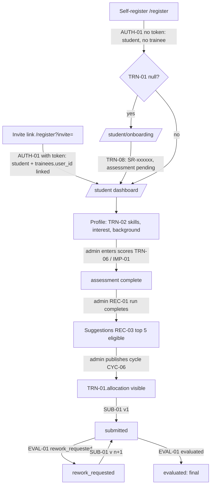
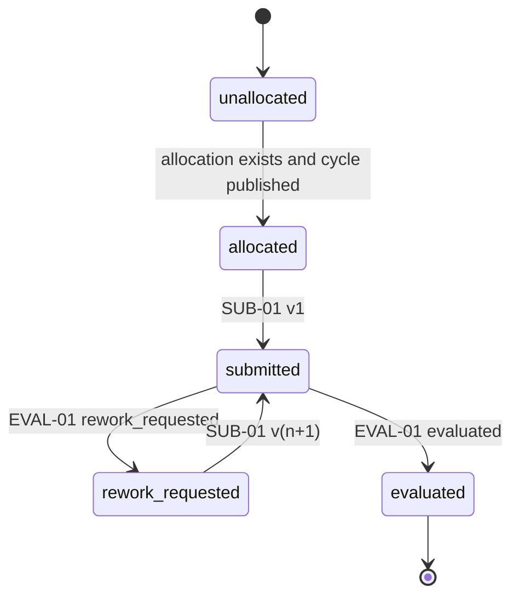
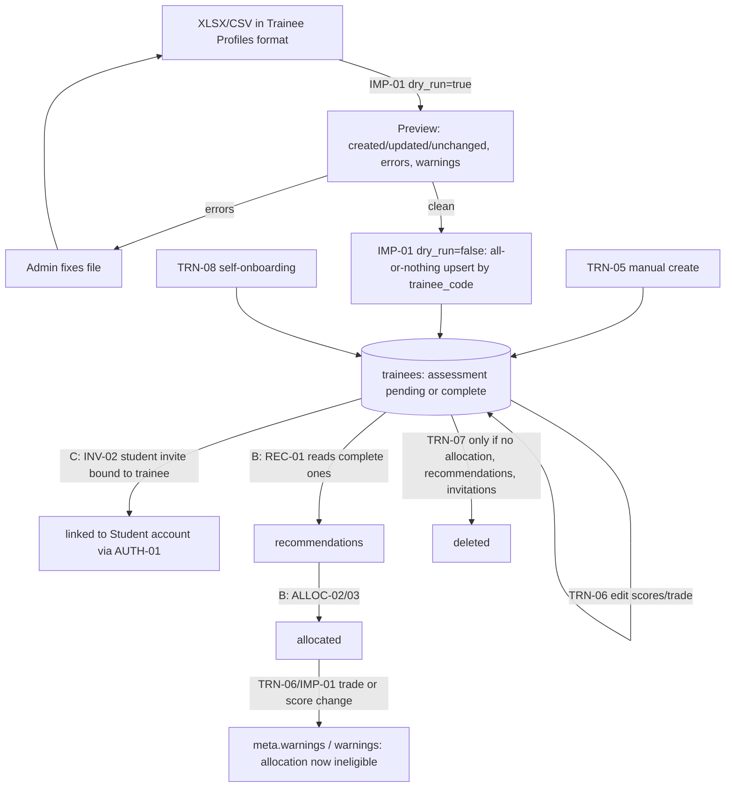

# Student Module Handbook (Teammate A)

**Status:** Proposed (Phase 3 handbook, rev 2.1). Derived from [api.md](api.md) rev 2.1 (including the binding §8 Clarifications C-1..C-30, which win over api.md §3/§5 text where more specific), [schema.md](schema.md), [frontend.md](frontend.md), [auth.md](auth.md), [roadmap.md](roadmap.md), [testing.md](testing.md), [requirements.md](requirements.md) and the Approved ADRs in [decisions.md](decisions.md). On any conflict, `api.md` and `schema.md` win. A change to an endpoint, field or code here goes into `api.md` first, through a lead-reviewed `contract/*` PR.

Terminology follows [requirements.md](requirements.md) §0: **Student** is the role (a trainee with a login), **Trainee** is the record in `app.trainees`, which may have no login.

---

## 1. Role and module responsibilities

Teammate A owns everything about the **trainee record** and the **submission** of project work, plus the Student-facing UI.

| Area | What A builds |
|---|---|
| Trainee data (backend) | `modules/trainees`: TRN-01, TRN-02, TRN-08 (student self-service) and TRN-03..TRN-07 (supervisor/admin data APIs that Teammate C's admin pages and Teammate B's supervisor pages call). Scoping, field-level write rules and gender privacy are A's responsibility even when the caller is an admin or supervisor page. |
| Imports (backend) | `modules/imports/parser.py` (shared XLSX/CSV reader, **built in Sprint 0** because seeds and C's IMP-02 depend on it) and `modules/imports/trainees.py` (IMP-01). |
| Submissions (backend) | `modules/submissions`: SUB-01..SUB-04 with student, supervisor and admin scoping, private file storage, version history and late flag. |
| Student UI | `features/student/*`: onboarding, dashboard, profile, suggested projects, catalogue, project detail, submission page, submission detail. |
| Shared views | `features/shared/TraineeProfileView` (used by A, B, C) and `features/shared/SubmissionDetailView` (used by A, B, C; B injects the evaluation form via `actions`). |

The brief's Student goals ([requirements.md](requirements.md) §1): keep background, interests and skills current; see suggested projects and why; see the final allocation; submit project work; see status, scores and feedback.

## 2. Scope boundaries

### 2.1 A owns (may create and change)

| Layer | Paths |
|---|---|
| API | `backend/app/modules/trainees/{router,schemas,service,repo,policies}.py` |
| API | `backend/app/modules/submissions/{router,schemas,service,repo,policies}.py` |
| API | `backend/app/modules/imports/parser.py`, `backend/app/modules/imports/trainees.py` (and the IMP-01 route) |
| API tests | `tests/unit/test_import_parser.py`, `tests/unit/test_file_sniffing.py`, `tests/unit/test_trainee_serializer.py`, `tests/integration/test_trainees*.py`, `tests/integration/test_import_trainees.py`, `tests/integration/test_submissions*.py`, A's rows in the authz matrix |
| Web | `frontend/src/features/student/**`, `frontend/src/features/shared/TraineeProfileView.tsx`, `frontend/src/features/shared/SubmissionDetailView.tsx` and their tests |
| Web | A's entries in `api/queryKeys.ts` (`qk.trainees.*`, `qk.submissions.*`) |
| E2E | `frontend/e2e/student-*.spec.ts` |

**Table write ownership** ([roadmap.md](roadmap.md) §1): A writes `trainees`, `trainee_skills`, `submissions` (insert only; `submissions.status` is written by B via EVAL-01). A never writes another module's table.

### 2.2 A must not change (consume as-is)

| Item | Owner |
|---|---|
| `core/*` (errors, security, deps, pagination, logging, tokens), `db/*`, **all migrations**, `storage/`, `audit.py`, `ai/` | F |
| `skills.service.resolve_names(session, names)` (the only way to create skills) | F |
| `reference.service.resolve_trade_names(session, names, create_missing: bool)` (the only way to create trades; C-5) | F |
| `progress.service.derive_progress(...)`, `recommendations.service.latest_completed_run(session, cycle_id)`, `recommendations.scoring.eligibility(trainee, project)` | B |
| `app/nav.ts`, `AppShell`, `AuthProvider`, `RequireRole`, `StudentGate`, `api/client.ts`, `api/upload.ts`, `api/errors.ts`, `lib/statusLabels.ts`, `components/shared/*`, `ProjectCard`, `ProjectDetailView` | F |
| `RecommendationCard`, `ProgressTable` | B |
| `features/admin/*` (C calls A's endpoints from there) | C |
| `docs/api.md`, `docs/schema.md`, `contracts/openapi.json` (regenerated, never hand-edited) | Lead |

### 2.3 Ask the lead before

- Adding, renaming or removing any endpoint, field, query parameter, sort value or error code.
- Any schema change (needs a migration PR by F).
- Changing the parser's public signature after CP0 (C and the seeds depend on it).
- Anything listed in §18.

### 2.4 Public functions A exposes

[roadmap.md](roadmap.md) §1 names these cross-module functions: `trainees.service.assessment_status(...)`, "the `Trainee` serializer", "the submissions scope predicate + `Submission` serializer (used by EVAL-01)". The signatures below are **adopted by [api.md](api.md) C-1 and frozen at CP0**. Per C-1, cross-module *service* functions take `session` first; serializers, policy predicates and the parser are pure and take no session. Changing any of them after CP0 needs a lead-reviewed contract PR.

```python
# app/modules/trainees/service.py
def assessment_status(session: Session, trainee: TraineeModel) -> AssessmentStatus:
    """'pending' if any of theory_score, practical_score, safety_score is None, else 'complete'."""

# app/modules/trainees/schemas.py   ("the Trainee serializer")
def serialize_trainee(trainee: TraineeModel, *, viewer: User) -> TraineeOut:
    """Builds the api.md §3 Trainee object. gender -> None unless viewer.role == 'admin'.
    account -> None unless viewer is admin or viewer.id == trainee.user_id."""

# app/modules/submissions/policies.py   ("the submissions scope predicate")
def submission_scope_predicate(viewer: User) -> ColumnElement[bool]:
    """SQL predicate over submissions JOIN allocations JOIN projects JOIN cycles JOIN trainees.
    student: trainees.user_id = viewer.id; supervisor: projects.supervisor_id = viewer.id AND
    cycles.status IN ('published','archived'); admin: true()."""
def can_view_submission(viewer: User, submission: SubmissionModel) -> bool: ...

# app/modules/submissions/schemas.py    ("the Submission serializer")
def serialize_submission(submission: SubmissionModel, *, viewer: User) -> SubmissionOut:
    """Builds the api.md §3 Submission object incl. nested Evaluation (or null). Never exposes file_path."""

# app/modules/imports/parser.py         (shared; used by imports.trainees, C's imports.projects, seeds)
def sniff_import_file(data: bytes, filename: str) -> Literal["xlsx", "csv"]: ...   # raises 415 AppError
def read_table(data: bytes, filename: str, *, sheet_name: str, header_marker: str) -> ParsedTable: ...
@dataclass(frozen=True)
class ParsedRow:    row_number: int; values: dict[str, str | None]      # keys = normalised header names
@dataclass(frozen=True)
class ParsedTable:  header_row: int; columns: list[str]; rows: list[ParsedRow]
def split_list(cell: str | None) -> list[str]: ...                       # comma split, trim, drop empty, dedupe (case-insensitive)
def parse_decimal(cell: str | None, *, min_value: Decimal, max_value: Decimal) -> Decimal | None: ...  # raises RowError

# app/modules/imports/trainees.py       (IMP-01 service; the seed script calls it, schema.md §8)
def import_trainees(session: Session, *, actor: User, cycle_id: UUID, data: bytes,
                    filename: str, dry_run: bool) -> ImportResult: ...
```

## 3. Pages and navigation

Student nav (declared only in `app/nav.ts`, [frontend.md](frontend.md) §2): Dashboard `/student` · My profile `/student/profile` · Suggested projects `/student/recommendations` · Project catalogue `/student/projects` · My project & submission `/student/submission`.
Non-nav routes owned by A: `/student/onboarding`, `/student/projects/:projectId`, `/student/submissions/:submissionId`.
All `/student/*` routes sit behind `RequireRole('student')` and `StudentGate` (F). Every page starts with `PageHeader`.

### 3.1 `/student/onboarding` — Complete your trainee profile

| Item | Spec |
|---|---|
| Purpose | A self-registered student has no trainee record (TRN-01 → `{"data": null}`). They pick a trade and describe themselves so the programme team can add scores. |
| Components | `PageHeader`, `FormField`, trade `select`, centre input, skills multi-input with SKL-01 autocomplete (`SkillChips` for chosen ones), career interest textarea, background textarea, info `Alert`. |
| Data | CYC-01 `GET /api/v1/cycles/current`, REF-01 `GET /api/v1/trades`, SKL-01 `GET /api/v1/skills?q=`, TRN-01 `GET /api/v1/trainees/me` |
| Action | TRN-08 `POST /api/v1/trainees/me` with `{"trade_id", "centre_name"?, "skills", "career_interest"?, "background"?}` |
| Copy | "Your assessment scores (theory, practical, safety) will be added by the programme team. Until then your suggestions stay pending." |
| Permission | Student only. `StudentGate` (F, C-9) reads CYC-01 first: with no active cycle it shows its "No active programme cycle" panel and never redirects here; with an active cycle and TRN-01 `null` it redirects here. On this page: if TRN-01 returns a record, `<Navigate to="/student" replace />`. Defensive only (direct URL, or the cycle closed meanwhile): if CYC-01 returns `null`, replace the form with `EmptyState` "No active programme cycle." (TRN-08 would return `409 NO_ACTIVE_CYCLE`.) |
| Loading | `LoadingState` until CYC-01, TRN-01 and REF-01 resolve. |
| Empty | No trades (REF-01 `[]`): `EmptyState` "Trades have not been set up yet. Contact your coordinator." |
| Success | Toast "Profile created". `await queryClient.invalidateQueries({queryKey: qk.trainees.all()})`, then `navigate('/student', {replace: true})`. |
| Error | `422` → inline field errors (`body.trade_id`, `body.skills`, …). `409 ACCOUNT_ALREADY_LINKED` → toast "You already have a profile" and invalidate + navigate to `/student`. `409 NO_ACTIVE_CYCLE` → switch to the no-cycle empty state. |
| Acceptance | Submitting a trade and two new skill names creates a record with code `SR-xxxxxx`, `assessment_status = "pending"`, and the student lands on the dashboard with the "Assessment pending" badge. A student who already has a record never sees the form. |

### 3.2 `/student` — Dashboard

| Item | Spec |
|---|---|
| Purpose | One glance: cycle state, deadline, assessment status, top suggestion, allocation, progress and the single next action. |
| Components | Cycle card (`StatusBadge kind="cycle"`, `DateTime` deadline), assessment card (`StatusBadge kind="assessment"`), top suggestion (`RecommendationCard compact perspective="trainee"`), allocation card, `ProgressTable` (own row) and a "Next step" card. |
| Data | CYC-01; TRN-01; REC-03 `GET /api/v1/recommendations?page_size=5` (scope forced to own eligible top 5 of the latest completed run of the active cycle; `run_id`/`cycle_id` ignored for students, C-19; render only the first, `compact`); PROG-01 `GET /api/v1/progress` (scope forced to own row). |
| Allocation card | Only when `trainee.allocation` is non-null (the API returns it only in a `published` cycle): `project.project_code`, `project.title` (link `/student/projects/{project.id}`), `ScoreBar` of `match_score` (hidden when `null`), supervisor `full_name`, `department` and `email` as a `mailto:` link (or "Supervisor to be confirmed" when `project.supervisor` is `null`). FR-17 factors (C-22): when `allocation.factors` is non-null, a collapsible "Why this project" list rendering each `Factor` (`label`, `points`/`max_points`, `detail`, "AI" tag when `ai_refined`); when `null` (manual allocation without a recommendation), the match score only. `override_reason` is always `null` for students and never rendered. |
| Progress | `ProgressTable rows={data} showTraineeColumn={false} showSupervisorColumn getRowHref={(r) => r.latest_submission ? `/student/submissions/${r.latest_submission.id}` : null}`. PROG-01 returns no row unless the trainee is allocated and the cycle is `published`/`archived`; then show "Not allocated yet" text instead of the table. |
| Next step | Derived client-side, first match wins: (1) CYC-01 `null` → "No active cycle". (2) `assessment_status = "pending"` → "Keep your profile up to date; the programme team will add your scores" → `/student/profile`. (3) cycle `draft` → "See your suggested projects" → `/student/recommendations`. (4) cycle `published`, no allocation → "Allocations are published, but you have not been allocated yet. Contact your coordinator." (5) progress `allocated` → "Submit your project work before {deadline}" → `/student/submission`. (6) `submitted` → "Version {n} is awaiting evaluation". (7) `rework_requested` → "Rework requested: read the feedback and submit a new version" → `/student/submission`. (8) `evaluated` → "Evaluated: grade {grade_label}" → `/student/submissions/{id}`. |
| Resume card | RES-02 (`qk.resumes.me()`): none → "Upload resume" link to `/student/profile`; `failed` → "Upload another file"; `extracted` → skills found, how many are not yet on the profile, and the upload date (ADR-015). |
| Loading | Each card loads independently with `LoadingState` (skeleton) in its slot. |
| Empty | REC-03 empty → card text per §3.4 empty rules. |
| Error | Per-card `ErrorState` with Retry; a failed card does not blank the page. |
| Acceptance | With the `published` seed and an invited student: the cycle chip says "Allocations published", the allocation card shows project, match score and supervisor email, the next step says "Submit your project work". With the `recommended` seed (draft cycle): no allocation card, top suggestion visible. |

### 3.3 `/student/profile` — My profile

| Item | Spec |
|---|---|
| Purpose | Read the programme-managed record; edit own skills, career interest and background. |
| Components | `TraineeProfileView trainee={me} showSensitive={false}`, info `Alert` "Trade, trainee code, centre and assessment scores are managed by the programme team. Ask your coordinator if something is wrong.", edit form (skills multi-input with SKL-01 autocomplete, career interest ≤ 300 with counter, background ≤ 2000 with counter). |
| Data | TRN-01 (reuse `qk.trainees.me()`), SKL-01 for autocomplete. |
| Action | TRN-02 `PATCH /api/v1/trainees/me` with `{"skills": [...], "career_interest": "...", "background": "..."}` (only these keys; never scores, trade, code, centre or gender). |
| Skills input | Free names allowed. Client trims, rejects names outside 1–80 chars, dedupes case-insensitively, and allows 0–20 names (C-4; server authoritative). Sending `[]` clears the skills. A cleared text field is sent as `""`, which the server turns into `null`. |
| Hint | "Changes are used the next time the programme team generates recommendations." |
| Loading / Error | `LoadingState`; `ErrorState` with Retry. |
| Success | Toast "Profile saved"; invalidate `qk.trainees.all()` and `qk.skills.list()` (no `q`, used as a prefix; see §18 N-1). |
| Errors | `422` → inline (`body.skills`, `body.career_interest`, `body.background`). `409 NO_ACTIVE_CYCLE` → invalidate `qk.cycles.current()` (StudentGate then shows its no-cycle panel). `409 NO_TRAINEE_RECORD` → invalidate `qk.trainees.me()` (StudentGate then redirects to onboarding). |
| Acceptance | Editing skills persists after reload; score fields are never inputs; the request body never contains other keys. |

#### 3.3a Resume panel on `/student/profile` (ADR-015, RES-01/02/04)

| Item | Spec |
|---|---|
| Purpose | Upload a resume. The AI suggests skills and lists projects, certifications and tools found in it. The student chooses which skills to add. |
| Components | `ResumePanel` (`features/student/ResumePanel.tsx`): a drop zone (drag and drop or browse; `.pdf,.docx`, ≤ 5 MB pre-checked client-side), "Download" button (RES-04), extraction card: suggested skills as toggle chips (`already_on_profile` pre-selected and disabled, `known_skill` badge), projects list, certifications, tools, career-interest hint with a "Use as career interest" button, `source` badge ("AI" / "Keyword match"). |
| Data | RES-02 `GET /trainees/me/resumes/latest` (`qk.resumes.me()`). |
| Upload | RES-01 multipart `file`. Progress as §12.3, then "Reading your resume…" while the server extracts (synchronous, no polling). On 201: write the response into `qk.resumes.me()` (the panel and the dashboard card update at once), toast "Resume read: review the suggestions below", and mark `qk.resumes.all()` stale. On an error: inline alert with the copy below and a "Try again" button that re-sends the same file. Uploading again replaces the current suggestions. |
| Apply | "Add selected skills" merges the chosen names with the saved skills and sends **TRN-02** `{skills}` (≤ 20 names in total; over the cap the button is disabled with a reason). The chips are marked optimistically in `qk.resumes.me()` and rolled back on error. On 200 the response is written into `qk.trainees.me()` (so the profile form remounts with the new skills), then `qk.trainees.all()`, `qk.resumes.all()` and `qk.skills.all()` are invalidated. "Use as career interest" sends TRN-02 `{career_interest}`. RES-01 never changes the profile by itself. |
| `status: failed` | `no_text` → "We couldn't read text from this file. Upload a text-based PDF or a DOCX (not a scan)." · `parse_error` → "This file couldn't be opened. Try saving it again as PDF." |
| Errors | `413` → "Resume must be 5 MB or smaller". `415` → "Upload a PDF or DOCX". `429 RATE_LIMITED` → "Too many uploads. Try again in an hour." `409 NO_ACTIVE_CYCLE` / `NO_TRAINEE_RECORD` as the profile form. `503` → `ErrorState`. |
| Acceptance | Uploading never changes skills until "Add selected skills" is saved; scores, trade and code are never derived from a resume. |

### 3.4 `/student/recommendations` — Suggested projects

| Item | Spec |
|---|---|
| Purpose | Show the student's own top 5 eligible suggestions with factor breakdown and AI explanation. |
| Components | Persistent banner (`Alert` info): "These are suggestions. Final allocation is decided by the programme team." List of `RecommendationCard recommendation={r} perspective="trainee" actions={<Link to={`/student/projects/${r.project.id}`}>View project</Link>}`. |
| Data | REC-03 `GET /api/v1/recommendations?page_size=5` (default sort `rank`). The server forces own trainee, `eligible`, `rank ≤ 5`, latest completed run of the active cycle (C-19). TRN-01 for the empty-state reason; CYC-01 for the allocation hint. |
| Allocation hint | If `trainee.allocation` is non-null, show a success `Alert` above the list: "You have been allocated to {project_code} {title}" → `/student/submission`. |
| Empty states (in order) | (1) CYC-01 `null` → "No active cycle". (2) `assessment_status = "pending"` → "Your assessment scores have not been entered yet, so suggestions are not available. The programme team will add them." (3) Otherwise REC-03 `[]` → "No suggestions yet. They appear after the programme team generates recommendations." (Per C-19 REC-03 returns `200 []` for both "no completed run" and "no eligible project", so one combined message is used.) |
| Loading / Error | `LoadingState`; `ErrorState` with Retry. |
| Permission | Visible in `draft` and `published` cycles, pending owner approval of D-3 ([roadmap.md](roadmap.md) §4). |
| Acceptance | Each card shows score, factor rows whose points add to the score, "AI" tag on refined factors, and the AI explanation as escaped text. At most 5 cards, all eligible. |

### 3.5 `/student/projects` — Project catalogue

| Item | Spec |
|---|---|
| Purpose | Browse published projects in the active cycle. |
| Components | Search input (`q`, debounced 300 ms), difficulty `select` (`beginner`/`intermediate`/`advanced`/any), removable trade chip "My trade: {trade.name} ×", grid of `ProjectCard project={p} to={`/student/projects/${p.id}`} badge={…}`, `Pagination` bound to `meta`. |
| Data | PRJ-01 `GET /api/v1/projects?trade_id={own trade}&q=&difficulty=&page=&page_size=20` (default sort `title`). Removing the chip omits `trade_id`. Filters are mirrored in the URL search params. REC-03 (same key as §3.4) to set the `badge`: when `p.id` matches a recommendation's `project.id`, badge = "Suggested · {score}". |
| Rules | `q` empty or whitespace is not sent; otherwise 1–100 chars ([api.md](api.md) §1). Students only ever see `published` projects in the active cycle; `stats` is `null` for students and must not be rendered. |
| Empty | With own-trade filter: "No published projects for your trade yet." + button "Show all trades". Without filters: "No projects are published yet." CYC-01 `null`: "No active cycle". |
| Loading / Error | `LoadingState`; `ErrorState`; a `422` (bad `q`) shows inline under the search box. |
| Acceptance | The page opens filtered to the own trade; clearing the chip lists other trades; search by title, code or category works. |

### 3.6 `/student/projects/:projectId` — Project detail

| Item | Spec |
|---|---|
| Components | `ProjectDetailView project={p} actions={…}` |
| Data | PRJ-02 `GET /api/v1/projects/{project_id}`; REC-03 (same key as §3.4). |
| `actions` slot | If the project is in the own REC-03 results: `<RecommendationCard recommendation={r} compact perspective="trainee" />`. If it is the own allocation (`trainee.allocation.project.id === p.id`): a "Your allocated project" badge and a link to `/student/submission`. Otherwise nothing. |
| Errors | `404` → `NotFound` (not visible to the student, e.g. draft or another cycle). |
| Acceptance | A suggested project shows its score and factors; a non-suggested one shows none; an unknown id shows NotFound. |

### 3.7 `/student/submission` — My project & submission

| Item | Spec |
|---|---|
| Purpose | See the allocation, submit work (v1, or v n+1 after rework), see history and the latest evaluation. |
| Components | Allocation panel; submit form (`FormField`, `FileField`, progress bar); `SubmissionDetailView` for the latest version with `history` and `historyHref`. |
| Data | CYC-01, TRN-01, SUB-02 `GET /api/v1/submissions?latest_only=false&sort=-submitted_at&page_size=50` (own, active cycle). |
| Allocation panel | When `trainee.allocation` is non-null: project code/title (link to detail), supervisor name, department and email, `ScoreBar` of `match_score`, the `allocation.factors` breakdown when non-null (C-22; same rendering as the dashboard card), cycle submission deadline. When `null`: reason panel "Allocations are not published yet" (cycle `draft`) or "You have not been allocated a project in this cycle. Contact your coordinator." (cycle `published`). |
| Form fields | `video_url` (https), `report_url` (https), `file` (≤ 10 MB; pdf, docx, pptx, zip, png, jpg/jpeg per C-12), `logbook_hours` (0–1000), `bom_cost_inr` (0–10,000,000, label "Bill of materials cost (INR)"), `note` (≤ 2000). Hint: "Provide at least one of: video link, report link, report file." |
| Allowed when | All true: cycle `published`; `trainee.allocation` non-null; latest version (history[0]) is absent or `rework_requested`. Otherwise the form is replaced or disabled **with the reason**: cycle not published → "Allocations are not published yet"; no allocation → "You have no allocated project"; latest `submitted` → "Version {n} is awaiting evaluation"; latest `evaluated` → "Your project has been evaluated. No further versions are accepted." |
| Late notice | If `now > cycle.submission_deadline`: warning "The deadline has passed. Your submission will be accepted but marked Late." |
| Action | SUB-01 `POST /api/v1/submissions` via `uploadMultipart<Submission>('/submissions', formData, {onProgress})`. Only non-empty fields are appended. Progress bar with `aria-live="polite"` percentage. Submit button disabled while in flight. |
| Success | Toast "Version {version} submitted"; reset the form; invalidate `qk.submissions.all()` and `qk.progress.all()`. |
| Errors | §9.3 mapping (field errors inline; `409` codes as a form-level alert plus refetch of SUB-02 and TRN-01). |
| Rework display | When the latest version is `rework_requested`, show its feedback (from `SubmissionDetailView`'s evaluation section) **above** the form. |
| Acceptance | v1 with a report link and a PDF succeeds and shows "Awaiting evaluation"; the form disappears with the reason; after supervisor rework the form reappears and v2 succeeds; after `evaluated` the rubric, total and grade show and the form never returns. |

### 3.8 `/student/submissions/:submissionId` — Submission detail

| Item | Spec |
|---|---|
| Components | `SubmissionDetailView submission={s} history={h} historyHref={(x) => `/student/submissions/${x.id}`}` (no `actions`). |
| Data | SUB-03 `GET /api/v1/submissions/{submission_id}`; then SUB-02 `GET /api/v1/submissions?latest_only=false&cycle_id={s.cycle_id}&sort=-submitted_at` filtered client-side to `allocation_id === s.allocation_id`. |
| Download | The view's button calls SUB-04 (§12.4). |
| Errors | `404` → `NotFound` (another trainee's submission is indistinguishable from an unknown id). |
| Acceptance | History lists every version with status badges; each links to its own detail; download opens the file. |

## 4. Workflows and state transitions

### 4.1 Student journey



### 4.2 Derived trainee progress (student view)



`progress` is derived only by B's `progress.service.derive_progress(...)` (served by PROG-01). A's UI never re-derives it for display; the "allowed to submit" check in §3.7 mirrors the server preconditions for UX only.

### 4.3 Submission version states (schema.md §6)

| From | Event | To | Server guard |
|---|---|---|---|
| none | student submits v1 | `submitted` | cycle `published`, allocation exists |
| `submitted` | supervisor `evaluated` | `evaluated` (final) | B: EVAL-01 |
| `submitted` | supervisor `rework_requested` | `rework_requested` | B: EVAL-01 |
| `rework_requested` | student submits | new row v n+1 `submitted` | `submissions_one_pending`, `submissions_version_key` |
| `submitted` | student submits | rejected | `409 SUBMISSION_PENDING` |
| `evaluated` | student submits | rejected | `409 SUBMISSION_ALREADY_EVALUATED` |

### 4.4 Admin-facing trainee data lifecycle (A's endpoints, C's pages)



## 5. Endpoint inventory

| ID | Method | Path | Owner | Used where |
|---|---|---|---|---|
| TRN-01 | GET | `/api/v1/trainees/me` | A | StudentGate (F), onboarding, dashboard, profile, suggestions, detail, submission |
| TRN-02 | PATCH | `/api/v1/trainees/me` | A | profile |
| TRN-08 | POST | `/api/v1/trainees/me` | A | onboarding |
| TRN-03 | GET | `/api/v1/trainees` | A | C admin trainees list; B supervisor trainee lists |
| TRN-04 | GET | `/api/v1/trainees/{trainee_id}` | A | C trainee detail; B supervisor trainee profile |
| TRN-05 | POST | `/api/v1/trainees` | A | C admin create trainee |
| TRN-06 | PATCH | `/api/v1/trainees/{trainee_id}` | A | C admin edit trainee (incl. scores) |
| TRN-07 | DELETE | `/api/v1/trainees/{trainee_id}` | A | C admin delete trainee |
| IMP-01 | POST | `/api/v1/admin/imports/trainees` | A | C admin import UI; seed script (service call) |
| SUB-01 | POST | `/api/v1/submissions` | A | submission page |
| SUB-02 | GET | `/api/v1/submissions` | A | submission page, submission detail; B evaluations list; C admin |
| SUB-03 | GET | `/api/v1/submissions/{submission_id}` | A | submission detail; B evaluation page |
| SUB-04 | GET | `/api/v1/submissions/{submission_id}/file-url` | A | `SubmissionDetailView` download (all roles) |
| AUTH-01 | POST | `/api/v1/auth/provision` | F | AuthProvider (registration, invite) |
| ME-01 | GET | `/api/v1/me` | F | AuthProvider |
| REF-01 | GET | `/api/v1/trades` | F | onboarding |
| SKL-01 | GET | `/api/v1/skills` | F | onboarding, profile autocomplete |
| CYC-01 | GET | `/api/v1/cycles/current` | F | AppShell chip, onboarding, dashboard, submission page |
| PRJ-01 | GET | `/api/v1/projects` | F | catalogue |
| PRJ-02 | GET | `/api/v1/projects/{project_id}` | F | project detail |
| REC-03 | GET | `/api/v1/recommendations` | B | dashboard, suggestions, catalogue badge, project detail |
| PROG-01 | GET | `/api/v1/progress` | B | dashboard |

## 6. Request/response examples (A-owned endpoints)

All examples follow [api.md](api.md) §3. `"uuid"` and `"…"` are placeholders as in api.md. Every error body has the shape `{"error": {"code", "message", "details": [{"field", "message"}], "request_id"}}`. Every response sends `Cache-Control: no-store`. Error lists below are in **check precedence order** ([api.md](api.md) §1); the first failing check wins. Steps 1–3 (`401 UNAUTHENTICATED`, `403 NOT_PROVISIONED`/`ACCOUNT_DISABLED`, `403 FORBIDDEN` for a role not in the endpoint's list) apply to every endpoint and are written "auth" below.

### 6.1 TRN-01 `GET /api/v1/trainees/me` (student)

Published cycle, allocated (`allocation` is the full `Allocation` object per C-22: `override_reason` present and `null` for students, `factors` from the linked recommendation or `null`, `project.supervisor.department` included):

```jsonc
{"data": {
  "id": "uuid", "cycle_id": "uuid", "trainee_code": "TRN-EL-002", "full_name": "Priya Sharma",
  "gender": null,
  "trade": {"id": "uuid", "name": "Electrician"},
  "centre_name": "Tata STRIVE SDC - Pune",
  "scores": {"theory": 91.0, "practical": 94.0, "safety": 98.0},
  "assessment_status": "complete",
  "skills": [{"id": "uuid", "name": "Solar Wiring"}, {"id": "uuid", "name": "Microcontrollers"}, {"id": "uuid", "name": "IoT"}],
  "career_interest": "Renewable Energy Systems",
  "background": null,
  "account": {"user_id": "uuid", "email": "priya@example.org"},
  "created_at": "…", "updated_at": "…",
  "allocation": {
    "id": "uuid", "cycle_id": "uuid",
    "trainee": {"id": "uuid", "trainee_code": "TRN-EL-002", "full_name": "Priya Sharma", "trade": {"id": "uuid", "name": "Electrician"}},
    "project": {"id": "uuid", "project_code": "PRJ-EL-101", "title": "Dual-Axis Automatic Solar Tracking System",
                "supervisor": {"id": "uuid", "full_name": "Dr. Mehta", "email": "mehta@strive.org", "department": "Electrical"}},
    "source": "auto", "match_score": 93.4, "recommendation_id": "uuid",
    "factors": [
      {"key": "practical_readiness", "label": "Practical score vs requirement", "points": 32.67, "max_points": 35,
       "detail": "Practical 94% vs required 85% (+9)", "ai_refined": false}
      /* , … one Factor per key; Σ points = match_score */
    ],
    "is_override": false, "override_reason": null,
    "created_by": {"id": "uuid", "full_name": "Admin"}, "created_at": "…", "updated_at": "…"}
}}
```

Draft cycle: same object with `"allocation": null`. No record, or no active cycle: `{"data": null}`.
Errors: auth (supervisor/admin → `403 FORBIDDEN`).

### 6.2 TRN-02 `PATCH /api/v1/trainees/me` (student)

```json
{"skills": ["Solar Wiring", "Microcontrollers", "IoT", "PLC Logic"],
 "career_interest": "Renewable Energy Systems",
 "background": "Built a small solar charger for my village school."}
```

`200 {"data": <Trainee>}` (no `allocation` key). Rules: every key optional; `skills` 0–20 names (C-4), each 1–80 after trim, deduplicated case-insensitively, resolved through `skills.service.resolve_names(session, names)`, **replaces** the set; `career_interest` ≤ 300; `background` ≤ 2000; `""` → `null`.

Errors in order:
1. auth
2. `422 VALIDATION_ERROR`, unknown key (mass-assignment defence):
```json
{"error": {"code": "VALIDATION_ERROR", "message": "Invalid request.",
  "details": [{"field": "body.scores", "message": "Extra inputs are not permitted"}], "request_id": "…"}}
```
   Same for `trade_id`, `trainee_code`, `centre_name`, `gender`, `full_name`; also length and count violations.
3. `409 NO_ACTIVE_CYCLE` (C-8)
4. `409 NO_TRAINEE_RECORD` (no linked trainee in the active cycle). There is no `INVALID_STATE` case (removed by C-8).

### 6.3 TRN-08 `POST /api/v1/trainees/me` (student, self-onboarding)

```json
{"trade_id": "uuid", "centre_name": "Tata STRIVE SDC - Pune",
 "skills": ["Circuit Wiring", "Multimeter"], "career_interest": "Industrial Automation & Solar", "background": null}
```

`201`:
```json
{"data": {
  "id": "uuid", "cycle_id": "uuid", "trainee_code": "SR-4K7Q2M", "full_name": "Ramesh Kumar",
  "gender": null,
  "trade": {"id": "uuid", "name": "Electrician"},
  "centre_name": "Tata STRIVE SDC - Pune",
  "scores": {"theory": null, "practical": null, "safety": null},
  "assessment_status": "pending",
  "skills": [{"id": "uuid", "name": "Circuit Wiring"}, {"id": "uuid", "name": "Multimeter"}],
  "career_interest": "Industrial Automation & Solar",
  "background": null,
  "account": {"user_id": "uuid", "email": "ramesh@example.org"},
  "created_at": "…", "updated_at": "…"}}
```

Server behaviour (C-7, C-4): active cycle (`draft|published`); `trainee_code` = `SR-` + 6 random chars from `[A-Z0-9]`, regenerated on a `trainees_cycle_code_key` clash; scores `null`; `gender` `null`; `user_id` = caller; `full_name` copied from `users.full_name`; `skills` 0–20 names, each 1–80.
Errors in order:
1. auth
2. `422 VALIDATION_ERROR` (unknown key, e.g. `scores`; missing `trade_id` or `skills`; lengths)
3. `409 NO_ACTIVE_CYCLE`
4. `422 VALIDATION_ERROR` `[{"field": "body.trade_id", "message": "Unknown trade"}]`
5. `409 ACCOUNT_ALREADY_LINKED` (the caller already has a trainee in this cycle; also mapped from `trainees_cycle_user_key` on a race)

### 6.4 TRN-03 `GET /api/v1/trainees` (supervisor, admin)

Query: `cycle_id` (default active), `trade_id`, `assessment_status` (`pending|complete`), `allocated` (`true|false`, admin), `linked` (`true|false`, admin), `has_open_invitation` (`true|false`, admin; C-10), `q` (name/code/centre), `page`, `page_size`, `sort` ∈ {`full_name` (default), `trainee_code`, `-practical_score`}. Admin-only filters sent by a supervisor are **ignored**, not rejected (C-2). `-practical_score` puts nulls last, then sorts by `full_name` (C-2).

Supervisor `200` (only trainees allocated to own projects in a `published|archived` cycle; `gender` and `account` null):
```json
{"data": [{
  "id": "uuid", "cycle_id": "uuid", "trainee_code": "TRN-EL-002", "full_name": "Priya Sharma",
  "gender": null, "trade": {"id": "uuid", "name": "Electrician"}, "centre_name": "Tata STRIVE SDC - Pune",
  "scores": {"theory": 91.0, "practical": 94.0, "safety": 98.0}, "assessment_status": "complete",
  "skills": [{"id": "uuid", "name": "Solar Wiring"}], "career_interest": "Renewable Energy Systems",
  "background": null, "account": null, "created_at": "…", "updated_at": "…"}],
 "meta": {"page": 1, "page_size": 20, "total": 1}}
```
Admin: same item shape with `gender` and `account` populated. No active cycle or unknown `cycle_id` → `200` with `[]` and `total: 0`. Supervisor in a `draft` cycle → `200 []`.
Errors: auth (student → `403 FORBIDDEN`) → `422` (sort not in the allowlist, `q` > 100 chars, bad enum/boolean/uuid, `page_size` out of 1–100).

### 6.5 TRN-04 `GET /api/v1/trainees/{trainee_id}` (student own, supervisor scoped, admin)

`200 {"data": <Trainee>}` (no `allocation` key; field privacy as TRN-03; a student reading their own record gets `account`). A student may read **their own** records in any cycle (C-10).
Errors: auth → `404 NOT_FOUND` (outside scope or unknown; never 403 for an invisible record).

### 6.6 TRN-05 `POST /api/v1/trainees` (admin)

```json
{"cycle_id": "uuid", "trainee_code": "TRN-EL-013", "full_name": "Asha Pawar", "gender": "female",
 "trade_id": "uuid", "centre_name": "Tata STRIVE SDC - Pune",
 "scores": {"theory": 81, "practical": 87, "safety": 92},
 "skills": ["Circuit Wiring", "Solar Wiring"], "career_interest": "Solar installation", "background": null}
```
`201 {"data": <Trainee>}` (admin view, `account: null`). Rules ([schema.md](schema.md) §4): `trainee_code` `^[A-Za-z0-9-]{1,40}$` (unique per cycle, case-insensitive); `full_name` 1–120; `gender` ∈ `female|male|other|undisclosed` or null; scores 0–100 each, optional; `centre_name` ≤ 120; `career_interest` ≤ 300; `background` ≤ 2000; skills 0–20 names, 1–80 each (C-4). Never sets `user_id`. Audit `trainee.created {trainee_code}` (C-29; never gender).
Errors in order: auth → `422` shape → `422` `body.cycle_id` unknown → `409 INVALID_STATE` (cycle archived, C-3) → `422` `body.trade_id` unknown → `409 DUPLICATE_CODE`.

### 6.7 TRN-06 `PATCH /api/v1/trainees/{trainee_id}` (admin)

```json
{"trade_id": "uuid", "scores": {"practical": 80}}
```
`200`, with warnings when an allocated trainee becomes ineligible (computed with B's `recommendations.scoring.eligibility(trainee, project)`):
```json
{"data": <Trainee>, "meta": {"warnings": ["Allocation to PRJ-EL-101 is now ineligible: trade_mismatch, below_min_practical"]}}
```
Any subset of the TRN-05 fields except `cycle_id` (`cycle_id` → 422 unknown field). `scores` is a partial object: only given keys change; an explicit `null` clears that score (assessment becomes `pending`). `skills` replaces the set. Skills 0–20 names (C-4). Never touches `user_id`. Same input twice → same state ([api.md](api.md) §6). Audit `trainee.updated {changed: ["trade_id", "scores.practical"]}` (C-29; field names only, never values; never gender values).
Errors in order: auth → `422` shape → `404 NOT_FOUND` → `409 INVALID_STATE` (cycle archived, C-3) → `422` `body.trade_id` unknown → `409 DUPLICATE_CODE`.

### 6.8 TRN-07 `DELETE /api/v1/trainees/{trainee_id}` (admin)

`204` (no body). `trainee_skills` cascade. Audit `trainee.deleted {trainee_code}` (C-29).
Errors in order: auth → `404 NOT_FOUND` → `409 INVALID_STATE` (cycle archived, C-3) → `409 RESOURCE_IN_USE` (has an allocation, recommendations or invitations; checked explicitly and also mapped from the FK violation):
```json
{"error": {"code": "RESOURCE_IN_USE", "message": "This trainee is referenced and cannot be deleted.",
  "details": [{"field": "trainee_id", "message": "Has recommendations in 1 run"}], "request_id": "…"}}
```

### 6.9 IMP-01 `POST /api/v1/admin/imports/trainees` (admin)

`multipart/form-data`: `file` (.xlsx or .csv, ≤ 5 MB), `cycle_id` (uuid), `dry_run` (`true|false`, default `true`).

**Column mapping (dataset "Trainee Profiles" sheet; header on sheet row 3 below the title "ITI Trainee Reference Dataset"; data rows 4–15)**

| Dataset column | Required | Trainee field | Rule |
|---|---|---|---|
| `Trainee ID` | column + value | `trainee_code` | `^[A-Za-z0-9-]{1,40}$`; upsert key, case-insensitive; blank → row error; duplicate in the same file → row error **on the later row** (C-11) |
| `Full Name` | column + value | `full_name` | 1–120; blank → row error |
| `Gender` | column; value optional | `gender` | `Male`→`male`, `Female`→`female`, `Other`→`other` (case-insensitive); blank → `null`; anything else → row error |
| `ITI Trade` | column + value | `trade_id` | blank → row error; resolved via F's `reference.service.resolve_trade_names(session, names, create_missing=True)` (C-5); new trades listed in `created_trades` |
| `ITI Name` | column; value optional | `centre_name` | ≤ 120 |
| `Trade Theory Score (%)` | column; value optional | `theory_score` | number 0–100; blank → `null` (assessment pending) |
| `Workshop Practical Score (%)` | column; value optional | `practical_score` | number 0–100; blank → `null` |
| `Safety Compliance Score (%)` | column; value optional | `safety_score` | number 0–100; blank → `null` |
| `Core Skills Demonstrated` | column; value optional | `skills` | comma-separated; 0–20 names, each trimmed, 1–80 (C-4); deduplicated case-insensitively; resolved via `skills.service.resolve_names(session, names)`; new names listed in `created_skills`; replaces the set on update |
| `Primary Career Interest` | column; value optional | `career_interest` | ≤ 300 |
| `Allocation Status` | no | — | **ignored** (A-10) |
| `Background` | optional column | `background` | ≤ 2000 |
| any other column | — | — | ignored |

Blank optional cell = `null` and **clears** the field on update (C-11). "Column" in the table means the header must exist; a missing required column is a file-level error.

**Parser rules (`modules/imports/parser.py`, shared with IMP-02; IMP-01 and IMP-02 behave identically per C-11)**
1. Sniff: `.xlsx` must start with the ZIP signature `PK\x03\x04` and contain `xl/workbook.xml`; `.csv` must decode as UTF-8 (BOM stripped) and contain no NUL bytes. Extension **and** signature must agree, else `415 UNSUPPORTED_FILE_TYPE`. Size checked while reading the upload stream; > 5 MB → `413 FILE_TOO_LARGE`.
2. XLSX: `openpyxl.load_workbook(BytesIO(data), read_only=True, data_only=True)` (cached values only; formulas and macros never evaluated). Use the sheet named `Trainee Profiles` (IMP-02: `Project Catalog`), else the first sheet. CSV: `csv` module, delimiter `,`.
3. Header row = the **first row containing a cell equal to the marker** (`Trainee ID`; IMP-02 `Project ID`) after trim and case-folding. Rows above it (titles, blank rows) are skipped.
4. Header matching: trim, collapse inner whitespace, case-insensitive. Unknown columns are ignored.
5. Data rows: rows after the header; a row where every cell is blank is skipped. Cell values are converted to trimmed strings (`88` → `"88"`, `88.0` → `"88"`, `None`/`""` → `None`).
6. `row_number` = the 1-based sheet row number (C-11): header = 3, first trainee = 4 in the dataset; for CSV, the 1-based line number.
6a. File-level checks (C-11): no header row found, or a required column missing → file-level error `{"row": null, "column": "<name>", "message": …}`; more than 2000 data rows → file-level error.
7. Numbers: accept integers and decimals (`.` separator) and an optional trailing `%`; must be within the column's range; stored as `numeric(5,2)`.
8. CSV and XLSX of the same content produce identical `ParsedTable.rows`.

**Import service rules (`modules/imports/trainees.py`)**: lock the cycle `FOR SHARE`; parse and validate **all** rows first; if `dry_run=false` and any row or file-level error exists → `422 IMPORT_INVALID`, nothing written; else upsert every row by `upper(trainee_code)` in the cycle, never touching `user_id`; count `created` / `updated` / `unchanged` over **valid rows only** (a row is `unchanged` when every mapped field and the skill set equal the stored values); compute `warnings` for allocated trainees that become ineligible via `eligibility(trainee, project)`; responses **always** include `errors` (possibly `[]`) and `warnings`; write one audit event `import.trainees {rows, created, updated}` **only when applied** (C-11, C-29; no names or codes). Dry runs never write and never audit.

Dry run (`dry_run=true`) on the provided dataset into an empty cycle, `200`:
```json
{"data": {"applied": false, "rows": 12, "created": 12, "updated": 0, "unchanged": 0,
  "created_trades": ["Electrician", "Fitter", "Welder", "COPA", "Mechanic Motor Vehicle", "Solar Technician"],
  "created_skills": ["Circuit Wiring", "PLC Logic", "Multimeter", "…"],
  "warnings": [], "errors": []}}
```
Dry run with a bad row, `200` (nothing written; counts cover the 11 valid rows):
```json
{"data": {"applied": false, "rows": 12, "created": 11, "updated": 0, "unchanged": 0,
  "created_trades": [], "created_skills": [], "warnings": [],
  "errors": [{"row": 7, "column": "Workshop Practical Score (%)", "message": "must be a number 0–100"}]}}
```
Apply (`dry_run=false`), `200`: same shape with `"applied": true`. Re-importing the same file → `"created": 0, "updated": 0, "unchanged": 12`.
Apply with a bad row, `422`, nothing written:
```json
{"error": {"code": "IMPORT_INVALID", "message": "The import file has errors. Nothing was imported.",
  "details": [{"field": "row 7: Workshop Practical Score (%)", "message": "must be a number 0–100"},
              {"field": "row 11: Gender", "message": "must be Male, Female or Other"}],
  "request_id": "…"}}
```
File-level error (required column missing). Dry run, `200`:
```json
{"data": {"applied": false, "rows": 12, "created": 0, "updated": 0, "unchanged": 0,
  "created_trades": [], "created_skills": [], "warnings": [],
  "errors": [{"row": null, "column": "Workshop Practical Score (%)", "message": "required column is missing"}]}}
```
Apply, `422`:
```json
{"error": {"code": "IMPORT_INVALID", "message": "The import file has errors. Nothing was imported.",
  "details": [{"field": "file", "message": "Required column is missing: Workshop Practical Score (%)"}],
  "request_id": "…"}}
```
Errors in order: auth → `422 VALIDATION_ERROR` (missing `file`/`cycle_id`, bad uuid, bad `dry_run`) / `413 FILE_TOO_LARGE` / `415 UNSUPPORTED_FILE_TYPE` → `422 VALIDATION_ERROR` `[{"field": "body.cycle_id", "message": "Unknown cycle"}]` (C-11) → `409 INVALID_STATE` (cycle archived, C-3) → `422 IMPORT_INVALID` (apply) or `200` with `errors` (dry run).

### 6.10 SUB-01 `POST /api/v1/submissions` (student)

`multipart/form-data` (all optional individually; at least one of the first three):

| Field | Rule |
|---|---|
| `video_url` | `https://…`, ≤ 2048 |
| `report_url` | `https://…`, ≤ 2048 |
| `file` | ≤ 10 MB; extension and sniffed content in {pdf, docx, pptx, zip, png, jpg/jpeg} (C-12); stored MIME derived from family + extension (§14.3); original names over 255 chars are truncated by sanitisation (extension kept), not rejected (C-12) |
| `logbook_hours` | number 0–1000; rounded half-up to 1 decimal (C-12) |
| `bom_cost_inr` | number 0–10,000,000 |
| `note` | ≤ 2000 |

`201`:
```json
{"data": {"id": "uuid", "cycle_id": "uuid", "allocation_id": "uuid", "version": 1, "status": "submitted", "is_late": false,
  "trainee": {"id": "uuid", "trainee_code": "TRN-EL-002", "full_name": "Priya Sharma"},
  "project": {"id": "uuid", "project_code": "PRJ-EL-101", "title": "Dual-Axis Automatic Solar Tracking System"},
  "submitted_by": {"id": "uuid", "full_name": "Priya Sharma"}, "submitted_at": "2026-10-05T09:00:00Z",
  "note": null, "video_url": null, "report_url": "https://…",
  "file": {"name": "report.pdf", "size_bytes": 482113, "mime_type": "application/pdf"},
  "logbook_hours": 36.0, "bom_cost_inr": 1250.00,
  "evaluation": null}}
```
Errors in order:
1. auth (supervisor/admin → `403 FORBIDDEN`)
2. `422 VALIDATION_ERROR` / `413 FILE_TOO_LARGE` / `415 UNSUPPORTED_FILE_TYPE`:
```json
{"error": {"code": "VALIDATION_ERROR", "message": "Invalid request.",
  "details": [{"field": "body", "message": "Provide a video link, report link or file"}], "request_id": "…"}}
```
```json
{"error": {"code": "UNSUPPORTED_FILE_TYPE", "message": "This file type is not allowed.",
  "details": [{"field": "body.file", "message": "Allowed: pdf, docx, pptx, zip, png, jpg, jpeg"}], "request_id": "…"}}
```
3. `409 NO_ACTIVE_CYCLE`
4. `409 INVALID_STATE` (active cycle is `draft`)
5. `409 NO_TRAINEE_RECORD`
6. `409 NOT_ALLOCATED`
7. `409 SUBMISSION_PENDING` (latest is `submitted`; also from `submissions_one_pending`)
8. `409 SUBMISSION_ALREADY_EVALUATED` (latest is `evaluated`; also from `submissions_one_evaluated`)
9. `503 SERVICE_UNAVAILABLE` (Storage or DB unreachable; Storage timeout 20 s)

### 6.11 SUB-02 `GET /api/v1/submissions`

Query: `cycle_id` (default active), `trainee_id`, `project_id`, `status` (`submitted|evaluated|rework_requested`), `latest_only` (default `true`; latest version per allocation chosen **before** `status` filtering), `page`, `page_size`, `sort` ∈ {`-submitted_at` (default), `submitted_at`}.
Scope: student → own trainee records (any cycle); supervisor → allocations on projects whose current `supervisor_id` = caller, cycle `published|archived`; admin → all. Filters narrow within the scope (a student passing another `trainee_id` gets `[]`).
`200 {"data": [<Submission>…], "meta": {"page": 1, "page_size": 20, "total": 2}}`. No active cycle or unknown `cycle_id` → `200 []`.
Errors: auth → `422` (sort, enum, boolean, uuid, paging).

### 6.12 SUB-03 `GET /api/v1/submissions/{submission_id}`

`200 {"data": <Submission>}`. `evaluation` is populated whenever an evaluation row exists, for both outcomes (C-25). Rework example:
```json
{"data": {"id": "uuid", "cycle_id": "uuid", "allocation_id": "uuid", "version": 1, "status": "rework_requested", "is_late": false,
  "trainee": {"id": "uuid", "trainee_code": "TRN-EL-002", "full_name": "Priya Sharma"},
  "project": {"id": "uuid", "project_code": "PRJ-EL-101", "title": "…"},
  "submitted_by": {"id": "uuid", "full_name": "Priya Sharma"}, "submitted_at": "2026-10-05T09:00:00Z",
  "note": null, "video_url": "https://…", "report_url": null, "file": null,
  "logbook_hours": 30.0, "bom_cost_inr": 1100.00,
  "evaluation": {"id": "uuid", "outcome": "rework_requested",
    "scores": {"workmanship": null, "functional_demo": null, "safety_sop": null, "documentation": null, "viva": null},
    "total_score": null, "grade": null, "grade_label": null,
    "feedback": "Tracker drifts after 10 minutes; recalibrate the LDR divider and resubmit the demo video.",
    "evaluator": {"id": "uuid", "full_name": "Dr. Mehta"}, "created_at": "…"}}}
```
Errors: auth → `404 NOT_FOUND`.

### 6.13 SUB-04 `GET /api/v1/submissions/{submission_id}/file-url`

`200 {"data": {"url": "…", "expires_in": 300, "file_name": "report.pdf"}}` (Supabase signed URL, 5 minutes).
Errors: auth → `404 NOT_FOUND` (outside scope, or the version has no file) → `503 SERVICE_UNAVAILABLE`.

### 6.14 RES-01..04 — resume (ADR-015)

Contract and the `Resume` object: [api.md](api.md) §5 RES. A owns `backend/app/modules/resumes/` (router, schemas, service, repo, policies) and the table `trainee_resumes`. The extraction itself is `ai/spa_ai/resume/` (A writes it, on F's `spa_ai.llm` client).
Service order for RES-01: role → active cycle / trainee record (409s) → rate limit (≤ 5 rows for the trainee in the last hour, else `429`) → size/extension/signature (413/415) → Storage upload `{cycle_id}/{trainee_id}/{resume_id}.{ext}` → `spa_ai.resume.extract(file_bytes, mime, known_skills, redact_terms=[full_name, trainee_code, centre_name])` → insert row (on failure, delete the object). Never log resume text or extraction output.
Policies: `can_view_resume(user, trainee)` = own trainee (student) · TRN-03 scope (supervisor) · admin. `can_download_resume(user, trainee)` = own (student) · admin.

## 7. AuthN / AuthZ

### 7.1 Router-level roles (`require_roles(...)`)

| Endpoint | Roles |
|---|---|
| TRN-01, TRN-02, TRN-08, SUB-01 | `student` |
| TRN-03 | `supervisor`, `admin` |
| TRN-04, SUB-02, SUB-03, SUB-04 | `student`, `supervisor`, `admin` |
| TRN-05, TRN-06, TRN-07, IMP-01 | `admin` |

### 7.2 `trainees/policies.py`

| Function | Rule |
|---|---|
| `trainee_scope_predicate(viewer) -> ColumnElement[bool]` | student: `trainees.user_id = viewer.id`; supervisor: `EXISTS (allocations a JOIN projects p JOIN cycles c WHERE a.trainee_id = trainees.id AND p.supervisor_id = viewer.id AND c.status IN ('published','archived'))`; admin: `true()` |
| `can_view_trainee(viewer, trainee) -> bool` | same rule for a loaded row (TRN-04) |
| `can_see_gender(viewer) -> bool` | `viewer.role == 'admin'` |
| `can_see_account(viewer, trainee) -> bool` | admin, or `trainee.user_id == viewer.id` |

Supervisor scope reads `allocations`, `projects`, `cycles` read-only in A's `repo.py` (allowed by [roadmap.md](roadmap.md) §1). Because scope uses the project's **current** `supervisor_id`, reassigning a project moves access immediately (edge case 10).

### 7.3 `submissions/policies.py`

| Function | Rule |
|---|---|
| `submission_scope_predicate(viewer)` | student: owning trainee's `user_id = viewer.id` (any cycle); supervisor: allocation's project `supervisor_id = viewer.id` and cycle `published|archived`; admin: all |
| `can_view_submission(viewer, submission)` | same rule for a loaded row (SUB-03, SUB-04; reused by B in EVAL-01 for its 404) |

### 7.4 Field-level write rules

| Field | Student (TRN-02/TRN-08) | Admin (TRN-05/06, IMP-01) | Supervisor |
|---|---|---|---|
| `skills`, `career_interest`, `background` | own record (TRN-02); set at onboarding (TRN-08) | yes | never |
| `trade_id` | **only at onboarding** (TRN-08, own new record); never changed afterwards | yes | never |
| `centre_name` | **only at onboarding** (TRN-08); never changed afterwards | yes | never |
| `scores.*` (`theory`, `practical`, `safety`) | never (422 unknown field) | yes | never |
| `trainee_code` | never (server-generated `SR-…` at onboarding) | yes | never |
| `full_name` | never via TRN (name changes go through ME-02) | yes | never |
| `gender` | never | yes (admin only; never read by scoring or Groq; never in audit metadata) | never |
| `user_id` | set to self at TRN-08 only | never via TRN/IMP (linking happens in AUTH-01) | never |
| `cycle_id` | server-set (active cycle) | TRN-05 only; immutable | never |

Enforced by separate Pydantic input models per endpoint with `ConfigDict(extra="forbid", str_strip_whitespace=True)`: `TraineeSelfUpdate` (3 keys), `TraineeSelfCreate`, `TraineeCreate`, `TraineeUpdate`.

## 8. Database entities and permitted operations

| Table | A's operations | Conditions |
|---|---|---|
| `trainees` | INSERT (TRN-05, TRN-08, IMP-01); UPDATE (TRN-02: 3 fields; TRN-06, IMP-01: admin fields); DELETE (TRN-07) | Delete only when no `allocations`, `recommendations`, `invitations` reference it |
| `trainee_skills` | DELETE + INSERT (replace set) in the same transaction as the trainee write | |
| `submissions` | INSERT only (SUB-01); SELECT | Never UPDATE (B updates `status` in EVAL-01) or DELETE |
| `skills` | via F's `skills.service.resolve_names(session, names)` only | |
| `trades` | SELECT (TRN-05/06/08 `trade_id` validation); IMP-01 resolves/creates only via F's `reference.service.resolve_trade_names(session, names, create_missing=True)` | Trades are F-owned (C-5); A never writes `trades` directly |
| `cycles` | SELECT; `FOR SHARE` lock | |
| `allocations` | SELECT; `FOR UPDATE` lock in SUB-01 (no writes) | |
| `projects`, `evaluations`, `users`, `recommendations`, `invitations` | SELECT (scope joins, serializers, TRN-07 reference checks) | |
| `audit_events` | INSERT via `audit.record(...)` in the same transaction | C-29: `trainee.created {trainee_code}`, `trainee.updated {changed: [field names]}`, `trainee.deleted {trainee_code}`, `import.trainees {rows, created, updated}` (applied imports only) |

### 8.1 Transactions and locks (lock order: cycle → trainee → project → allocation → submission)

| Operation | Steps |
|---|---|
| TRN-02 / TRN-06 (schema.md §7 "Trainee edit") | `SELECT cycle FOR SHARE` (TRN-06: not archived, C-3); `SELECT trainee FOR UPDATE`; validate; update columns; `resolve_names`; replace `trainee_skills`; (TRN-06) compute warnings via `eligibility()`; audit; commit |
| TRN-08 (schema.md §7 "Trainee create") | `SELECT active cycle FOR SHARE`; check no own trainee in cycle; insert trainee (`SR-` code, regenerated on `trainees_cycle_code_key` clash); `resolve_names`; insert `trainee_skills`; commit. Race → `trainees_cycle_user_key` → `ACCOUNT_ALREADY_LINKED` |
| TRN-05 (schema.md §7 "Trainee create") | `SELECT cycle FOR SHARE` (not archived); insert; skills; audit. `trainees_cycle_code_key` → `DUPLICATE_CODE` |
| TRN-07 (schema.md §7 "Trainee delete") | `SELECT cycle FOR SHARE` (not archived); `SELECT trainee FOR UPDATE`; reference checks; delete; audit; FK violation → `RESOURCE_IN_USE` |
| IMP-01 | `SELECT cycle FOR SHARE`; parse + validate all rows; `SELECT` existing trainees of the cycle by code `FOR UPDATE` (id order); upsert all; replace skills; one audit event; commit. Dry run: same reads, then `ROLLBACK` (so `resolve_names` creates nothing) |
| SUB-01 | Validate fields + file in memory first (precedence step 4). Then: `SELECT active cycle FOR SHARE` (must be `published`); load own trainee; `SELECT allocation FOR UPDATE`; read latest version status; generate `submission_id`; upload to `{cycle_id}/{allocation_id}/{submission_id}.{ext}`; `INSERT version = max+1`; commit. Any failure after upload → `storage.delete(path)` (compensation), then re-raise |

### 8.2 Constraint → error mapping relevant to A (`core/errors.py`, F)

| Constraint | Code |
|---|---|
| `trainees_cycle_code_key` | `409 DUPLICATE_CODE` |
| `trainees_cycle_user_key` | `409 ACCOUNT_ALREADY_LINKED` |
| `submissions_one_pending` | `409 SUBMISSION_PENDING` |
| `submissions_one_evaluated` | `409 SUBMISSION_ALREADY_EVALUATED` |
| FK violation on trainee delete | `409 RESOURCE_IN_USE` |
| `submissions_version_key`, `submissions_has_content`, CHECKs | prevented by locks/validation; would surface as `500 INTERNAL_ERROR` |

## 9. Validation and error handling

### 9.1 Server rules summary

| Input | Rule | Code |
|---|---|---|
| Unknown body/multipart field | rejected | 422 |
| Strings | trimmed; empty optional → `null` | — |
| `q` | empty/whitespace = omitted; 1–100 chars; `ILIKE` with `%`/`_` escaped | 422 |
| `sort` | exact allowlist strings per endpoint | 422 |
| `page`/`page_size` | ≥ 1 / 1–100 | 422 |
| Skill names | 0–20 names, each 1–80 (TRN-02/05/06/08, IMP-01; C-4) | 422 (import: row error) |
| Admin-only filters from non-admins | ignored (C-2) | — |
| Writes in an archived cycle (TRN-05/06/07, IMP-01) | rejected (C-3) | 409 `INVALID_STATE` |
| Scores | 0–100 | 422 |
| URLs | `https://`, ≤ 2048 | 422 |
| Submission file | ≤ 10 MB / pdf, docx, pptx, zip, png, jpg, jpeg | 413 / 415 |
| Import file | ≤ 5 MB / xlsx or csv by extension and signature / ≤ 2000 data rows | 413 / 415 / file-level error |

### 9.2 Field error mapping

`api/errors.ts` gives `ApiError {status, code, message, details, requestId}`. Forms strip `body.` from `details[].field` and set the matching react-hook-form field (`body.file` → `file`, `body.skills` → `skills`). `field: "body"` → form-level alert. Unmapped fields → form-level alert listing them.

### 9.3 UI mapping per code (student pages)

| Code | UI |
|---|---|
| `VALIDATION_ERROR` | inline field errors (or form alert for `body`) |
| `FILE_TOO_LARGE` / `UNSUPPORTED_FILE_TYPE` | inline on the file field |
| `NO_ACTIVE_CYCLE` | form alert "No allocation cycle is open." + invalidate `qk.cycles.current()` |
| `INVALID_STATE` | (SUB-01 only on student pages) form alert "Allocations are not published yet." + refetch CYC-01/TRN-01 |
| `NO_TRAINEE_RECORD` | invalidate `qk.trainees.me()` (gate redirects to onboarding) |
| `NOT_ALLOCATED` | form alert "You have no allocated project." + refetch TRN-01 |
| `SUBMISSION_PENDING` | form alert "A version is already awaiting evaluation." + refetch SUB-02 |
| `SUBMISSION_ALREADY_EVALUATED` | form alert "Your project has been evaluated; no further versions are accepted." + refetch SUB-02 |
| `ACCOUNT_ALREADY_LINKED` | toast + navigate to `/student` |
| `NOT_FOUND` | `NotFound` page (detail routes) |
| `FORBIDDEN` | `Forbidden` page |
| `SERVICE_UNAVAILABLE` / `INTERNAL_ERROR` | `ErrorState` or toast with copyable `request_id` + Retry |
| `UNAUTHENTICATED` / `ACCOUNT_DISABLED` | handled by `api/client.ts` and `uploadMultipart` middleware (F) |

Admin-page mapping for TRN-05..07 and IMP-01 belongs to C; import errors (`row N: Column`) render as a table ([frontend.md](frontend.md) §5).

## 10. Page states summary

| Page | Loading | Empty | Error | Read-only / disabled reason |
|---|---|---|---|---|
| Onboarding | full `LoadingState` | no cycle; no trades | `ErrorState` | — |
| Dashboard | per-card skeleton | no cycle; no suggestions; not allocated | per-card `ErrorState` | — |
| Profile | `LoadingState` | — | `ErrorState` | — (editable while the cycle is active) |
| Suggestions | `LoadingState` | no cycle; assessment pending; none yet | `ErrorState` | banner "Final allocation is decided by the programme team" |
| Catalogue | `LoadingState` (grid) | none for my trade (+ show all); none at all; no cycle | `ErrorState` | — |
| Project detail | `LoadingState` | — | `NotFound` / `ErrorState` | — |
| Submission | `LoadingState` per section | no allocation panel; no versions yet ("You have not submitted yet") | `ErrorState` | form replaced with reason (§3.7) |
| Submission detail | `LoadingState` | — | `NotFound` / `ErrorState` | read-only view |

## 11. Shared components and types

### 11.1 Owned by A (props are fixed by [frontend.md](frontend.md) §4)

```ts
// features/shared/TraineeProfileView.tsx
type TraineeProfileViewProps = { trainee: Trainee; showSensitive?: boolean };
```
Renders: `full_name`, `trainee_code`, `trade.name`, `centre_name` (or "—"), `StatusBadge kind="assessment" value={assessment_status}`, three `ScoreBar`s (Theory, Practical, Safety; "Not entered" when `null`), `SkillChips` of `skills`, `career_interest`, `background` (escaped text, line breaks preserved). With `showSensitive` (admin only): `gender` (or "Not recorded") and `account.email` (or "No linked account"). Without it, gender and account are never rendered, even if present.

```ts
// features/shared/SubmissionDetailView.tsx
type SubmissionDetailViewProps = {
  submission: Submission; history?: Submission[];
  historyHref?: (s: Submission) => string; actions?: ReactNode;
};
```
Renders, read-only: header "Version {version}" + `StatusBadge kind="submission"` + `Late` badge when `is_late`; `submitted_at` (`DateTime`) and `submitted_by.full_name`; project code/title; video and report links (`target="_blank" rel="noopener noreferrer"`, shown only when non-null); file block (`file.name`, size via `lib/format.ts`, `mime_type`) with a **Download** button (SUB-04, §12.4); logbook hours; BOM cost formatted as INR; note (escaped). Evaluation section when `evaluation` is non-null: rubric table (`<th scope>`): Workmanship & precision /25, Functional working demo /25, Safety & SOP adherence /15, Logbook & documentation /15, Viva voce /20, Total /100 (`total_score`), grade (`StatusBadge kind="grade"` with `grade_label`), feedback (escaped), evaluator and date. Rework outcome: scores show "—" when `null`, feedback is emphasised. History list (when `history` given): one row per version (version, status badge, late badge, date), linked via `historyHref`, current version highlighted. `actions` renders below the evaluation section (B passes the EVAL-01 form).

### 11.2 Consumed

| Component | Owner | Usage |
|---|---|---|
| `RecommendationCard {recommendation, actions?, compact?, perspective?}` | B | suggestions (full), dashboard + project detail (`compact`); always `perspective="trainee"` on student pages |
| `ProgressTable {rows, meta?, …, showTraineeColumn?, showSupervisorColumn?, getRowHref?}` | B | dashboard own row |
| `ProjectCard {project, to, badge?}`, `ProjectDetailView {project, actions?}` | F | catalogue, detail |
| `PageHeader`, `StatusBadge`, `LoadingState`, `EmptyState`, `ErrorState`, `FormField`, `FileField`, `DateTime`, `ScoreBar`, `SkillChips`, `Toaster`, `NotFound`, `Forbidden`, `Pagination` | F | everywhere |

### 11.3 Types

All types come from `schema.gen.ts` (generated by `pnpm gen:api`; never hand-written): `Trainee`, `Allocation`, `Submission`, `Evaluation`, `Recommendation`, `ProgressRow`, `Project`, `Cycle`, `Trade`, `Skill`. The TRN-01 response type is the generated `Trainee` + `allocation` model. Zod schemas in `features/student/forms/*.ts` exist only for client UX and mirror the server limits.

## 12. Frontend–backend integration

### 12.1 Query keys added by A (`api/queryKeys.ts`; every key is a function)

| Key | Endpoint |
|---|---|
| `qk.trainees.all()` | root |
| `qk.trainees.me()` | TRN-01 |
| `qk.trainees.list(params)` | TRN-03 (used by C, B) |
| `qk.trainees.detail(traineeId)` | TRN-04 |
| `qk.submissions.all()` | root |
| `qk.submissions.list(params)` | SUB-02 |
| `qk.submissions.detail(submissionId)` | SUB-03 |

SUB-04 is **not** cached (no key): it is fetched on click. Keys nest under their root (`qk.trainees.me()` = `['trainees', 'me']`) so invalidating a root covers its children.
These are exactly A's row of the canonical registry ([api.md](api.md) C-6).
Consumed keys (registry names, C-6): F `qk.cycles.current()`, `qk.trades.list()`, `qk.skills.list(q?)`, `qk.projects.all()`, `qk.projects.list(p)`, `qk.projects.detail(id)`; B `qk.recommendations.all()`, `qk.recommendations.list(p)`, `qk.allocations.all()`, `qk.progress.all()`, `qk.progress.list(p)`; C `qk.reports.overview(cycleId?)`.

### 12.2 Invalidations per mutation

| Mutation | Caller | Invalidate |
|---|---|---|
| TRN-08 | A onboarding | `qk.trainees.all()`, `qk.skills.list()` |
| TRN-02 | A profile | `qk.trainees.all()`, `qk.skills.list()` |
| SUB-01 | A submission | `qk.submissions.all()`, `qk.progress.all()` |
| TRN-05, TRN-07 | C admin pages | `qk.trainees.all()`, `qk.skills.list()`, `qk.progress.all()`, `qk.reports.overview()` |
| TRN-06 | C admin pages | `qk.trainees.all()`, `qk.skills.list()`, `qk.progress.all()`, `qk.allocations.all()` (eligibility/trainee display), `qk.reports.overview()` |
| IMP-01 `dry_run=false` success | C admin import | `qk.trainees.all()`, `qk.skills.list()`, `qk.trades.list()`, `qk.progress.all()`, `qk.allocations.all()`, `qk.reports.overview()` |
| IMP-01 `dry_run=true` | C | none |
| EVAL-01 (B) affecting A's data | B | `qk.submissions.all()`, `qk.progress.all()` |

### 12.3 Upload progress (SUB-01)

`uploadMultipart<Submission>('/submissions', formData, { onProgress: (pct) => setProgress(pct) })` from `api/upload.ts` (same bearer, `X-Request-ID`, 401-refresh and `ACCOUNT_DISABLED` handling as the JSON client). `FileField` pre-checks 10 MB on the client; the server is authoritative. The button stays disabled from click until the promise settles (prevents double submits; a second submit would anyway get `SUBMISSION_PENDING`). Errors arrive as `ApiError` and map per §9.3.

### 12.4 File download flow

1. User clicks **Download** in `SubmissionDetailView`.
2. Call `GET /submissions/{submission_id}/file-url` via `client.GET` (no cache, no prefetch).
3. On `200`, `window.open(data.url, '_blank', 'noopener')`. The URL is never stored in state or the query cache (it expires in 300 s).
4. `404` → toast "File not available"; `503` → toast "Storage is unavailable, try again" with `request_id`.

### 12.5 Polling

Not needed for A's pages. Submission status changes come from supervisors; default TanStack `refetchOnWindowFocus` plus the invalidations above are enough.

### 12.6 StudentGate and onboarding redirect

`StudentGate` (F, C-9) reads CYC-01 (`qk.cycles.current()`) first: no active cycle → a "No active programme cycle" panel, no redirect. With an active cycle it calls TRN-01 (`qk.trainees.me()`) and redirects to `/student/onboarding` when the result is `null`; the onboarding route itself is exempt. A's responsibilities: (a) the onboarding page redirects to `/student` when TRN-01 is non-null; (b) after TRN-08 succeeds, `await invalidateQueries(qk.trainees.all())` **before** navigating, so the gate sees the record; (c) do not `setQueryData(qk.trainees.me(), …)` from TRN-02/TRN-08 responses, because they lack `allocation`; (d) on `NO_ACTIVE_CYCLE` from TRN-02/TRN-08/SUB-01, invalidate `qk.cycles.current()` so the gate switches to its panel.

## 13. Tests

### 13.1 API unit (`tests/unit/`)

| Area | Cases |
|---|---|
| Parser | header detection below the title row (dataset header = row 3); marker match case/space-insensitive; unknown columns ignored; `Allocation Status` ignored; all-blank rows skipped; `row_number` equals sheet row; `split_list` trims, drops empties, dedupes case-insensitively; `parse_decimal` accepts `88`, `88.0`, `88%`, rejects `abc`, `-1`, `101`; CSV and XLSX of the same rows give identical results |
| Dataset fixture | `tests/fixtures/dataset.xlsx` parses to 12 rows; TRN-EL-002 maps to Priya Sharma / Female → `female` / Electrician / Tata STRIVE SDC - Pune / 91, 94, 98 / 3 skills / Renewable Energy Systems; `dataset_trainees.csv` gives the same rows |
| Import row validation (C-11) | gender mapping (Male/Female/Other/blank/"M" → error); blank code/name/trade → row error; blank score → `null`; duplicate Trainee ID → error on the **later** row; code regex; score range; > 20 skills → row error; missing required column → file-level error `row: null`; 2001 data rows → file-level error; `row` = 1-based sheet row |
| File sniffing | xlsx renamed to csv → 415; binary renamed `.csv` → 415; pdf/docx/pptx/zip/png/jpg/jpeg pass; a 300-char file name is truncated (extension kept), not rejected; exe renamed `.pdf` → 415; docx renamed `.pptx` → 415; 10 MB boundary (10 MB passes, +1 byte → 413); 5 MB import boundary |
| `assessment_status` | all set → `complete`; any `None` → `pending` |
| Serializers | `serialize_trainee` hides gender for student and supervisor, shows for admin; `account` only for admin or self; `serialize_submission` never contains `file_path` |
| Input models | `TraineeSelfUpdate` rejects `scores`, `trade_id`, `trainee_code`, `centre_name`, `gender`, `full_name`; > 20 skills → error |

### 13.2 API integration (`tests/integration/`, real Postgres as `spa_api`, `FakeStorage`)

- **Import**: dry run of the dataset → 12 creates, row count in `trainees` still 0; apply → 12 rows with correct scores and skills; re-import → 12 unchanged; bad row with `dry_run=false` → `422 IMPORT_INVALID` and **no** trainee, skill or trade written; bad row with `dry_run=true` → `200` with `errors`; clean responses contain `"errors": []`; missing column on apply → `422 IMPORT_INVALID` with `field: "file"`; archived cycle → `409 INVALID_STATE`; unknown cycle → `422 body.cycle_id`; 413/415; trade change of an allocated trainee → warning; blank optional cell clears the stored value; unknown trade created via `resolve_trade_names` and listed; `user_id` of a linked trainee unchanged after re-import; audit `import.trainees` written once on apply and never on dry run.
- **TRN self-service**: TRN-01 null without record and without cycle; TRN-01 `allocation` null in draft, present in published with `override_reason: null`, `factors` and `project.supervisor.department` (C-22); TRN-02 without an active cycle → `NO_ACTIVE_CYCLE` (C-8); TRN-02 with `scores` → 422 and DB unchanged; TRN-08 `full_name` equals `users.full_name`; skill edits persist and replace; TRN-08 creates pending `SR-` record; second TRN-08 → `ACCOUNT_ALREADY_LINKED`; TRN-08 without cycle → `NO_ACTIVE_CYCLE`; TRN-08 unknown trade → 422 `body.trade_id`.
- **TRN admin**: TRN-05 duplicate code (case-insensitive) → `DUPLICATE_CODE`; TRN-06 trade change on an allocated trainee → `meta.warnings`; TRN-06 with `cycle_id` → 422; TRN-07 with recommendations → `RESOURCE_IN_USE`; TRN-07 unreferenced → 204 and audit `trainee.deleted {trainee_code}`; TRN-05/06/07 in an archived cycle → `INVALID_STATE` (C-3); TRN-06 audit metadata is `{changed: [...]}` with no gender value; TRN-03 `has_open_invitation` filter (admin).
- **Scoping**: supervisor TRN-03 lists only own allocated trainees, `gender`/`account` null; supervisor TRN-04 unallocated → 404, allocated → 200; supervisor in draft cycle → `[]`; supervisor passing `allocated`/`linked`/`has_open_invitation` → filters ignored (C-2); `-practical_score` puts nulls last; student TRN-04 own record in an archived cycle → 200 (C-10); student TRN-04 other → 404; student TRN-03 → 403; non-admin TRN-05/06/07/IMP-01 → 403.
- **Submissions**: link-only, file-only, both → 201; neither → 422 `body`; draft cycle → `INVALID_STATE`; no cycle → `NO_ACTIVE_CYCLE`; no record → `NO_TRAINEE_RECORD`; not allocated → `NOT_ALLOCATED`; pending exists → `SUBMISSION_PENDING`; after evaluated → `SUBMISSION_ALREADY_EVALUATED`; after rework → v2 201 and v1's `evaluation` populated with the rework outcome (C-25); `.jpeg` accepted; `logbook_hours` 12.25 stored as 12.3; `is_late` true after the deadline; storage upload failure → 503 and no row; DB failure after upload → `FakeStorage` object deleted; unknown multipart field → 422.
- **Concurrency**: two simultaneous SUB-01 for one allocation (threads) → exactly one 201, other `SUBMISSION_PENDING`; two simultaneous TRN-08 → one 201, other `ACCOUNT_ALREADY_LINKED`.
- **Cross-user**: student SUB-03/SUB-04 on another trainee's submission → 404; supervisor SUB-02 excludes colleague projects; supervisor SUB-03 on colleague's → 404; SUB-04 on a version without a file → 404; after a project's supervisor changes, the old supervisor gets 404 and the new one 200.
- **Precedence**: e.g. SUB-01 with invalid file **and** draft cycle → 415 (shape before state); TRN-06 unknown id with bad trade → 404.
- Authz matrix rows for all 13 A endpoints × 3 roles + unauthenticated.

### 13.3 Web unit/component (Vitest)

`TraineeProfileView` (sensitive hidden by default; pending scores show "Not entered"); `SubmissionDetailView` (rubric totals, rework feedback, history links, Download calls SUB-04 and opens the URL); submission form (disabled reasons for each state; `details` mapping to fields; progress updates); onboarding redirect when TRN-01 non-null; next-step derivation for every state.

### 13.4 E2E (Playwright)

1. **Student flow** (`published` seed): open invite link → register → dashboard shows allocation → suggestions show factors → submit report link + PDF → status "Awaiting evaluation".
2. **Rework loop** (with B): supervisor requests rework → student sees feedback, submits v2 → supervisor evaluates → student sees total, grade and history.
3. **Self-onboarding** (`imported` seed): register without invite → redirected to onboarding → create profile → dashboard shows "Assessment pending" and suggestions empty state.
4. **Role isolation**: student opens `/admin` → Forbidden; another trainee's `/student/submissions/:id` → NotFound.

## 14. Security and privacy

### 14.1 Gender and PII
- `gender` is returned only to admins (`serialize_trainee`), written only by TRN-05/06/IMP-01, never passed to `eligibility()`/scoring inputs by A, never in audit metadata (TRN-06 audits field names only), never in logs.
- Supervisors never see `account` or `gender`; students never see other trainees (all reads go through the scope predicates).

### 14.2 Logging
Log only `user_id`, `request_id`, route, status, latency. Never log names, emails, trainee codes, centres, skills free text, background, notes, file names, file contents, import cell values, signed URLs or tokens. Import row errors go to the response, not to logs.

### 14.3 Uploads (SUB-01)
- Read the stream with a hard cap (abort at 10 MB + 1 byte → 413).
- Sniff content: `%PDF-` → pdf; `\x89PNG\r\n\x1a\n` → png; `\xFF\xD8\xFF` → jpg (extension `.jpg` or `.jpeg`, C-12); `PK\x03\x04` → zip family, then `word/document.xml` → docx, `ppt/presentation.xml` → pptx, otherwise zip. The extension must match the sniffed family, else 415.
- Stored MIME is derived from family + extension, exactly one of the six types in [schema.md](schema.md) §8; client `Content-Type` is ignored.
- Storage path uses only server ids (`{cycle_id}/{allocation_id}/{submission_id}.{ext}`); the original name is kept in `file_name` for display only, rendered escaped and offered as `file_name` by SUB-04.
- Bucket is private; downloads only through 5-minute signed URLs after the scope check.
- Links are rendered with `rel="noopener noreferrer"`; only `https://` URLs are accepted.

### 14.4 Imports (IMP-01)
- Extension **and** signature sniffing (§6.9); 5 MB cap; `openpyxl` read-only, `data_only=True` (no formula evaluation, no macros).
- All-or-nothing transaction; dry run rolls back.
- Cell values are treated as data only; nothing is executed or interpolated into SQL (ORM parameters only).

### 14.5 Free text
`career_interest`, `background`, `note` and AI explanations are rendered as escaped text (React default; never `dangerouslySetInnerHTML`).

## 15. Acceptance criteria and Definition of Done

### 15.1 Module acceptance (maps to [requirements.md](requirements.md) §9)
1. IMP-01 dry run of the dataset shows 12 creates; apply persists 12 trainees with correct scores and skills; re-import shows 12 unchanged; a bad row rejects the whole file with per-row errors.
2. A self-registered student completes onboarding and gets a pending `SR-` record; an invited student lands directly on the dashboard.
3. Students can edit only skills, career interest and background; any other field returns 422.
4. Suggested projects show only own top 5 eligible with factors summing to the score and the "programme team decides" banner.
5. The published allocation shows project, match score, factors (when the allocation came from a recommendation, C-22) and supervisor name, department and email; nothing shows before publish.
6. A student submits a report link plus a PDF; rework → v2; evaluated → rubric, total, grade, feedback visible; no v3 accepted.
7. Late submissions are accepted and flagged.
8. Supervisors see only trainees and submissions on their projects, without gender or account; students get 404 for anything not their own.
9. C's trainee admin pages work end to end on TRN-03..07 + IMP-01 without changes to A's contract.

### 15.2 Definition of Done (per PR; [testing.md](testing.md) §6)
1. Matches [api.md](api.md) exactly; `contracts/openapi.json` regenerated and committed.
2. Tests cover the happy path, 401/403, object-level 404, 422 and every documented 409 of the endpoint.
3. UI handles loading, empty, error and success, with inline server errors.
4. CI green (ruff, mypy, pytest, eslint, tsc, vitest).
5. Verified on a Vercel preview against `spa-dev`.
6. The §17 checklist items for the touched pages are ticked in the PR.

## 16. Dependencies and checkpoints

| Checkpoint | A delivers | A needs |
|---|---|---|
| **CP0** (end Sprint 0) | `modules/imports/parser.py` + unit tests incl. dataset fixture; `imports/trainees.py` service usable by `scripts/seed.py`; the §2.4 signatures frozen (C-1) | F: migration 0001, `core/*`, storage, `resolve_names`, `resolve_trade_names`, test infra, SPA shell, `StudentGate` (C-9), `uploadMultipart`, `api/queryKeys.ts` registry (C-6) |
| **Sprint 1 order 1** (for C) | TRN-03..07 + IMP-01 merged, with scoping and guards | F: CYC-01, REF-01 |
| Order 2 | TRN-01/02/08 + onboarding and profile pages; `TraineeProfileView` (for B's supervisor trainee page and C's detail page) | F: SKL-01 |
| **CP½** (end day 2) | lifecycle steps 1–5 ([requirements.md](requirements.md) §2: import → publish projects → rule-only recommendations) via Swagger on `spa-dev` with the real dataset; A's part is IMP-01, TRN-03..08 | C: IMP-02, PRJ-06; B: REC-01..03 |
| **CP¾** (mid day 3) | steps 6–7 (auto-allocate, override, publish) visible to students through TRN-01 `allocation` | B: ALLOC (order 3); C: CYC-06 |
| Order 3 | suggestions page + catalogue + detail | B: REC-03 + `RecommendationCard` (end of order 2); F: PRJ-01/02, `ProjectCard`, `ProjectDetailView` |
| Order 4 (for B) | SUB-01..04, `SubmissionDetailView`, `submission_scope_predicate`, `can_view_submission`, `serialize_submission` | B: ALLOC (order 3, so allocations exist); EVAL-01 (order 4) for the rework loop |
| Order 5 | Dashboard | B: PROG-01 + `ProgressTable` |
| **CP1** | all 13 A endpoints merged, authz matrix rows green | — |
| **CP2** | full lifecycle on `spa-dev` from `empty` with the real dataset, student part driven by A | B, C |

**Seed scenarios to use while blocked** (real backend data, no mocks; [schema.md](schema.md) §8):

| Blocked on | Use seed | For |
|---|---|---|
| Nothing (own APIs) | `empty` | import tests and manual import |
| — | `imported` | profile, onboarding, TRN-03..07 against the 12 dataset trainees, 4 student accounts |
| REC-03 / `RecommendationCard` | `recommended` | suggestions page once B merges REC-03 (until then build layout against the generated types only) |
| ALLOC | `published` | submission page, allocation card, SUB-01 |
| EVAL-01 | `demo` | evaluation display, history, grades in `SubmissionDetailView` (10 sample submissions; 2 allocated trainees without submissions for live SUB-01) |

## 17. Manual testing checklist

- [ ] Import dataset with dry run: 12 creates, nothing in the trainee list afterwards.
- [ ] Import for real: 12 trainees; re-import: 12 unchanged.
- [ ] Edit one practical score cell to `150`, dry run: row error shown with sheet row number and column; apply: 422, nothing imported.
- [ ] Delete the `Workshop Practical Score (%)` column, dry run: file-level error with `row: null`; apply: 422 `field: "file"`.
- [ ] Rename a `.png` to `.xlsx` and import: 415.
- [ ] Register without invite: redirected to onboarding; no cycle → no-cycle message.
- [ ] Complete onboarding: `SR-` code, "Assessment pending", dashboard next step points to profile.
- [ ] Profile: add a new skill name and save; reload; it persists; score fields are not editable.
- [ ] Send `PATCH /trainees/me {"scores": {"practical": 99}}` via Swagger as a student: 422.
- [ ] Invited student (`published` seed): dashboard allocation card with match score, "Why this project" factors and supervisor name, department and email.
- [ ] Override allocation (TRN-CP-008 → PRJ-CP-401 in `demo`): shown with match score; factors only if the allocation has a linked recommendation; no override reason visible.
- [ ] Suggestions: ≤ 5 cards, all eligible, factors sum to score, banner visible.
- [ ] Catalogue opens on own trade; removing the chip shows other trades; search works.
- [ ] Project detail of a suggested project shows its recommendation card.
- [ ] Submission form disabled with reason in a `draft` cycle.
- [ ] Submit with no link and no file: inline "Provide a video link, report link or file".
- [ ] Submit an 11 MB file: blocked client-side; via Swagger: 413.
- [ ] Submit link + PDF: progress bar, toast, status "Awaiting evaluation", form replaced with reason.
- [ ] Download the PDF from the detail page; the link stops working after 5 minutes.
- [ ] Supervisor requests rework: feedback visible above the form; submit v2; history shows v1 and v2.
- [ ] Supervisor evaluates: rubric, total, grade label shown; form never returns.
- [ ] After the deadline (edit cycle deadline as admin): submission flagged Late.
- [ ] As a student, open another trainee's submission URL: NotFound.
- [ ] As a supervisor, TRN-04 of a trainee on a colleague's project: 404; own trainee: gender null.
- [ ] Logs for the above contain no names, emails, file names or notes.

## 18. Contract gaps found

### 18.1 Former gaps (handbook rev 2), all resolved

| # | Former gap | Status |
|---|---|---|
| G-01 | Exact signatures of A's public functions and the parser | Resolved by api.md C-1 (§2.4 signatures adopted, `session` first for service functions, frozen at CP0) |
| G-02 | StudentGate redirect loop with no active cycle | Resolved by api.md C-9 (§3.1, §12.6) |
| G-03 | schema.md §7 provision row vs AUTH-01; missing TRN-05/07/08 lock rows | Resolved by api.md C-7 + schema.md §7 corrected rows (§8.1) |
| G-04 | TRN-02 unreachable `INVALID_STATE`; no-active-cycle code | Resolved by api.md C-8 (§6.2) |
| G-05 | `override_reason` omitted vs null in TRN-01 | Resolved by api.md C-22 (always present, `null` for non-admins; §6.1) |
| G-06 | Source of `full_name` at TRN-08 | Resolved by api.md C-7 |
| G-07 | Skill limits; `SR-` code alphabet and clash handling | Resolved by api.md C-4 and C-7 |
| G-08 | Admin writes in an archived cycle | Resolved by api.md C-3 (`409 INVALID_STATE` for TRN-05/06/07, IMP-01) |
| G-09 | `Submission.evaluation` for rework versions | Resolved by api.md C-25 |
| G-10 | REC-03 empty-state ambiguity; student without record | Resolved by api.md C-19 (`200 []`; one combined empty message, §3.4) |
| G-11 | Import row numbering, file-level errors, counts, `errors` presence, audit, blank cells, row cap | Resolved by api.md C-11 (IMP-01 and IMP-02 identical; §6.9) |
| G-12 | Trade creation by A's import on a C-owned table | Resolved by api.md C-5 (trades F-owned via `reference.service.resolve_trade_names`) |
| G-13 | Unknown `cycle_id` on import: 404 vs 422 | Resolved by api.md C-11 (`422 body.cycle_id`) |
| G-14 | Allocation factors and supervisor department for FR-17 | Resolved by api.md C-22 (`Allocation.factors`, `project.supervisor.department`; §3.2, §3.7) |
| G-15 | Query-key names | Resolved by api.md C-6 (registry names used in §12) |
| G-16 | Students lose submission history after a cycle is archived | Accepted for the MVP (lead decision; no change) |
| G-17 | TRN-07 audit action | Resolved by api.md C-29 (`trainee.deleted {trainee_code}`) |
| G-18 | jpeg, long file names, `logbook_hours` rounding, supervisor-sent admin filters, null ordering, student TRN-04 in other cycles | Resolved by api.md C-12, C-2, C-10 |
| G-19 | D-3 (students see suggestions before publish) | Not a contract gap: **open owner decision D-3** ([roadmap.md](roadmap.md) §4). The handbook shows suggestions in `draft` and `published`; if D-3 is rejected, B's REC-03 scope changes and §3.2/§3.4 hide the list before publish. |

### 18.2 New gaps (rev 2.1)

| # | Gap | Where | What this handbook does meanwhile |
|---|---|---|---|
| N-1 | The C-6 registry has no root keys for skills, trades or reports (`qk.skills.all()`, `qk.trades.all()`, `qk.reports.all()` don't exist), but mutations need to invalidate every `qk.skills.list(q)` variant and the overview. frontend.md §5 (polling) still says to invalidate `qk.reports.all()`, and admin.md/supervisor.md still use `qk.reports.all()`, `qk.trades.all()` and `qk.runs.latest`. | api.md C-6, frontend.md §5 | Invalidates with `qk.skills.list()`, `qk.trades.list()` and `qk.reports.overview()` called without arguments as prefixes. This works only if those factories omit the optional argument from the array. F needs to confirm, or add roots to the registry. |
| N-2 | The api.md §3/§5 text is now stale against §8: the §3 `Allocation` lacks `factors` and `project.supervisor.department`; TRN-01 still says "without `override_reason`"; TRN-02 still lists `INVALID_STATE`; SUB-01 lists only `jpg`; IMP-02 still says `404 (cycle)`. §8 wins, but `contracts/openapi.json` is generated from the Pydantic models, so a reader of §3/§5 could build the wrong models. | api.md §3, §5 vs §8 | Follows §8 everywhere (§6). The lead should fold C-22/C-8/C-11/C-12 into §3/§5. |
| N-3 | C-11 says "max 2000 data rows (else 422 file-level)". It doesn't say whether a **dry run** over the cap returns `200` with a file-level `errors` entry (like a missing column) or a `422`, nor what the `422` code and `field` are. | api.md C-11 | Treats it like the other file-level errors: dry run → `200` with `{"row": null, …}`; apply → `422 IMPORT_INVALID` `field: "file"`. Needs confirmation; C's IMP-02 must match. |
| N-4 | C-1 says cross-module *service* functions take `session` first. That makes `assessment_status(session, trainee)` take a session it doesn't use. C-1 doesn't say whether the pure serializers (`serialize_trainee`, `serialize_submission`) and policy predicates also take `session`. | api.md C-1 | `session` only on `trainees.service.*` and `imports.trainees.import_trainees`; serializers, predicates and the parser stay session-free (§2.4). Confirm at CP0. |
| N-5 | C-17 adds `assessment_pending` as an `ineligible_reasons` value, but the frontend.md §3 eligibility label map lists only `trade_mismatch` and `below_min_practical`. This affects B's `RecommendationCard` and the TRN-06/IMP-01 warning text when an admin clears an allocated trainee's practical score. | frontend.md §3, api.md C-17 | TRN-06/IMP-01 warnings print the raw reason code. F should add a label. |

### Lead resolutions (rev 2.1, final)
- N-1 → api.md C-6: root keys `qk.skills.all()`, `qk.trades.all()`, `qk.reports.all()` exist; keys are hierarchical; argument-less factories are valid prefixes.
- N-2 → the api.md §3 `Allocation` and §5 TRN-01/TRN-02/SUB-01/IMP-02 text now matches §8.
- N-3 → C-11: the >2000-row cap is a file-level error, the same as a missing column (dry run `200` `errors`; apply `422 IMPORT_INVALID` with `field: "file"`).
- N-4 → C-1: `session` only for functions that touch the DB. Serializers and pure predicates take none. Drop `session` from `assessment_status` if it doesn't query.
- N-5 → frontend.md §3: label "Assessment pending" (warning).

Open gaps: none. Open owner decision: D-3.
